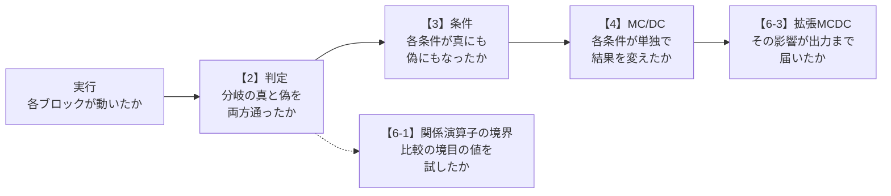

# 02a カバレッジの考え方（判定・条件・MC/DC）

- 関連するテーマ: [02 設計情報からのテスト自動生成](../themes/02-test-generation-from-design.md)
- 確認日: 2026-10-25
- 調査時点の最新リリース: R2026b
- 元のドキュメントの言語: 日本語（参照したページの多くはR2026bの日本語版。`sldvoptions` のページの日本語版はR2026aの版）

テーマ02では、設計モデルから「判定・条件・MC/DC等の目標を満たすテスト」をSimulink Design Verifierで自動生成する方法を整理した。ところが、その目標を選ぶ画面やオプションには、「判定」「条件判定」「MCDC」「拡張MCDC」「関係演算子境界」といった言葉が、説明なしに並ぶ。どれを選べば何が確かめられ、テストの数がどう変わるのかは、論理式と真理値表の考え方を知らないと分からない。この解説では、3つの条件からなる1つの論理式を最後まで使い、真理値表の8行のどれを選べば各カバレッジが満たされるかを、手で数えながら説明する。


この解説の全体像の絵である。上の段は、例の式の真理値表の8行のうち、各カバレッジを満たすためにどの行をテストに選ぶかを示す。「独立の組」は、その条件だけを変えると `out` が変わる2つの行の組で、MC/DCでは、すべての条件について、この組の両方の行をテストに含める（4節）。下の段は、右ほど確かめることが強くなり、要るテストが増える順の並びである（1節の図と同じく一般的な考え方）。各カバレッジは2〜6節で説明する。

## 想定環境・前提・所要の目安

| 項目 | 内容 |
|---|---|
| 製品 | 2節〜5-1節の考え方は、製品に依らない（5-2節以降は、MathWorksの製品での扱い）。カバレッジの測定にはSimulink Coverage、テストの自動生成にはSimulink Design Verifierを使う。3-3節・4-5節のMATLABのコードは、MATLABだけで動く（この解説はR2026bのドキュメントで確かめた。`sldvoptions` はR2026aの版） |
| 前提の知識 | 論理演算の「かつ」（AND、`&&`）と「または」（OR、`\|\|`）。真（1）と偽（0）で考えること |
| 前提の文書 | テーマ02の「はじめに」（テストケースとカバレッジとは何か） |
| 所要の目安 | 読むだけなら1〜2時間。真理値表を手で追う場合は、さらに30分程度 |

**注記**

- **期待する結果の出どころ**: この解説の「期待する結果」は、この解説の作成時にMATLABで実行して確かめたものではない。同じ計算を別の言語（Python）で行って値を確かめたもので、MATLABの表示の書式（空白・桁）とは違うことがある。
- **公式の記述と一般論の区別**: MathWorksの製品での決まり（カバレッジの定義、MC/DCの2つの定義の既定、テスト生成のオプション）は、公式のドキュメントで確かめた。カバレッジの一般的な考え方と、例の式の計算は、その都度、一般的な説明であることを書いた。
- **コードについて**: 例の式とコードは、この解説のために作ったもので、公式の例題を写したものではない。
- **実行環境が無くても読めるように**: 真理値表と、各カバレッジを満たす行の選び方を、すべて本文に書いた。

## 0. 学習目標と完了条件

この解説を読み終えると、次のことができるようになる。

1. 判定・条件・MC/DCの各カバレッジが何を確かめるかを、真理値表の行の選び方で説明できる。
2. 判定と条件のカバレッジが100%でも、MC/DCが満たされない例を示せる。
3. 条件の数が `n` のとき、MC/DCを満たすテストが少なくとも何個要るかの目安を説明できる。
4. MC/DCの2つの定義（unique-causeとmasking）の違いと、Simulink CoverageとSimulink Design Verifierでの既定を説明できる。
5. 関係演算子の境界のカバレッジが、判定のカバレッジでは見つからない誤りを確かめるものであることを説明できる。
6. Simulink Design Verifierのテスト生成の目標（`ModelCoverageObjectives`）を、確かめたいことに合わせて選べる。

完了条件: 8節の5つの問いに、本文を見返さずに答えられること。

## 1. 全体像

カバレッジは、弱いものから強いものへ、次の順に積み重なる（判定・条件・MC/DCの順の関係は一般的な説明。5-3節のとおり、MathWorksの製品での細かい扱いには例外がある）。【】の番号は、この解説の節の番号である。



### 1-1. この解説で使う例の式

すべての節で、次の式を使う。

```text
out = A && (B || C)
```

例えば、`A` を「イグニッションがオン」、`B` を「アクセルが踏まれている」、`C` を「クルーズ制御が有効」とすると、`out` は「駆動力を出してよい」という判定になる（この意味づけは、読みやすくするための架空の例である）。`A`・`B`・`C` のような、真か偽かを返す個々の式を**条件**、条件を `&&`・`||` で組み合わせた全体（ここでは `out` の式）を**判定**という。

3つの条件の真偽の組み合わせは `2³ = 8` 通りで、すべてを並べた表を**真理値表**という。この解説では、各行を「行1」〜「行8」と呼ぶ。`B || C` の列は、判定の途中の値（部分式）である。

| 行 | A | B | C | B \|\| C | out |
|---|---|---|---|---|---|
| 1 | 0 | 0 | 0 | 0 | 0 |
| 2 | 0 | 0 | 1 | 1 | 0 |
| 3 | 0 | 1 | 0 | 1 | 0 |
| 4 | 0 | 1 | 1 | 1 | 0 |
| 5 | 1 | 0 | 0 | 0 | 0 |
| 6 | 1 | 0 | 1 | 1 | 1 |
| 7 | 1 | 1 | 0 | 1 | 1 |
| 8 | 1 | 1 | 1 | 1 | 1 |

1つのテストケースは、この表の1行に当たる入力を与えることだと考える（実際のテストケースは入力の時系列だが、この解説では1時点の組み合わせだけを考える）。

## 2. 判定カバレッジ

**判定カバレッジ**は、各判定が、真の結果と偽の結果の両方を少なくとも1回ずつ通ったかを確かめる（一般的な定義）。MathWorksの「モデル カバレッジの種類」のページは、SwitchブロックやStateflowのステートのような**判定点**（処理の流れが分岐する箇所）を対象に、シミュレーションで通った経路の割合として測ると説明している。同じページは、Logical Operatorブロックのように入力の論理的な組み合わせを出すブロックを、3節の条件カバレッジの対象として挙げている。そのため、Simulinkのモデルで例の式をLogical Operatorブロックで作った場合に、判定カバレッジがどこで測られるかは、ブロックごとに違いうる（テーマ02の「カバレッジの対象となるモデル オブジェクト」で確かめる）。この節の説明は、`out` の式を1つの分岐と見なした一般論の当てはめである。

例の式では、`out` が1になる行（6・7・8）から1つ、0になる行（1〜5）から1つを選べば、判定カバレッジは100%になる。例えば、行1と行8の2つのテストで足りる。

判定カバレッジは、`if` 文の両方の向きを通したことを示すが、その結果が「どの条件のおかげか」は確かめない。行1と行8の組では、`A`・`B`・`C` が同時に変わっているので、例えば `B` を書き忘れた誤った式 `A && C` でも、行1では0、行8では1となり、同じ結果になる。このテストでは誤りに気づけない。

## 3. 条件カバレッジ

### 3-1. 定義

**条件カバレッジ**は、各条件が、真と偽の両方を少なくとも1回ずつとったかを確かめる。「モデル カバレッジの種類」のページも、各条件が少なくとも1回は真に、少なくとも1回は偽になることを、条件カバレッジが完全になる条件としている。対象は、Logical Operatorブロックのように入力の論理的な組み合わせを出すブロックと、Stateflowの遷移である。

### 3-2. 判定カバレッジとの関係

条件カバレッジと判定カバレッジは、どちらかが他方を含む関係にはない（一般的な説明）。例の式で確かめる。

| テストの組 | 判定 | 条件 | 説明 |
|---|---|---|---|
| 行1と行8 | 100% | 100% | `A`・`B`・`C` がそれぞれ0と1をとり、`out` も0と1をとる |
| 行4と行5 | 50% | 100% | `A` は0と1、`B` と `C` も1と0をとるが、`out` はどちらも0 |

行4と行5の組は、条件の真偽はすべてそろうのに、判定の真の向きを一度も通っていない。このため、2つを合わせた**条件判定カバレッジ**（判定と条件の両方を満たす）が使われることが多い。Simulink Design Verifierのテスト生成の目標の「条件判定」（`ConditionDecision`）は、これに当たる（6-3節）。

ただし、2節の行1と行8の組は、条件判定カバレッジも100%なのに、`B` を書き忘れた誤りを見逃す。各条件が結果に効いていることまでは、条件判定カバレッジでも確かめられない。

### 3-3. MATLABで真理値表を作る

真理値表は、MATLABで次のように作れる（MATLABだけで動き、ほかの製品は要らない）。

```matlab
% 8行×3列の0と1の表を作る（列が A, B, C）
rows = dec2bin(0:7) - '0';

% 例の式を、表の各行について計算する
out = rows(:,1) & (rows(:,2) | rows(:,3));

% A, B, C, out を並べて表示する
disp([rows out])
```

**期待する結果**

```text
     0     0     0     0
     0     0     1     0
     0     1     0     0
     0     1     1     0
     1     0     0     0
     1     0     1     1
     1     1     0     1
     1     1     1     1
```

読み方: 上から行1〜行8で、4列目が `out` である。1-1節の真理値表と同じになっていれば正しい。

## 4. MC/DC

### 4-1. 定義と「独立の組」

**MC/DC**（Modified Condition/Decision Coverage、改良条件判定カバレッジ）は、条件判定カバレッジに加えて、**各条件が、ほかの条件とは独立に、判定の結果を変えられる**ことをテストで示すものである（一般的な定義）。

元来の考え方に近い**unique-cause** MC/DCでは、ある条件だけを変え、ほかの条件はそのままにしたとき、判定の結果が変わる2つの行の組を探す。この組を、その条件の**独立の組**という。すべての条件について、独立の組の両方の行がテストに含まれていれば、MC/DCは100%である（ここまでは一般的な説明。MathWorksの製品の既定は、5-1節のmaskingという別の定義である）。

「モデル カバレッジの種類」のページは、ブロックについては、ほかの入力に依存せずに、いずれかの入力の変化でブロックの出力が変わることを、Stateflowの遷移については、各条件の変化で遷移が少なくとも1回起こることを、フルカバレッジの条件としている。

### 4-2. 例の式の独立の組

例の式で、各条件の独立の組を探す。

| 条件 | 独立の組 | 理由 |
|---|---|---|
| A | 行2と行6、行3と行7、行4と行8 | `B \|\| C` が1のとき、`A` だけを変えると `out` が変わる |
| B | 行5と行7 | `A` が1で `C` が0のときだけ、`B` だけを変えると `out` が変わる |
| C | 行5と行6 | `A` が1で `B` が0のときだけ、`C` だけを変えると `out` が変わる |

`A` が0の行では、`B` と `C` をどう変えても `out` は0のままである。このように、ほかの条件の値によって、ある条件の影響が結果に現れなくなることを、**マスキング**（覆い隠す）という。

### 4-3. MC/DCを満たす最小のテスト

`B` の組（行5・7）と `C` の組（行5・6）は1通りずつしかないので、行5・6・7は必ず要る。これに `A` の組の1つを足す。行6・7は `A` の組にも使える（行2と行6、行3と行7）ので、行2か行3を1つ足せばよい。

```text
unique-causeのMC/DCを満たす最小のテストの組: 行2・5・6・7、または 行3・5・6・7（どちらも4つ）
```

5-1節のmaskingの定義では、`A` の組に行4と行6・行4と行7も使えるので、行4・5・6・7も最小の組になる。

条件の数を `n` とすると、MC/DCを満たすには、一般に少なくとも `n + 1` 個のテストが要り、うまく選べば `n + 1` 個に近い数で済むことが多い（一般的な説明）。例の式は `n = 3` で、4つで済んだ。すべての組み合わせ（`2ⁿ` 個）を試すのに比べて、条件が多いほど差が大きくなる。条件が10個なら、すべての組み合わせは1024個だが、MC/DCの目安は11個程度である。

### 4-4. 2節・3節との比較

| テストの組 | 判定 | 条件 | MC/DC |
|---|---|---|---|
| 行1と行8 | 100% | 100% | 0%（独立の組が1つもない） |
| 行4と行5 | 50% | 100% | 0% |
| 行3・5・6・7 | 100% | 100% | 100% |

`B` を書き忘れた誤った式 `A && C` を、行3・5・6・7で試すと、行7（`A=1, B=1, C=0`）で正しい式は1、誤った式は0となり、違いが見つかる。MC/DCは、各条件が結果に効いていることを示すので、条件の書き忘れや、`&&` と `||` の取り違えのような誤りを見つけやすい（一般的な説明）。

### 4-5. MATLABで独立の組を探す

3-3節の `rows` と `out` を使い、各条件について、その条件だけが違い、`out` が変わる行の組を探す。

```matlab
% 各条件 k について、その条件だけを反転した行を探し、out が変わる組を表示する
for k = 1:3
    for r = 1:8
        s = rows(r,:);
        s(k) = 1 - s(k);                         % 条件 k だけを反転する
        r2 = find(ismember(rows, s, 'rows'));    % 反転した組み合わせの行
        if r < r2 && out(r) ~= out(r2)
            fprintf('条件%d: 行%dと行%d\n', k, r, r2);
        end
    end
end
```

**期待する結果**

```text
条件1: 行2と行6
条件1: 行3と行7
条件1: 行4と行8
条件2: 行5と行7
条件3: 行5と行6
```

読み方: 条件1〜3が `A`・`B`・`C` に当たる。4-2節の表と同じ組が出ていれば正しい。

## 5. MC/DCの2つの定義と短絡評価

### 5-1. unique-causeとmasking

4節で使ったunique-cause MC/DCは、ほかの条件を**すべて**そのままにすることを求める。これに対して**masking** MC/DCは、結果に影響しえない条件（マスキングされている条件）なら、変わってもよいとする。

例の式の `A` で考える。`A && (B || C)` の `A` の影響を示すには、`B || C` が1でさえあればよく、`B` と `C` の値の内訳は問わない、と考えるのがmaskingである。すると、`A` の独立の組は、`A` が0で `B || C` が1の行（2・3・4）と、`A` が1で `B || C` が1の行（6・7・8）の、どの組み合わせでもよくなる。

| 定義 | `A` の独立の組 |
|---|---|
| unique-cause | 行2と行6、行3と行7、行4と行8（3組） |
| masking | 上の3組に加えて、行2と行7、行2と行8、行3と行6、行3と行8、行4と行6、行4と行7（9組） |

（`B` と `C` の組は、どちらの定義でも4-2節と同じになる。上の表の値は、この解説の例の式で計算したもので、一般的な定義の当てはめである。）

この違いは、条件どうしが独立に動かせない場合に効いてくる。たとえば、モデルの中で `B` と `C` が同じ信号から作られていて、片方を変えると他方も変わる場合、unique-causeでは独立の組が作れずに100%に届かないことがあるが、maskingなら届くことがある。MathWorksの「Simulink Coverage での MCDC の定義」のページは、別の式 `(A||B)&&(C||D)` で、2つの入力が同じ信号から分かれている場合の、この違いの例を示している。

### 5-2. MathWorksの製品での既定

| 製品 | 使う定義 | 出どころ |
|---|---|---|
| Simulink Coverage（カバレッジの測定） | 既定はmasking。モデルのコンフィギュレーションのパラメーター `CovMcdcMode` を［ユニークコーズ］にすると、unique-causeで測る（ダイアログの表示は［マスキング］・［ユニークコーズ］。値の書き方は `'Masking'`・`'UniqueCause'`） | 「Simulink Coverage での MCDC の定義」のページ（値の書き方は「Simulink Design Verifier での MCDC」のページ） |
| Simulink Design Verifier（テストの自動生成） | 常にmaskingでテストを生成する | 同上、「Simulink Design Verifier での MCDC」のページ |

「Simulink Coverage での MCDC の定義」のページは、航空機のソフトウェアの規格であるDO-178Bの認証で、maskingのMC/DCがMC/DCの目標を満たすものとして認められる（その補足の文書であるDO-248Cの討議資料#13）ことに触れている。

Simulink Coverageをunique-causeにすると、テストを生成したSimulink Design Verifierとは定義が違うので、結果が食い違うことがある（「Simulink Design Verifier での MCDC」のページ）。また、このページによると、数え方も違う。Simulink Coverageは1つの条件を1つの目標として数えるが、Simulink Design Verifierは、独立の組の真の側と偽の側を別々の目標として数える。unique-causeで測る必要がある場合、このページは、テスト生成のテストスイート（生成されるテストケースの集まり）の最適化（`TestSuiteOptimization`）を `IndividualObjectives` にすると食い違いを減らせるとしている。

### 5-3. 短絡評価

多くのプログラミング言語では、`A && (B || C)` を左から評価し、`A` が0なら、`B || C` を評価せずに結果を0と決める。これを**短絡評価**（ショートサーキット）という（一般的な説明）。短絡評価では、評価されなかった条件の真偽が記録されないので、その条件が真にも偽にもなったことを示すテストを、別に用意する必要が出てくる。

「モデル カバレッジの種類」のページは、Simulinkの論理ブロックを短絡評価として扱う設定にすると、そのブロックの条件カバレッジとMC/DCが100%にならないことがあるとしている。また、同じページは、判定カバレッジや条件カバレッジが完全にならない場合があるために、判定カバレッジが100%でなくてもMC/DCが100%になりうるように作られている、とも説明している。1節の図の「積み重なる」順は一般的な考え方で、製品の数値が必ずこの順になるとは限らない。

### 5-4. 記録できない場合

「モデル カバレッジの種類」のページによると、異なる種類の論理演算子（`&&` と `||` 等）を混ぜ、12を超える条件を持つ式をブロックが定義していると、MC/DCを記録できない。

## 6. カバレッジのほかの種類と、テスト生成の目標の選び方

### 6-1. 関係演算子の境界

`speed > 10` のような比較では、`>` と `>=` の取り違えや、境目の値の誤り（10と11の書き間違い）がよく起こる（一般的な説明）。判定カバレッジは、真と偽の両方を通せば満たされるので、`speed = 0` と `speed = 100` のテストでも100%になり、この種の誤りを見つけられない。

**関係演算子の境界のカバレッジ**は、比較の両辺が等しい値と、両辺が許容差だけ離れた値をテストで試したかを確かめる。「モデル カバレッジの種類」のページによると、許容差は、整数では1で、等しい値も確かめる。浮動小数点数では `max(absTol, relTol*max(|lhs|,|rhs|))` で、既定は `absTol = 1e-05`、`relTol = 0.01` である（`lhs`・`rhs` は比較の左辺と右辺）。対象は、Relational OperatorブロックやIfブロックのような明示的な比較と、AbsやSaturationのような、中で比較をしているブロックである。

### 6-2. そのほかの種類

「モデル カバレッジの種類」のページは、ほかに、**実行**（各項目がシミュレーションで動いたか。最も基本的なカバレッジ）、サイクロマティック複雑度、ルックアップテーブル、信号の範囲、信号のサイズ、目的と制約、整数のオーバーフローでの飽和を挙げている。どのブロックがどの種類の対象になるかは、テーマ02のリンクの表の「カバレッジの対象となるモデル オブジェクト」で確かめる。

### 6-3. テスト生成の目標を選ぶ

Simulink Design Verifierでテストを自動生成するときは、`sldvoptions` のオプション `ModelCoverageObjectives` で、どのカバレッジを満たすテストを作るかを選ぶ（`Mode` が `TestGeneration` のとき。`sldvoptions` のページ）。

| 値 | 目標 | この解説の節 |
|---|---|---|
| `None` | カバレッジの目標を使わない（ページは値を挙げるだけなので、値の名前からの解釈） | — |
| `Decision` | 判定 | 2節 |
| `ConditionDecision`（既定） | 条件判定 | 3-2節 |
| `MCDC` | MC/DC（maskingで生成） | 4節・5節 |
| `EnhancedMCDC` | 拡張MCDC | 下の段落 |

関係演算子の境界の目標は、別のオプション `IncludeRelationalBoundary` を `on` にして加える（既定は `off`）。「テスト生成用のモデル カバレッジ オブジェクティブ」のページは、IfブロックとFcnブロックでは関係演算子の境界のテスト生成をサポートしないこと、MinMaxブロックではこの目標のテストを生成しないことを注意している。

**拡張MCDC**は、MC/DCを拡張したもので、ある条件の影響が、下流のブロックで覆い隠されずに、モデルの出力まで届くことを確かめるテストを作る（「Simulink Design Verifier での拡張 MCDC カバレッジ」のページ）。例えば、Switchブロックの出力が、下流のMinブロックやMaxブロックで別の信号に負けて出力に現れないと、Switchの分岐を通しても、その結果を出力で確かめられない。拡張MCDCは、そうならない入力を選ぶ。5-1節のmaskingが「1つの式の中」での覆い隠しの扱いなのに対し、拡張MCDCは「ブロックの間」での覆い隠しを扱う、と考えればよい（この対比は著者の整理）。

どれを選ぶかの目安は、次のとおりである（著者の整理）。

- まず、既定の `ConditionDecision` で、判定と条件の抜けを探す。
- 条件の書き忘れや演算子の取り違えまで確かめたい場合や、安全性の規格でMC/DCを求められる場合は、`MCDC` にする（テーマ02の「はじめに」のとおり、航空や自動車などの安全性の規格で、安全度の水準が高いソフトウェアに求められる〈推奨される〉ことがある）。
- 比較の境目の誤りを確かめたい場合は、`IncludeRelationalBoundary` を `on` にする。
- 条件の影響がモデルの出力で確かめられることまで求める場合は、`EnhancedMCDC` を検討する。

テスト生成をスクリプトで実行する流れ（`sldvoptions` → `sldvrun` → `sldvruntest`）は、テーマ02の「設計パターンごとのテスト生成」に書いた。

## 7. 注意点

- **カバレッジは十分条件ではない**: カバレッジが100%でも、テストの期待する結果（正しい出力）が誤っていれば、誤りは見つからない。カバレッジは「テストが通った場所」を示すもので、「動作が正しいこと」は、要件に基づくテストで確かめる（一般的な説明。テーマ02の「要件ベースのテスト生成」を参照）。
- **定義をそろえる**: MC/DCの数値を比べるときは、どちらの定義（unique-causeかmasking）で測ったかを確かめる（5-2節）。
- **実際のテストは時系列**: この解説では1時点の組み合わせだけを考えたが、Stateflowのチャートのように状態を持つモデルでは、ある組み合わせに到達するまでの入力の順序も要る（一般的な説明）。Simulink Design Verifierが生成するテストケースも、入力の時系列である（テーマ02の「はじめに」のテストケースの定義）。

## 8. 確かめの問い

<details>
<summary>問1. 例の式で、行2と行7の2つのテストを選んだ。判定・条件のカバレッジはそれぞれ何%か。</summary>

行2は `A=0, B=0, C=1, out=0`、行7は `A=1, B=1, C=0, out=1` である。`out` は0と1をとるので判定は100%。`A`・`B`・`C` はそれぞれ0と1をとるので条件も100%である（2節・3節）。

</details>

<details>
<summary>問2. 問1の行2と行7は、Aの独立の組になるか。unique-causeとmaskingのそれぞれで答えよ。</summary>

unique-causeでは、`A` のほかに `B` と `C` も変わっているので、独立の組にならない。maskingでは、両方の行で `B || C` が1なので、`A` の独立の組になる（4-2節・5-1節）。

</details>

<details>
<summary>問3. 条件が5つの判定で、MC/DCを満たすには、テストが少なくとも何個要るか。すべての組み合わせは何個か。</summary>

目安は `n + 1 = 6` 個で、すべての組み合わせは `2⁵ = 32` 個である（4-3節）。

</details>

<details>
<summary>問4. `speed > 10` を `speed >= 10` と書き間違えた。speed = 0 と speed = 100 のテストで見つけられるか。どのカバレッジの目標を加えればよいか。</summary>

見つけられない。どちらの式でも、0では偽、100では真になるので、判定カバレッジは100%になる。境目の値（10と、そこから許容差だけ離れた値）を試す、関係演算子の境界のカバレッジの目標を加える（`IncludeRelationalBoundary` を `on`）（6-1節・6-3節）。

</details>

<details>
<summary>問5. Simulink CoverageでMC/DCが100%と報告されたが、同僚はunique-causeで測ると100%に届かないと言う。考えられる理由は何か。</summary>

Simulink Coverageの既定はmaskingなので、unique-causeでは独立の組を作れない条件（例えば、ほかの条件と同じ信号から作られていて、単独では変えられない条件）がある可能性がある（5-1節・5-2節）。

</details>

## 次に読むもの

- テーマ02のリンクの表の「テスト生成用のモデル カバレッジ オブジェクティブ」と「拡張 MCDC 解析用のモデルの解析」: 6-3節の目標を、公式の例で確かめられる。
- テーマ02のリンクの表の「カバレッジの対象となるモデル オブジェクト」: どのブロックがどのカバレッジの対象になるか。
- テーマ02の「設計パターンごとのテスト生成」: 真理値表・状態遷移表・Stateflowチャートを含むモデルで、テストを生成する流れ。

## 出典

この解説は、次のMathWorksの公式のドキュメント（いずれも2026-10-25に確認）を読み、自分の言葉で説明し直したものである。文章の逐語の転載ではない。例の式、真理値表、独立の組、テストの組の計算、コードは、この解説のために作ったものである。カバレッジの包含関係、短絡評価の説明、`n + 1` の目安、関係演算子の境界でよく起こる誤り、目標の選び方の目安、拡張MCDCとmaskingの対比は、公式のドキュメントではなく一般的な説明と著者の整理による。

- [モデル カバレッジの種類](https://jp.mathworks.com/help/slcoverage/ug/types-of-model-coverage.html) — 実行・判定・条件・MC/DC・関係演算子の境界の定義、許容差、短絡評価の設定の影響、判定が100%でなくてもMC/DCが100%になりうること、12を超える条件の制限、カバレッジの種類の一覧（R2026b）
- [Simulink Coverage での MCDC の定義](https://jp.mathworks.com/help/slcoverage/ug/modified-condition-and-decision-coverage-definitions-in-simulink-verification-and-validation.html) — unique-causeとmasking、既定、`CovMcdcMode`、DO-248Cの討議資料#13（R2026b）
- [Simulink Design Verifier での MCDC](https://jp.mathworks.com/help/slcoverage/ug/modified-condition-and-decision-coverage-in-simulink-design-verifier.html) — テスト生成は常にmasking、目標の数え方の違い、`IndividualObjectives`（R2026b）
- [テスト生成用のモデル カバレッジ オブジェクティブ](https://jp.mathworks.com/help/sldv/ug/model-coverage-objectives-for-test-generation.html) — 目標の種類、関係演算子の境界の目標の注意（R2026b）
- [sldvoptions](https://jp.mathworks.com/help/sldv/ref/sldvoptions.html) — `ModelCoverageObjectives` の値と既定、`IncludeRelationalBoundary`、`Mode`、`TestSuiteOptimization`（R2026a）
- [Simulink Design Verifier での拡張 MCDC カバレッジ](https://jp.mathworks.com/help/sldv/ug/enhanced-mcdc-coverage-in-simulink-design-verifier.html) — 拡張MCDCが下流のブロックからのマスキングを避けるテストを作ること（R2026b）
