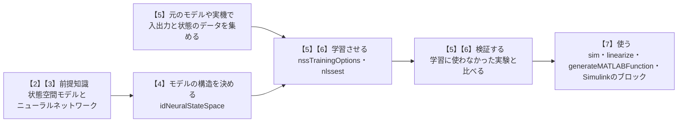
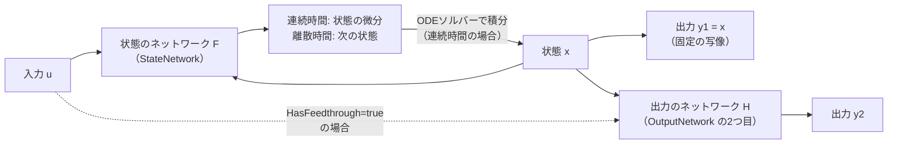

# 03a ニューラル状態空間モデルのしくみと使い方

- 関連するテーマ: [03 プラントモデルをニューラルネットワークに置き換えるサロゲート化](../themes/03-surrogate-model-with-neural-network.md)
- 確認日: 2026-10-25
- 調査時点の最新リリース: R2026b
- 元のドキュメントの言語: 英語（`jp.mathworks.com`で開いても、本文は英語で表示される）

テーマ03では、重いプラントモデルを軽いサロゲートモデルに置き換える方法を一覧にした。その中の**ニューラル状態空間モデル**は、プラントの内部の状態を明示的に持ち、Simulinkのブロックとしても使えるため、動的なプラントの置き換えに向いた方式である。一方で、公式のドキュメントは英語だけで、読むには「状態空間モデル」「微分方程式」「ニューラルネットワークの学習」の3つの前提知識が要る。この解説では、その前提知識を順に説明したうえで、モデルの構造と、MATLABで学習させる手順を、公式の例題（単振り子）に沿って説明する。

## 想定環境・前提・所要の目安

| 項目 | 内容 |
|---|---|
| 製品 | MATLAB、System Identification Toolbox、Deep Learning Toolbox（R2022b以降。この解説はR2026bのドキュメントで確かめた） |
| 前提の知識 | 高校数学の微分（「変化の速さ」としての微分）と、ベクトル・行列の記法。大学の制御工学・機械学習の知識は前提にしない |
| 前提の文書 | テーマ03の「はじめに」（サロゲートモデルとは何か）を読んでいること |
| 所要の目安 | 読むだけなら1〜2時間。例題を動かす場合は、学習の計算の時間が別にかかる |

**注記**

- **期待する結果の出どころ**: この解説の「期待する結果」は、この解説の作成時にMATLABで実行して確かめたものではない。公式の例題とリファレンスのページの記述から想定したものである。実際の表示の細部（数値・書式）は、リリースや乱数によって変わる。
- **コードについて**: 例題のコードを丸ごと写したものではなく、要点の行だけを、この解説の説明に合わせて書き直したものである。全体のコードは、6節の公式の例題のページから開く。
- **実行環境が無くても読めるように**: 各手順の後に、何が表示されれば成功かを書いた。MATLABが手元に無くても、流れと読み方は追える。

## 0. 学習目標と完了条件

この解説を読み終えると、次のことができるようになる。

1. 状態空間モデルの「状態」「状態方程式」「出力方程式」を、自分の言葉で説明できる。
2. ニューラル状態空間モデルで、2つのニューラルネットワーク（状態の関数・出力の関数）がそれぞれ何を学習するかを説明できる。
3. 学習に状態の計測値が要る理由と、状態を測れないときの扱いを説明できる。
4. `idNeuralStateSpace`・`createMLPNetwork`・`nssTrainingOptions`・`nlssest`を使って、モデルを作り、学習させる手順を追える。
5. 学習したモデルを、シミュレーション・線形化・MATLAB関数の生成・Simulinkのブロックに使い分けられる。

## 1. 全体像

ニューラル状態空間モデルを使う作業は、次の流れになる。この解説の節の番号は、図の中の【】の番号と同じである。



## 2. 前提知識（1）状態空間モデル

### 2-1. 「状態」とは何か

ボールを投げ上げる場面を考える。ある時刻のボールの**位置**と**速度**が分かれば、その後の動きは（重力などの法則に従って）決まる。それより前にどう投げたかという経緯は、位置と速度の中にすべて含まれていて、改めて知る必要はない。

このように「今の値さえ分かれば、この先の動きが入力から決まる」最小限の量の組を、**状態**と呼ぶ。状態はふつう、ベクトル `x` にまとめて書く。ボールなら `x = [位置; 速度]` である。モーターなら回転の角度・角速度・電流、バッテリーなら充電の量（SOC）・温度、のように、プラントによって状態は変わる。

プラントに外から加える操作（モーターの電圧、ヒーターの電力等）を**入力** `u`、センサーで測れる量を**出力** `y` と呼ぶ。状態は、必ずしもすべて測れるとは限らない。

### 2-2. 状態方程式と出力方程式

状態空間モデルは、状態の時間変化と出力を、次の2つの式で表す。時間を連続に扱う**連続時間**のモデルでは、状態の時間変化を微分（ドットの記号 $\dot{x}$ は `x` の時間での微分、つまり「状態が変わる速さ」）で書く。

$$
\dot{x}(t) = F\bigl(x(t),\, u(t)\bigr)
$$

$$
y(t) = H\bigl(x(t),\, u(t)\bigr)
$$

1つ目の式を**状態方程式**、2つ目の式を**出力方程式**と呼ぶ。状態方程式は「今の状態と入力から、状態が変わる速さが決まる」ことを表す。変わる速さが分かれば、少しずつ時間を進めて（数値積分して）状態の軌跡を求められる。この計算をする道具が**ODEソルバー**（常微分方程式を数値的に解くプログラム。MATLABの`ode45`等）である。

時間を一定の間隔（**サンプル時間** `Ts`）ごとに区切って扱う**離散時間**のモデルでは、状態方程式は「次の時刻の状態」を直接与える。

$$
x(t+1) = F\bigl(x(t),\, u(t)\bigr)
$$

離散時間の式の `t` は秒ではなく**サンプルの番号**（何番目の時点か）で、`t+1` は1サンプル後（時間にして `Ts` 秒後）を表す。

### 2-3. 線形の場合との関係

制御工学の教科書でよく見る状態空間モデルは、`F` と `H` が行列の掛け算で書ける**線形**の場合である（テーマ04の現代制御もこの形を使う）。

$$
\dot{x} = A x + B u, \qquad y = C x + D u
$$

線形のモデルは扱いやすいが、振り子の大きな振れ、摩擦、飽和のような**非線形**の挙動は表せない。ニューラル状態空間モデルは、この `F` と `H` を行列の代わりにニューラルネットワークで表すことで、非線形の挙動もデータから学習できるようにしたものである。

## 3. 前提知識（2）ニューラルネットワークで関数を近似する

### 3-1. 多層パーセプトロン（MLP）

ニューラル状態空間モデルの既定のネットワークは、**多層パーセプトロン**（MLP）という最も基本的な形である。MLPは、次の計算を何層か重ねたものである。

1. 入力のベクトルに行列（**重み**）を掛け、ベクトル（**バイアス**）を足す（**全結合層**）。
2. 結果の各要素に、`tanh` のような曲がった関数（**活性化関数**）を通す。

入力と出力の間にある層を**隠れ層**、1つの層の要素の数を**ノード数**（またはユニット数）と呼ぶ。「隠れ層が2つ、ノード数がそれぞれ64」なら、入力 → 64個 → 64個 → 出力、という形になる。

活性化関数が無いと、何層重ねても全体は行列の掛け算1回と同じ（線形）になる。活性化関数があることで、曲がった関係を表せる。MathWorksのドキュメントは、`tanh` やシグモイドのような活性化関数を持つ隠れ層が1つ以上あるMLPは、ノード数が十分多ければ任意の連続な関数を近似できる（**万能近似**）ことを、MLPを選ぶ根拠に挙げている。ただし、これは理論上の性質で、何個あれば足りるかの目安は示されていない。

### 3-2. 学習とは

重みとバイアス（まとめて**学習可能なパラメーター**）を、データに合うように少しずつ直していく作業が**学習**である。

1. 今のパラメーターで、データの入力に対する予測を計算する。
2. 予測と計測値のずれを1つの数（**損失**）にまとめる。ニューラル状態空間モデルの既定は、ずれの絶対値の平均（**平均絶対誤差**、MAE）である。
3. 損失が小さくなる方向（**勾配**）を計算し、パラメーターをその方向に少し動かす。動かす幅を**学習率**と呼ぶ。

この繰り返しを、データ全体を一通り使うごとに数えた回数を**エポック**という。パラメーターの動かし方の工夫（**最適化の手法**）には、Adam・SGDM・RMSProp・L-BFGSがあり、ニューラル状態空間モデルではこの4つから選ぶ。学習の関数 `nlssest` で手法を指定しなかったときの既定はAdamである（`nlssest` のリファレンス）。初めて試すなら既定のAdamから始めればよい（この一文は著者の目安）。

### 3-3. パラメーターの数とデータの量

6節の例題の状態のネットワークを例に、パラメーターの数を数える。この例題では、既定（4-1節のノード数64）より大きいノード数128の隠れ層を2つ使う。ネットワークが受け取る値は、状態2つとシステムの入力1つの計3つ、ネットワークが出す値は状態の微分の2つである。パラメーターの数は、各層の重みの数とバイアスの数の和で、次のようにおよそ1.7万個になる。

```text
3×128 + 128  =    512   （入力 → 1層目）
128×128 + 128 = 16,512   （1層目 → 2層目）
128×2 + 2    =    258   （2層目 → 出力）
合計          ≈ 17,000
```

一方、6節の例題のデータは、1秒の実験を0.1秒ごとに記録したもの（1実験で11時点）が約100回分で、時点の数は千程度である。このように、パラメーターの数がデータの数を上回ることがよくある。System Identification Toolboxはこの場合に警告を出すが、ニューラルネットワークでは珍しくない状態なので、例題ではこの警告を一時的に止めている。データより多いパラメーターを持つモデルは、学習に使ったデータにだけ合う（**過学習**）おそれがあるので、5節の検証が欠かせない。

## 4. ニューラル状態空間モデルの構造

### 4-1. 2つのネットワークと出力の分け方

ニューラル状態空間モデルは、2-2節の `F` と `H` を、それぞれ別のニューラルネットワークで表す。

- **状態のネットワーク**（プロパティ `StateNetwork`）: 状態 `x` と入力 `u` を受け取り、連続時間なら状態の微分 $\dot{x}$ を、離散時間なら次の時刻の状態を出す。既定は、ノード数64の隠れ層2つ、活性化関数 `tanh` のMLP。
- **出力のネットワーク**（プロパティ `OutputNetwork`）: 2つのネットワークの組になっている。1つ目は、状態をそのまま出力に写す固定の写像（学習するパラメーターが無い）で、2つ目が `H` を学習するMLPである。

出力 `y` は、上の2つに対応して2つの部分に分かれる。

$$
y_1(t) = x(t) + e_1(t)
$$

$$
y_2(t) = H\bigl(x(t),\, u(t)\bigr) + e_2(t)
$$

出力 `y` は、`y1` の下に `y2` を縦に並べたベクトルである。

`e1`・`e2` は計測の雑音である。つまり、**出力の先頭の部分は状態そのもの**で、その後ろに、状態以外の計測値（振り子なら先端の位置）が続く。後ろの部分は、出力の数が状態の数より多いときにだけある。



### 4-2. 状態の計測値が要る理由と、測れないときの扱い

状態のネットワークは「状態の変わり方」を学習する。そのためには、学習のデータの中に、状態が実際にどう変わったか、つまり**状態の計測値**が要る。出力の先頭を状態そのものにしているのはこのためで、学習のデータの出力 `Y` の先頭の列には、状態の計測値を並べる決まりになっている。

元のモデルがシミュレーションのモデルなら、状態（Simscape〈物理のモデルを部品の接続で作るSimulinkの拡張〉の変数や、Integratorブロックの値）を記録できるので、この決まりは満たしやすい。実機のデータで状態を測れない場合について、公式のドキュメントは、**出力を状態と見なして**（出力の数だけ状態があるものとして）学習する方法を示している。この場合、学習した状態は、元のプラントの物理的な状態とは一致しなくてよく、「出力の動きを再現できる内部の量」という意味になる。

### 4-3. 構造を決める主な設定

モデルは `idNeuralStateSpace` で作る。最初の引数が状態の数で、残りは名前と値の組で指定する。

| 設定 | 既定 | 意味 |
|---|---|---|
| `NumInputs` | 0 | 入力の数。0なら入力の無い（自律の）システム |
| `NumOutputs` | 状態の数 | 出力の数。先頭の「状態の数」個が状態の計測値 |
| `Ts` | 0 | サンプル時間。0なら連続時間、正の値なら離散時間 |
| `HasFeedthrough` | `false` | 出力 `y2` が、同じ時刻の入力 `u` に直接よるか（直達項。線形の場合の `D u` に当たる、というのは著者の対応づけ） |
| `IsTimeInvariant` | `true` | `F`・`H` が時刻 `t` そのものによらないか。`false` にすると時刻もネットワークの入力になる |
| `LatentDim` | `NaN`（使わない） | 正の整数にすると、4-4節のオートエンコーダーを加える |

`LatentDim` と `IsTimeInvariant` は、作った後には変えられない。また、作った後で `Ts` を変えると、ネットワークを学習し直す必要がある。

**連続時間と離散時間の選び方**: 連続時間のモデルは、学習の後で任意の時間刻みでシミュレーションでき、物理モデルの微分方程式と同じ形で考えられる。離散時間のモデルは、決まったサンプル時間で動く制御器やHILの環境にそのまま合わせやすい。公式のドキュメントには選び方の基準は書かれていないので、使う場面のサンプル時間が決まっているかどうかを目安にするとよい（この段落の目安は、この解説の著者の整理である）。

### 4-4. オートエンコーダーで状態の次元を変える

状態の数が多い（例えば、有限要素法のモデルの節点の温度が何百個もある）場合は、`LatentDim` を設定して、状態を少ない数の**潜在の状態** `z` に縮めてから学習できる。このしくみを**オートエンコーダー**という（値を少ない次元に縮めるネットワークと、元の次元に戻すネットワークの組で、戻した値が元の値に近くなるように学習するもの）。このとき、ネットワークは次の4つになる。

1. **エンコーダー**: 状態 `x` を潜在の状態 `z` に写す。
2. **状態のネットワーク**: `z` と `u` から、`z` の微分（または次の時刻の `z`）を出す。
3. **デコーダー**: `z` を元の状態に戻す。
4. **出力のネットワーク**: `z` と `u` から出力の後ろの部分を出す（R2025aで、`x` ではなく `z` を受け取る形に変わった）。

潜在の次元を元の状態より小さくすれば低次元化（ROM）になる。公式のドキュメントは、逆に大きくすると、潜在の空間で状態の変わり方を線形に近づけられる場合があることにも触れている。

## 5. 学習のしくみ

### 5-1. 予測した軌跡と計測した軌跡を比べる

ニューラル状態空間モデルの学習は、次のように考えると分かりやすい（ここは、学習の設定の項目の名前とドキュメントの説明から、この解説の著者が整理したものである）。

1. 学習のデータを、ある長さの区間（**ウィンドウ**。設定 `WindowSize`、既定は自動）に分ける。
2. 各区間の始まりの状態の計測値から出発し、状態のネットワークで時間を進めて、状態の軌跡を予測する。連続時間のモデルでは、ネットワークが出す微分をODEソルバー（設定 `ODESolverOptions`）で積分する。区間の途中の入力の扱いは設定 `InputInterSample` で決まり、既定は `'foh'`（一次ホールド）である。設定のページは `'foh'` の意味を説明していないが、一次ホールドは一般に、記録した時点の間を直線で補う方法を指す。
3. 予測した軌跡と、計測した状態・出力のずれ（損失）を計算し、3-2節の方法でパラメーターを直す。

1時点先だけを当てるのではなく、軌跡全体を合わせるように学習するので、学習したモデルを長い時間シミュレーションしても、ずれが積み重なりにくくなることが期待できる。この考え方は、リファレンスのページが参考文献に挙げている **Neural ODE**（常微分方程式の右辺をニューラルネットワークで表す手法。テーマ03の「内部の状態の扱い方」を参照）と同じ系統である。

### 5-2. データの集め方

データは `nlssest` に、時刻つきの表（`timetable`）か、System Identification Toolboxの入出力データのオブジェクト `iddata` で渡す。複数の実験は、実験ごとの表をセル配列（型の違う値や大きさの違う値を並べて入れられるMATLABの配列）にまとめて渡す（すべての実験で時刻の並びをそろえる。ただし、5-3節の設定で検証に回す最後の実験だけは、長さが違ってよい）。

1つの長い実験より、**始まりの状態と入力を変えた短い実験をたくさん**集めるのが、公式の例題の方針である。そうすると、状態の空間のいろいろな場所で「状態の変わり方」を学べるから、と考えられる（この理由づけは著者の解釈）。テーマ03の「はじめに」のとおり、学習に使った範囲の外では精度の保証が無いので、使う場面で通りうる状態と入力の範囲を覆うように実験を計画する。

### 5-3. 検証

学習に使わなかった実験で予測を比べる（**検証**）。`nlssest` に `UseLastExperimentForValidation=true` を渡すと、最後の実験を学習から外し、学習の途中で予測と比べた図を表示する（更新の間隔は `ValidationFrequency`、既定は10エポックごと）。R2026a以降は、2つ目の出力 `params` で、学習・検証の損失の最小値とそのときのパラメーターを受け取れる。

## 6. MATLABでの手順（単振り子の例題）

公式の例題「[Neural State-Space Model of Simple Pendulum System](https://jp.mathworks.com/help/ident/ug/training-a-neural-state-space-model-for-a-simple-pendulum-system.html)」（英語）に沿って、手順の要点を説明する。例題では、データを `load pendulumdata` で読み込む。データの入手のしかたは例題のページに書かれていないので、例題のページから例題を開いて、データのファイルがあることを確かめてから実行する。

### 6-1. 対象のシステムとデータ

単振り子に、根元のトルク `τ` を加えるシステムである。

| 種類 | 中身 |
|---|---|
| 状態（2つ） | 振れの角度 `θ`、角速度 |
| 入力（1つ） | トルク `τ`（各実験の中で、-2〜2の範囲でランダムに変える） |
| 出力（2つ） | 先端のおもりの横の位置、縦の位置 |
| データ | 始まりの角度・角速度を変えた1秒の実験を101回。0.1秒ごとに記録 |

モデルの出力は、4-1節の決まりで「状態2つ＋先端の位置2つ」の4つになる。

### 6-2. データを読み込み、モデルを作る

```matlab
% 例題のデータを読み込む（Y: 出力の表のセル配列、U: 入力の表のセル配列）
load pendulumdata

% 状態2つ・入力1つ・出力4つ（先頭2つが状態）の連続時間のモデルを作る
sys = idNeuralStateSpace(2, NumInputs=1, NumOutputs=4);

% 乱数の種を固定する（ネットワークの初期値をそろえるため）
rng(0)

% 状態のネットワーク: 隠れ層2つ（ノード数128）、活性化関数tanh
sys.StateNetwork = createMLPNetwork(sys, "state", ...
    LayerSizes=[128 128], Activations="tanh", ...
    WeightsInitializer="glorot", BiasInitializer="zeros");

% 出力のネットワークの2つ目（先端の位置を出す側）も同じ形にする
sys.OutputNetwork(2) = createMLPNetwork(sys, "output", ...
    LayerSizes=[128 128], Activations="tanh", ...
    WeightsInitializer="glorot", BiasInitializer="zeros");
```

例題のコードは出力の数を `NumOutput=4` と書いているが、ここではリファレンスの名前（`NumOutputs`）に合わせた。`OutputNetwork(1)` は4-1節の「状態をそのまま出す」固定の写像なので、設定するのは2つ目だけである。`WeightsInitializer`・`BiasInitializer` は、学習を始める前の重みとバイアスの決め方（glorotは層の大きさに応じた幅の乱数、zerosは0）である。

**期待する結果**

`sys` を表示すると、モデルの式の形と、ネットワークの概要が表示される。次は表示の要点で、実際の表示の文面ではない。

```text
連続時間のニューラル状態空間モデル
  状態方程式:  dx/dt = f(x(t), u(t))
  出力方程式:  y1 = x + e1,  y2 = g(x, u) + e2
  状態 2、入力 1、出力 4
  隠れ層の数と活性化関数（tanh）
```

読み方: 連続時間であること（`Ts` を指定していないため）、状態・入力・出力の数が指定どおりであることを確かめる。

### 6-3. 学習の設定をして学習させる

```matlab
% 最適化の手法にAdamを選び、エポックの数と学習率を決める
options = nssTrainingOptions("adam");
options.MaxEpochs = 200;
options.LearnRate = 0.005;

% 最後の実験を検証に回して学習させる
sys = nlssest(U, Y, sys, options, UseLastExperimentForValidation=true);
```

例題では、この前に、3-3節の「パラメーターの数がデータの数より多い」という警告を一時的に止めている（警告の識別子は `Ident:estimation:NparGTNsamp`）。止めなくても学習はできる。

**期待する結果**

学習の間、2つの図が更新される。

```text
図1: 損失（平均絶対誤差）とエポックの関係
     - 状態のネットワークと出力のネットワークの損失が、それぞれ表示される
図2: 検証の実験での、計測値と予測の比較
     - 状態2つ（角度・角速度）と出力2つ（先端の位置）の時間変化
```

読み方: 図1の損失が、エポックが進むにつれて下がり、終わりのほうで横ばいになっていれば、学習は進んでいる。図2で、予測の線が計測値の線に重なっていれば、学習に使わなかった実験でも再現できている。例題のページは図を示すだけで、一致の度合いの数値は示していないので、この段階の判定は目で見て行う。損失が下がらない場合は、学習率を下げる、エポックを増やす、データの範囲を見直す、の順に試すのが一般的である（この段落の最後の一文は、ニューラルネットワークの学習の一般的な進め方であり、例題のページの記述ではない）。

## 7. 学習したモデルを使う

### 7-1. 主な使い方

| 使い方 | 関数・ブロック | 何をするか |
|---|---|---|
| ある時点の値を見る | `evaluate(sys, x0, u0)` | 状態 `x0`・入力 `u0` のときの、状態の微分（離散時間なら次の状態）と出力を返す |
| シミュレーション | `sim` | 入力の時系列と初期状態から、出力の時系列を計算する |
| 線形化 | `linearize(sys, x0, u0)` | 動作点（線形化の基準にする状態と入力の組） `(x0, u0)` のまわりの線形モデル（2-3節の `A`・`B`・`C`・`D`）を作る。テーマ04の制御設計の手法に渡せる |
| MATLAB関数に書き出す | `generateMATLABFunction(sys, "myStateFcn", "myOutputFcn")` | 状態の関数と出力の関数、およびそれらのヤコビ行列（7-2節の偏微分を並べた行列）を計算するMATLABの関数を作る。例題は、生成した関数をシミュレーションやC/C++のコード生成に使えるとしている。例題では、生成した関数の値と `evaluate` の値の差が0と表示され、一致することを確かめている |
| Simulinkで使う | Neural State-Space Modelブロック | 学習したモデルをブロックとして動かす。初期状態を設定でき、状態とその微分（離散時間では差分）を出力できる（テーマ03のリンクの表を参照） |

### 7-2. 線形化の意味

`linearize` は、非線形の `F` と `H` を、動作点のまわりで直線（平面）で近似し、線形の状態空間モデル（Control System Toolboxがあれば `ss`、無ければ `idss` のオブジェクト）を返す。`linearize` のページは、行列の求め方を説明せず、Simulink Control Designの線形化の説明を参照するよう案内している。この節の以下の説明は、制御工学の一般的な線形化の理論による。線形化したモデルの `x`・`u`・`y` は、動作点からの**ずれ**（`x - x0` 等）を表す。行列は、`F` と `H` をそれぞれ状態と入力で偏微分したもので、どれも動作点での値をとる。

$$
A = \left.\frac{\partial F}{\partial x}\right|_{(x_0,\,u_0)}, \qquad
B = \left.\frac{\partial F}{\partial u}\right|_{(x_0,\,u_0)}
$$

$$
C = \left.\frac{\partial H}{\partial x}\right|_{(x_0,\,u_0)}, \qquad
D = \left.\frac{\partial H}{\partial u}\right|_{(x_0,\,u_0)}
$$

偏微分は「ほかの変数を止めて、1つの変数だけを少し動かしたときの変わり方」である。ここでの `H` は出力全体（`y1` と `y2`）を出す関数と考える。`y1 = x` の部分は、`C` では単位行列（対角が1で、ほかが0の行列）、`D` では0になる（`C` の単位行列は、`linearize` のページにも書かれている）。線形化したモデルが元のモデルに近いのは、動作点の近くだけである。例題では、線形化したモデルと非線形のモデルのステップ応答（入力を急に一定の値にしたときの応答）を比べている。

## 8. 確かめの問い

<details>
<summary>問1. 状態が3つ、状態以外のセンサーの値が2つあるプラントを学習させるとき、NumOutputsはいくつにし、学習のデータの出力Yの列はどう並べるか。</summary>

`NumOutputs=5` にする。`Y` の先頭の3列に状態の計測値を、その後ろの2列にセンサーの値を並べる（4-1節・4-2節）。

</details>

<details>
<summary>問2. 実機のデータで、状態を測れず、出力が2つだけ測れるとき、どう学習させるか。そのとき学習した状態は何を意味するか。</summary>

出力を状態と見なし、状態の数を2（出力の数と同じ）にして学習させる。学習した状態は元のプラントの物理的な状態とは限らず、出力の動きを再現できる内部の量である（4-2節）。

</details>

<details>
<summary>問3. 学習の損失は十分下がったのに、検証の実験で予測が大きくずれた。考えられる原因を2つ挙げよ。</summary>

1つは、パラメーターの数がデータの数より多く、学習のデータにだけ合ってしまった（過学習。3-3節）。もう1つは、検証の実験が、学習のデータで覆っていない状態・入力の範囲を通った（5-2節）。

</details>

## 次に読むもの

- 実際の製品に近い例: テーマ03のリンクの表の「Reduced Order Modeling of Electric Vehicle Battery System Using Neural State-Space Model」（EVバッテリーの電圧・温度の予測と、Simulinkのブロックでの利用）。
- 他の方式との比較: テーマ03の「内部の状態の扱い方」の表（LSTM・Neural ODE・非線形ARXとの違い）。

## 出典

この解説は、次のMathWorksの公式のドキュメント（いずれも英語、2026-10-25に確認、R2026b。7-2節の偏微分の式は、公式のドキュメントではなく制御工学の一般的な理論による）を読み、自分の言葉で説明し直したものである。文章の逐語の転載ではない。コードは、例題の手順の要点をこの解説の説明に合わせて書き直したものである。

- [What Are Neural State-Space Models?](https://jp.mathworks.com/help/ident/ug/what-are-neural-state-space-models.html) — モデルの式、状態を測れないときの扱い、MLPと万能近似、オートエンコーダー
- [idNeuralStateSpace](https://jp.mathworks.com/help/ident/ref/idneuralstatespace.html) — 作り方の設定と既定値、ネットワークの既定の形、変更の履歴（R2022b導入、R2025aの変更）
- [nlssest](https://jp.mathworks.com/help/ident/ref/nlssest.html) — 学習のデータの形、検証の設定、`params` の出力（R2026a以降）
- [nssTrainingOptions](https://jp.mathworks.com/help/ident/ref/nsstrainingoptions.html) — 最適化の手法と、学習の設定の項目・既定値
- [Neural State-Space Model of Simple Pendulum System](https://jp.mathworks.com/help/ident/ug/training-a-neural-state-space-model-for-a-simple-pendulum-system.html) — 6節・7節の例題
- [idNeuralStateSpace/linearize](https://jp.mathworks.com/help/ident/ref/idneuralstatespace.idneuralstatespacelinearize.html) — 線形化の書き方、返すオブジェクト、`C` の単位行列（R2022b導入）
- [Neural State-Space Model](https://jp.mathworks.com/help/ident/ref/neuralstatespacemodel.html) — Simulinkのブロックの初期状態と出力（R2022b導入）
