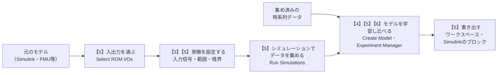

# 03b Reduced Order Modelerアプリで低次元化モデルを作る

- 関連するテーマ: [03 プラントモデルをニューラルネットワークに置き換えるサロゲート化](../themes/03-surrogate-model-with-neural-network.md)
- 確認日: 2026-10-25
- 調査時点の最新リリース: R2026b
- 元のドキュメントの言語: 英語（`jp.mathworks.com`で開いても、本文は英語で表示される）

テーマ03では、重いプラントモデルを軽いサロゲートモデル（低次元化モデル、ROM）に置き換える方法を一覧にした。その中の**Reduced Order Modeler**は、R2025bで加わったアプリで、元のモデルからのデータの集め方の設計、データの生成、複数の種類のモデルの学習と比較、Simulinkへの書き出しまでを、1つの画面で行える。ドキュメントは英語だけで、画面の項目には「実験」「ハイパーパラメーター」「Sobol列」「TestMSE」のような、実験計画と機械学習の言葉が説明なしに並ぶ。この解説では、それらの言葉をその場で説明しながら、公式の例題（ジェットエンジンのタービンブレード）に沿って、アプリの流れを順にたどる。

## 想定環境・前提・所要の目安

| 項目 | 内容 |
|---|---|
| 製品 | MATLAB、Simulink、Reduced Order Modeler for MATLAB（アドオン、R2025b以降）。アプリのページは、ほかに必要な製品を挙げていない。5節の例題の必要な製品には、System Identification Toolbox・Deep Learning Toolbox・Partial Differential Equation Toolboxが含まれる（テーマ03の補足のとおり、ベータ版の配布ページもSystem Identification Toolbox・Deep Learning Toolbox等を必要な製品に挙げていた）。並列の実行にはParallel Computing Toolbox（任意）。この解説はR2026bのドキュメントで確かめた |
| 前提の知識 | Simulinkのモデルを開いてシミュレーションできること。ニューラルネットワークの学習の基本（重み・損失・エポック）は、解説[03a](03a-neural-state-space-model.md)の3節で説明している |
| 前提の文書 | テーマ03の「はじめに」（サロゲートモデルとは何か）。5節で作るモデルの1つ（ニューラル状態空間モデル）の中身は03aで説明している |
| 所要の目安 | 読むだけなら1〜2時間。例題を動かす場合は、元のモデルのシミュレーションと学習の時間が別にかかる（例題は、時間を省くために集め済みのデータを用意している） |

**注記**

- **期待する結果の出どころ**: この解説の「期待する結果」は、この解説の作成時にMATLABで実行して確かめたものではない。公式の例題とアプリのページの記述から想定したものである。画面の配置や表示の細部は、リリースによって変わることがある。
- **操作の書き方**: アプリの操作は、公式の例題の手順の要点を、画面の項目の名前（英語）と、この解説の説明に合わせて書き直したもので、例題の文章を写したものではない。設定値は例題に合わせた。
- **実行環境が無くても読めるように**: 各段階で、何が表示されれば進んでいるかを書いた。

## 0. 学習目標と完了条件

この解説を読み終えると、次のことができるようになる。

1. 静的なROMと動的なROMの違いと、Reduced Order Modelerがどちらを作れるかを説明できる。
2. 実験計画で入力信号の種類（ランダムパルス・2値の信号・Sobol列・チャープ）と範囲・境界を選ぶ理由を説明できる。
3. 学習の結果の表の TrainingMSE・TestMSE・TrainingLoss を読み、モデルを選べる。
4. アプリの流れ（入出力の選択 → 実験の設定 → シミュレーション → 学習 → 書き出し）を、例題に沿って追える。
5. 書き出したROMを使うときに、正規化と元に戻す処理が要る理由を説明できる。

完了条件: 8節の5つの問いに、本文を見返さずに答えられること。

## 1. 全体像

アプリでの作業は、次の流れになる。【】の番号は、この解説の節の番号である。



元のモデルを動かさずに、手元の時系列データからROMを作ることもできる。データは、行列、`timetable`（時刻つきの表）、データストア（ファイルに分かれた大量のデータを少しずつ読み込むためのMATLABのオブジェクト。R2026aから）で渡せる（アプリのページ）。図の中の **Experiment Manager** は、多数の学習を管理して結果を比べるアプリで、4-3節で説明する。

## 2. 前提知識（1）ROMの分類とアプリの守備範囲

### 2-1. データ駆動と線形化

公式のドキュメント「Reduced Order Modeling Overview」は、ROMの作り方を大きく2つに分けている。

- **データ駆動の方法**: 元のモデルを動かして入力と出力のデータを集め、そのデータから軽いモデルを学習する。
- **線形化に基づく方法**: 非線形のモデルをいくつかの動作点（基準にする状態と入力の組）で線形化し、それらをつないだ線形パラメーター変動（LPV）モデルにしたり、状態の数の多い線形モデルの状態を減らしたりする。

同じページは、データ駆動の方法では物理的な意味が見えにくくなること、線形化に基づく方法では高い周波数の動きが落ちることがあることを、それぞれの代償に挙げている。Reduced Order Modelerはデータ駆動の方法のためのアプリである。線形のモデル（`ss` 等）を渡した場合は、Control System ToolboxのModel Reducerという別のアプリが開く（アプリのページ）。

### 2-2. 静的なROMと動的なROM

データ駆動のROMには、**静的**なものと**動的**なものがある。

- **静的なROM**: 入力の値から、出力の値を直接返す。時間の経過や過去の入力を覚えない。例えば「部品の寸法と材料の値から、最終的な最大の変形量を返す」ような使い方である。
- **動的なROM**: 時間とともに変わる入力から、時間とともに変わる出力を返す。過去の入力の影響を、内部の状態や過去の値として覚えている。

「Reduced Order Modeling Overview」は、この2つの言葉を定義せずに使っているので、上の説明は著者の整理である。アプリでは、出力の記録の仕方で区別する。出力の最後の時点の値だけを記録する設定（Only log final values）にすると、静的なROMを作るためのデータになる（アプリの設定のページ）。

## 3. 前提知識（2）実験計画

### 3-1. なぜ入力を設計するのか

データ駆動のROMは、学習に使ったデータの範囲でしか信頼できない（テーマ03の「はじめに」）。使う場面で通りうる入力の範囲と、入力の変わり方（ゆっくりか、急か）を、データが覆っている必要がある。そのために、元のモデルにどんな入力を与えてシミュレーションするかを前もって決めるのが**実験計画**である。アプリでは、シミュレーションの条件を決める設定を**実験**（Experiment）と呼び、実験の信号とパラメーターの設定で、与える入力の値を決める（アプリの設定のページ）。5節の例題では、1つの実験から1回のシミュレーションを行い、同じ設定の実験を2つ作って2回分のデータを集めている。

### 3-2. 入力信号の種類

アプリの設定のページによると、時間とともに変わる入力（信号）には、次の種類を選べる。各信号の性質の説明は、一般的な意味である。

| 種類 | どんな信号か | 向いていること |
|---|---|---|
| Random pulses（既定） | 一定の幅ごとに、範囲の中のランダムな値に切り替わる階段状の信号 | 範囲の中のいろいろな値と、急な変化への応答を集める |
| Binary sequence | 2つの値の間を切り替わる信号 | 大きな振れ幅での応答を、少ない値の組み合わせで集める |
| Sobol sequence | **Sobol列**（範囲の中に、偏りが少なく均等に散らばるように作った数の並び）に従って値を変える信号 | ランダムに選ぶより少ない数で、入力の範囲をむらなく覆う |
| Chirp signal | 周波数が時間とともに変わる正弦波（**チャープ**） | 遅い変化から速い変化まで、周波数ごとの応答を集める |
| Custom signal | 時刻と値の組を自分で与える信号 | 実際の運転のパターンなど、決まった入力を使う |

信号の入れ方には、元の入力を置き換える**Replace**（既定）と、元の入力に揺らぎを足す**Perturb**がある。

### 3-3. 範囲と境界

各入力には、取りうる値の範囲を与える。さらに、Random pulses・Binary sequence・Sobol sequenceでは、複数の入力の組み合わせに**境界**（Boundaries）を設けられる。例えば「温度が高いときは圧力も高い」のように、実際には起こらない組み合わせを除くためである。境界は折れ線（多角形）か楕円で指定し、境界の外に出た値は、選び直す（既定）か、境界の上に寄せる（アプリの設定のページ）。

### 3-4. パラメーターを入力にする

信号のほかに、ブロックのパラメーター（質量・寸法などの定数）もROMの入力にできる。パラメーターの値の決め方には、指定した値のすべての組み合わせでシミュレーションする**Values**（既定）と、指定した確率の分布から指定した数だけ値を選ぶ**Distribution**がある（アプリの設定のページ）。

## 4. 前提知識（3）学習と評価

### 4-1. 学習用とテスト用のデータ

集めたデータは、学習に使う部分と、学習に使わずに精度を確かめる部分（**テスト用のデータ**）に分けて使う（一般的な機械学習の進め方）。学習用のデータにだけ合い、新しいデータに合わない状態を**過学習**という。テスト用のデータでの誤差が、学習用のデータでの誤差よりずっと大きければ、過学習を疑う。どのくらい大きければ過学習とするかの決まったしきい値は無く、公式のドキュメントにも示されていない（5-5節の例題で選んだモデルは、テスト用の誤差が学習用の約2倍で、例題はこれをよいモデルとして選んでいる）。

アプリの例題では、テスト用のデータは、集めたデータの一部を学習に使わずに残したもので、その割合はExperiment Managerの説明（Description）の欄に表示される。どの部分をテスト用に残すかの分け方は、例題のページに書かれていない。これとは別に、例題は5-6節で、学習に使ったデータとは別のファイルの**検証用のデータ**を用意し、Simulinkのモデルで予測を確かめている。

### 4-2. 結果の表の指標

アプリの学習の結果の表には、次の3つが並ぶ（アプリの設定のページ）。

- **TrainingMSE**: 学習用のデータでの**平均二乗誤差**（MSE。予測と正解の差を2乗して平均したもの。小さいほどよく合っている）。
- **TestMSE**: テスト用のデータでの平均二乗誤差。新しいデータへの当てはまりの目安になる。
- **TrainingLoss**: 学習のときに最小にした損失の値。

例題では、損失で並べ替えたうえで、TestMSEと損失がともに小さいモデルを選んでいる。

### 4-3. ハイパーパラメーターとその探し方

学習で自動的に決まる重みとは別に、学習を始める前に人が決める設定（層の数、各層のノード数、学習率、サンプル時間など）を**ハイパーパラメーター**という。アプリは、候補の値を並べて、その組み合わせごとにモデルを学習し、結果を表で比べる。この作業には、Experiment Manager（多数の学習を管理して結果を比べるアプリ）を使う。組み合わせの探し方は次の3つから選ぶ（アプリの設定のページ）。各方法の性質の説明は一般的な意味である。

| 探し方 | 内容 |
|---|---|
| Exhaustive Sweep（既定） | 候補のすべての組み合わせを試す。確実だが、候補が多いと回数が掛け算で増える |
| Bayesian Optimization | それまでの結果から、よさそうな組み合わせを予測して次に試す。少ない回数でよい組み合わせを探す |
| Random Sampling | 候補の中からランダムに組み合わせを選んで試す |

### 4-4. 正規化

入力と出力の値の大きさが大きく違う（例: 圧力が50万、温度が1000）と、ニューラルネットワークの学習はうまく進みにくい。そこで、各信号から平均を引き、標準偏差（ばらつきの大きさ）で割って、平均0・ばらつき1にそろえてから学習することが多い。これを**正規化**という（一般的な機械学習の前処理）。正規化したデータで学習したモデルは、正規化した入力を受け取り、正規化した出力を返す。そのため、使うときは、入力を同じ平均と標準偏差で正規化し、出力を元の大きさに戻す処理（**逆正規化**）が要る。

5節の例題のページは、LSTMとNSSのモデルが学習の中で入力と出力の信号を正規化すること、そのときの平均と標準偏差が、書き出した学習の結果の `Normalization` の欄（平均が `Mu`、標準偏差が `Sigma`）に入ることを説明している。5-6節のSimulinkのモデルは、この値を使うNormalizeとDenormalizeのブロックを置いている。

## 5. アプリの流れ（タービンブレードの例題）

公式の例題「[Reduced Order Model of a Jet Engine Turbine Blade](https://jp.mathworks.com/help/ident/ug/reduced-order-model-of-a-jet-engine-turbine-blade.html)」（英語）に沿って説明する。

### 5-1. 対象のモデル

例題のSimulinkのモデル `JetEngineBlade` は、タービンブレードの最大の変位を求める。MATLAB Functionブロックの中で、まず熱の伝わり方の方程式を解いて羽根の温度の分布を求め、次に熱膨張と圧力による変形を構造の方程式で求める（例題の必要な製品には、偏微分方程式を解くPartial Differential Equation Toolboxが含まれる）。1回のシミュレーションに長い時間がかかるので、軽いROMに置き換える価値がある。例題は、同じ流れが、有限要素法（FEM）や数値流体解析（CFD）のモデルをFMU（ほかのツールのモデルをSimulinkで動かすための共通の形式）で取り込んだ場合にも使えるとしている。

| 種類 | 中身 |
|---|---|
| 入力（3つ） | 周囲の温度（Ambient）、冷却の温度（Cooling）、圧力（Pressure） |
| 出力（1つ） | 羽根の最大の変位（maxDisp） |

### 5-2. アプリを開く

```matlab
% 例題のモデルを開き、そのモデルを対象にアプリを開く
open_system("JetEngineBlade")
reducedOrderModeler("JetEngineBlade")
```

例題のページから例題を開いた状態で実行する。例題は、5-4節のシミュレーションを省けるように、集め済みのデータのセッションのファイルと、5-6節の検証用のデータのファイル（`turbineblade_validationData.mat`）を用意している。

**期待する結果**

```text
Reduced Order Modeler のウィンドウが開き、
ツールストリップに Reduced Order Model のタブが表示される
（New Session・Run Simulations・Create Model などのボタンが並ぶ）
```

読み方: タブが表示されれば開けている。アドオンが入っていない場合は、アドオン エクスプローラーから Reduced Order Modeler for MATLAB を入れる（入手の方法の注意は、テーマ03の補足を参照）。

### 5-3. 入出力を選ぶ

New Sessionで作業を始め、Select ROM I/Osのダイアログで、モデルの中の信号に役割（I/Oの種類）を割り当てる。

| I/Oの種類 | 意味 | 例題での割り当て |
|---|---|---|
| Simulation Input | データを集めるときに、置き換えたり揺らしたりする信号 | Ambient・Cooling・Pressure |
| ROM Input | 作るROMの入力になる信号 | 3つの入力の `_input` の信号 |
| ROM & Simulation Input（既定） | 上の2つを兼ねる | — |
| ROM Output | 作るROMの出力になる信号 | maxDisp |

ROM Outputが1つ以上と、Simulation Input（またはROM & Simulation Input）が1つ以上必要である（アプリの設定のページ）。

例題では、ランダムなパルスを差し込む点（Simulation Input）として `Ambient` 等を、ROMが受け取る入力（ROM Input）として名前の後ろに `_input` が付いた `Ambient_input` 等を、別々の信号として選んでいる。例題のページは、パルスを差し込んだうえでROMの入力と出力のデータを集めるために選ぶ、と説明しているが、それぞれの信号がモデルのどこにあるかと、2つを分ける理由は説明していない。分けておけば、差し込む点とROMが受け取る点をモデルの別の位置に取れる、と考えられる（この理由づけは著者の解釈）。迷ったら、両方を兼ねる既定のROM & Simulation Inputを使えばよい。

### 5-4. 実験を設定し、シミュレーションする

New Experimentで実験を作り、3節の設定をする。例題の設定は次のとおりである。

| 項目 | 例題の値 |
|---|---|
| 入れ方 | Replace |
| 信号の種類 | Random pulses（幅100、パルスの数200） |
| 範囲 | 周囲の温度 800〜2000、冷却の温度 50〜250、圧力 45万〜55万 |
| 実験の数 | 同じ設定の実験を2つ作り、データの量を増やす |

Run Simulationsでシミュレーションを行う（Parallel Computing Toolboxがあれば並列にできる）。例題には、この段階を飛ばせるように、集め済みのデータのセッションのファイルが用意されている。

**期待する結果**

```text
Simulation Result のタブと Result: Experiment のタブに、
各回のシミュレーションの入力と出力の時系列の図が表示される
```

読み方: 入力の図で、範囲の中のいろいろな値をパルスが行き来していれば、3-1節の「範囲を覆う」ことができている。ランダムなパルスを使うので、実行のたびに集まるデータと、学習したモデルの性能は少しずつ変わる（例題の注意）。

### 5-5. モデルを学習し、比べる

Create Modelの一覧からモデルの種類を選び、データをExperiment Managerに送って学習する。例題では、LSTMとニューラル状態空間モデル（NSS）の2つを作って比べる。

| モデル | 例題で試すハイパーパラメーター |
|---|---|
| LSTM Network | サンプル時間 0.2、隠れ層のノード数 20・40・60・80、学習率の初期値 1e-2・1e-5、層の数 1・2（Exhaustive Sweepですべての組み合わせ） |
| Neural State Space（離散時間） | 入力の遅れ 0・1、出力の遅れ 0〜2、層の数 2・3、ノード数 16・32・64、サンプル時間 0.2、ウィンドウの長さ 50、重なり 0 |

表の設定の意味は次のとおりである。

- **入力の遅れ**・**出力の遅れ**: 何サンプル前までの入力・出力を使うか。例題のページは定義を書いていないが、モデルの式に `u[k-NumberInputLags]`・`x[k-NumberOutputLags]` の形の項を示している（`k` はサンプルの番号）。例題は、測れる出力が状態より少ないときに、過去の出力（出力の遅れの分）を状態に加えて補うと説明している。これは、解説03aの4-2節の「状態の計測値が要る」という決まりを、過去の出力で満たす工夫と考えられる（この関係づけは著者の解釈）。
- **ウィンドウの長さ**・**重なり**: 例題のページは値だけを示し、定義を書いていない。ウィンドウの長さは、解説03aの5-1節の、学習のデータを区切る区間（ウィンドウ）の長さに当たると考えられる。重なりは、隣り合うウィンドウが重なるサンプルの数と考えられる（どちらも著者の解釈。重なりは03aでは扱っていない）。

**期待する結果**

```text
Experiment Manager に、ハイパーパラメーターの組み合わせごとの行が並び、
各行に TrainingMSE・TestMSE・TrainingLoss が表示される
例題のNSSの選んだモデルは、TrainingMSE が約0.02、TestMSE が約0.04
```

読み方: 4-2節のとおり、TestMSEと損失がともに小さい行を選ぶ。TestMSEがTrainingMSEの何倍にもなっている行は、過学習を疑う（4-1節のとおり、しきい値は決まっていない。例題の約2倍は、よいモデルとして選ばれた例である）。選んだモデルは、Exportでワークスペースに書き出す（例題では `trainingOutput_lstm`・`trainingOutput_nss` という名前）。

### 5-6. Simulinkで使う

書き出したモデルは、Simulinkのブロックとして使う。アプリから、ROM_Blockというサブシステムを含むモデルとして書き出すこともできる（アプリの設定のページ）。例題では、書き出した学習の結果の `Normalization` の欄から平均と標準偏差を取り出してワークスペースの変数に入れ、用意済みの別のモデル `JetEngineBlade_AI` で、LSTMとNSSの予測を元のモデルの応答と比べる（4-4節の正規化）。このモデルでは、LSTMとNSSのそれぞれの経路で、入力をNormalizeのブロックで正規化してからモデルに入れ、モデルの出力をDenormalizeのブロックで元の大きさに戻している。LSTMとNSSのモデルそのものをどのブロックで動かしているかは、例題のページに書かれていない（ブロックの候補は、テーマ03の「Simulinkへの組み込み」のリンクの表にある）。

**期待する結果**

```text
スコープに、元のモデルの応答（検証用のデータ）と、
LSTM・NSSの予測が重ねて表示される
```

読み方: 予測の線が元の応答の線に近ければ、学習に使わなかった入力でも再現できている。例題は、両方のモデルがよく追従していると述べているが、比べ方は1組の検証用のデータの図を見るだけで、元のモデルと比べて何倍速くなったかの数値は示していない。

## 6. モデルの種類の選び方

アプリで学習できるモデルの種類は次のとおりである（アプリの設定のページ）。概要の列は、テーマ03・解説03aの説明と一般的な意味による。

| 種類 | 概要 | 詳しい説明 |
|---|---|---|
| Nonlinear ARX | 過去の入力と出力の値から、今の出力を予測する | テーマ03の「内部の状態の扱い方」 |
| Neural State Space | 状態を持ち、状態の変わり方をニューラルネットワークで表す | 解説03a |
| LSTM Network | 時系列を扱うニューラルネットワーク。内部のセル状態と隠れ状態で過去を覚える | テーマ03の「内部の状態の扱い方」 |
| MLP Network | 多層パーセプトロン | 解説03aの3-1節 |
| Cascade-Correlation | 学習しながら隠れ層のノードを足していくニューラルネットワーク（一般的な意味。アプリの設定のページは、System Identification Toolboxの説明のページへ案内している） | — |
| Gridded Interpolant・Scattered Interpolant | 集めた点の間を補って値を返す（格子状に並んだ点か、ばらばらの点か）。**静的なROM専用** | — |

静的なROM専用と明記されているのは、補間（Interpolant）の2つだけである。ほかの5つの種類について、アプリの設定のページは、静的・動的のどちらに使うかを区別して書いていない。

**Trial All** を選ぶと、補間以外の5つの種類をまとめて学習する。アプリの設定のページは、これで最も誤差の小さいモデルの構造の見当をつけ、その構造に絞ってハイパーパラメーターを変えて学習する、という使い方を示している。

どれを選ぶべきかについて、公式のドキュメント「Reduced Order Modeling Overview」は「用途による」とするだけで、具体的な基準は示していない。迷ったら、上のTrial Allの使い方で構造の見当をつけ、4-2節の指標で比べればよい。状態を明示的に持つかどうかで選ぶ場合は、テーマ03の「内部の状態の扱い方」の表が参考になる。

## 7. 注意点

- **範囲の外では保証が無い**: 3節の実験の範囲の外の入力では、ROMの精度は分からない。使う場面の範囲を覆うように実験を設定する。
- **検証の量**: 例題の検証は1組のデータの図だけである。実際に使う前には、学習に使わなかった複数の入力のパターンで、元のモデルとの誤差が許容できるかを確かめる（一般的な進め方）。
- **アドオンの版**: アプリは以前、File Exchangeのベータ版のサポートパッケージとして配布されていた。古い記事の手順は、名前や入手の方法が今と違うことがある（テーマ03の補足）。

## 8. 確かめの問い

<details>
<summary>問1. 「部品の寸法から最終的な変形量だけを知りたい」場合、出力の記録の仕方をどう設定し、どの種類のモデルを候補にするか。</summary>

寸法はブロックのパラメーターなので、ROMの入力に加える（3-4節）。出力は、最後の値だけを記録する設定（Only log final values）にして、静的なROMを作る。候補は、静的なROM専用の補間（Gridded・Scattered Interpolant）である。ほかの種類も、Trial Allで比べられる（2-2節・6節）。

</details>

<details>
<summary>問2. 実際には「温度が高いのに圧力が低い」状態は起こらない。実験の設定で何を使うか。</summary>

入力の組み合わせに境界（Boundaries）を設けて、起こらない組み合わせを除く（3-3節）。

</details>

<details>
<summary>問3. 結果の表で、TrainingMSEは最も小さいが、TestMSEがその10倍の行がある。この行を選ぶべきか。</summary>

選ばない。学習用のデータにだけ合っている過学習の疑いがある。TestMSEと損失がともに小さい行を選ぶ（4-1節・4-2節）。

</details>

<details>
<summary>問4. 書き出したモデルをSimulinkで動かしたら、出力の値の大きさがまったく合わない。まず何を疑うか。</summary>

正規化と逆正規化の処理が抜けていないか（学習のときと同じ平均・標準偏差で、入力を正規化し、出力を元に戻しているか）を疑う（4-4節・5-6節）。

</details>

<details>
<summary>問5. アプリでROMを作る作業を、入出力の選択から書き出しまで、5つの段階の順に並べよ。</summary>

入出力を選ぶ（Select ROM I/Os）→ 実験を設定する（New Experiment）→ シミュレーションでデータを集める（Run Simulations）→ モデルを学習して比べる（Create Model・Experiment Manager）→ 書き出す（Export）（1節・5節）。

</details>

## 次に読むもの

- ニューラル状態空間モデルの中身: 解説[03a](03a-neural-state-space-model.md)。
- 日本語の手順の記事: テーマ03のリンクの表のブログ「Reduced Order Modeler App: 低次元化モデル（ROM）をインタラクティブに構築」（ベータ版の時代の記事なので、名前や入手の方法が今と違うことがある）。
- アプリの紹介の動画: テーマ03のリンクの表の「What Is the Reduced Order Modeler App?」（英語、約4分）。

## 出典

この解説は、次のMathWorksの公式のドキュメント（いずれも英語、2026-10-25に確認、R2026b）を読み、自分の言葉で説明し直したものである。文章の逐語の転載ではない。操作の手順は、例題の手順の要点をこの解説の説明に合わせて書き直したもので、設定値は例題に合わせた。静的・動的なROMの説明、入力信号・探し方の性質、ハイパーパラメーター・学習用とテスト用のデータ・過学習・正規化の一般的な説明は、公式のドキュメントではなく一般的な意味・進め方と著者の整理による。

- [Reduced Order Modeler](https://jp.mathworks.com/help/simulink/slref/reducedordermodeler-app.html) — アプリの目的、開き方、データからの作成、Model Reducerとの関係、変更の履歴（R2025b導入、R2026aのデータストア）
- [Configure Options in Reduced Order Modeler](https://jp.mathworks.com/help/simulink/ug/configure-tuning-options-in-reduced-order-modeler.html) — I/Oの種類、出力の記録の仕方、入力信号の種類と入れ方、境界、パラメーターの決め方、モデルの種類（静的なROM専用の補間）、Trial All、探し方、指標、書き出し
- [Reduced Order Model of a Jet Engine Turbine Blade](https://jp.mathworks.com/help/ident/ug/reduced-order-model-of-a-jet-engine-turbine-blade.html) — 5節の例題
- [Reduced Order Modeling Overview](https://jp.mathworks.com/help/ident/ug/reduced-order-modeling.html) — ROMの分類と代償、選び方
