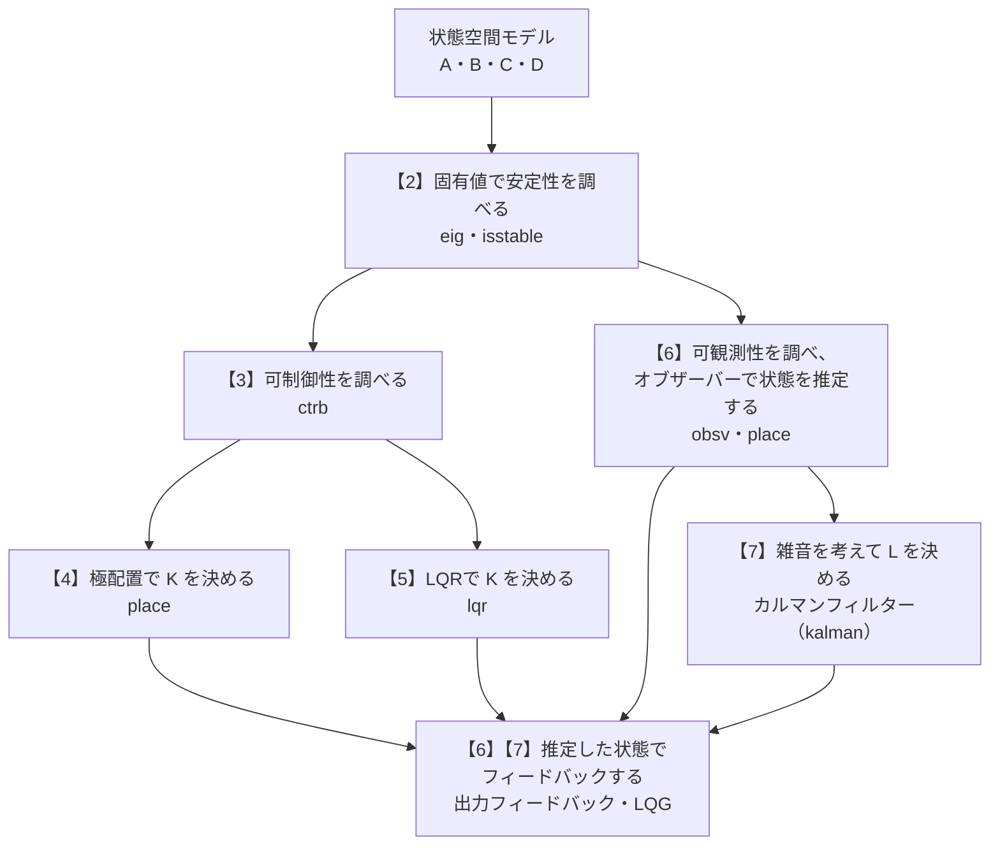

# 04a 現代制御の数学（固有値・可制御性・極配置・LQR・オブザーバー）

- 関連するテーマ: [04 古典制御と現代制御でできること](../themes/04-classical-and-modern-control.md)
- 確認日: 2026-10-25
- 調査時点の最新リリース: R2026b
- 元のドキュメントの言語: 日本語（参照した関数のページの日本語版はR2026aの版で、英語版より古いことがある）

テーマ04では、現代制御の道具として `ctrb`・`obsv`・`place`・`lqr`・`kalman` などの関数を並べた。これらの関数のページは、「固有値」「行列の階数」「2次形式」「正定値」「リカッチ方程式」といった線形代数と制御理論の言葉を、説明なしに使っている。状態空間モデルを `A`・`B`・`C`・`D` の行列で書けても、これらの言葉を知らないと、関数が何を計算しているのか、結果をどう読めばよいのかが分からない。この解説では、1つの小さな例の系を最後まで使い、必要な数学をその場で説明しながら、安定性の判定から、極配置、LQR、オブザーバー、LQGまでを順にたどる。

## 想定環境・前提・所要の目安

| 項目 | 内容 |
|---|---|
| 製品 | MATLAB、Control System Toolbox（この解説の関数は、日本語版のR2026aのドキュメントで確かめた。調査時点の最新はR2026b） |
| 前提の知識 | 状態空間モデル `ẋ = Ax + Bu`、`y = Cx + Du` を行列で書けること。行列の掛け算と、2×2の行列の行列式の計算 |
| 前提の文書 | テーマ04の「はじめに」（古典制御と現代制御の違い）。解説[03a](03a-neural-state-space-model.md)の7-2節（線形化）を読んでいると、非線形のプラントからこの解説の `A`・`B` がどう得られるかが分かるが、必須ではない |
| 所要の目安 | 読むだけなら2〜3時間。手計算を追う場合は、さらに1時間程度 |

**注記**

- **期待する結果の出どころ**: この解説の「期待する結果」は、この解説の作成時にMATLABで実行して確かめたものではない。例の系の値を手で計算して求めたもので、表示の書式（桁数・並び順・空白）は実際のMATLABの表示と違うことがある。値そのものは手計算で検算してある。
- **公式の記述と一般論の区別**: 関数の決まり（符号の付け方、出力の意味、使える条件）は公式のドキュメントで確かめた。式の導き方や意味づけのうち、公式のドキュメントに書かれていない制御理論の一般的な内容は、その都度「一般的な理論」と書いた。
- **コードについて**: 例の系とコードは、この解説のために作ったもので、公式の例題を写したものではない。
- **実行環境が無くても読めるように**: 各手順の後に、何が表示されれば正しいかと、手計算の過程を書いた。

## 0. 学習目標と完了条件

この解説を読み終えると、次のことができるようになる。

1. 行列 `A` の固有値から、系が安定かどうかと、応答の速さ・振動の有無を読み取れる。
2. 可制御行列・可観測行列を作り、その階数から可制御性・可観測性を判定できる。
3. 状態フィードバック `u = -Kx` で閉ループの極が `A - BK` の固有値になることを説明し、`place` でゲインを求められる。
4. LQRの評価関数の `Q`・`R` の意味を説明し、`lqr` の出力 `K`・`S`・`P` を読み取れる。
5. オブザーバーの推定の誤差が `A - LC` で決まることを説明し、`place` でオブザーバーのゲインを求められる。
6. カルマンフィルターとLQGが、オブザーバーと状態フィードバックの組み合わせのどこを置き換えたものかを説明できる。

完了条件: 9節の4つの問いに、本文を見返さずに答えられること。

## 1. 全体像

この解説の流れを図に示す。【】の番号は節の番号である。



### 1-1. この解説で使う例の系

すべての節で、次の2つの状態を持つ系を使う。

```matlab
A = [0 1; 2 -1];
B = [0; 1];
C = [1 0];
D = 0;
```

状態 `x1` を位置、`x2` を速度と見ると、この式は「加速度 = 2×位置 − 速度 + 入力」を表す。ばねなら位置を0に戻す向きに力がかかるが、この系では位置と同じ向きに押される（位置が正なら正の向きに押される）ので、放っておくと倒れていく倒立振子のような系の、簡単な模型になっている。出力 `y = Cx` は位置 `x1` だけで、速度は測れないものとする。

## 2. 固有値と安定性

### 2-1. 固有値と固有ベクトル

正方行列 `A` に対して、0でないベクトル `v` と数 `λ`（ラムダ）が

$$
A v = \lambda v
$$

を満たすとき、`λ` を `A` の**固有値**、`v` を**固有ベクトル**という。`A` を掛けても向きが変わらず、`λ` 倍に伸び縮みするだけの特別な向きが固有ベクトルである。

固有値は、次の式（**特性方程式**）の解として求まる。`det` は行列式、`I` は対角が1でほかが0の**単位行列**である。

$$
\det(\lambda I - A) = 0
$$

例の系では、`λI - A = [λ -1; -2 λ+1]` なので、行列式は `λ(λ+1) - 2 = λ² + λ - 2 = (λ+2)(λ-1)` になり、固有値は `1` と `-2` である。固有ベクトルは、`λ = 1` に `[1; 1]`、`λ = -2` に `[1; -2]` が対応する（`A` を掛けて確かめられる。たとえば `A*[1; 1] = [1; 1]`）。

固有値は複素数になることもある。2×2の行列では、特性方程式が実数の解を持たないとき、`σ ± jω`（`j` は虚数単位で、`j² = -1`）の組で現れる。`σ` を**実部**、`ω` を**虚部**といい、虚部の符号だけが違うこの2つを、互いに**共役**な複素数という。複素数は、横軸に実部、縦軸に虚部をとった平面（**複素平面**）の上の点として表せる。

### 2-2. 固有値が応答を決める理由

入力が無い（`u = 0`）とき、初期状態 `x(0)` からの動きは、固有ベクトルの向きの成分ごとに分けて考えられる（以下は線形代数の一般的な結果で、`A` の固有ベクトルが状態の数だけあり、互いに線形独立〈3-1節〉な場合の話である。例の系はこれに当てはまる）。初期状態を固有ベクトルの和 `x(0) = c1 v1 + c2 v2` に分けると、その後の状態は

$$
x(t) = c_1 e^{\lambda_1 t} v_1 + c_2 e^{\lambda_2 t} v_2
$$

になる。固有ベクトルの向きの成分は、向きを保ったまま `e^{λt}` の速さで伸び縮みする。この1つ1つの動きを**モード**という。

- `λ` が負の実数なら、そのモードは時間とともに0に近づく。絶対値が大きいほど速く減る（`1/|λ|` がおおよその時間の目安で、**時定数**という）。
- `λ` が正の実数なら、そのモードは時間とともに大きくなり続ける。
- `λ = σ ± jω` の複素数なら、そのモードは角周波数 `ω` で振動しながら、`e^{σt}` で大きさが変わる。**角周波数**は、振動の速さを1秒あたりに進む角度（ラジアン）で表したもので、振動の周期は `2π/ω` 秒になる。

例の系は固有値 `1` を持つので、初期状態に `[1; 1]` の向きの成分が少しでもあれば、その成分は `e^t` で大きくなり続ける。つまり、この系は放っておくと倒れる。

### 2-3. 安定の条件と「極」

連続時間の系が**安定**（入力が無いとき、どの初期状態からも状態が0に近づく）であるための条件は、**すべての固有値の実部が負**であることである。MathWorksのドキュメントでは、`isstable` のページが、連続時間の系ではすべての極が複素平面の左側の開いた半平面（実部が負の領域。境界の虚軸は含まない）にあること、離散時間の系ではすべての極が半径1の円の内側にあることを、安定の条件としている。

ここでいう**極**は、状態空間モデルでは `A` の固有値のことである（`pole` のページ）。テーマ04の「はじめに」で「応答の速さと減衰を決める値」と書いた極は、2-2節のモードの `λ` にほかならない。古典制御で伝達関数の分母の根として求める極と、同じものを別の見方で見ている（ただし、3節の可制御でないモードや、6節の可観測でないモードは、伝達関数には現れない）。

### 2-4. MATLABで確かめる

```matlab
sys = ss(A, B, C, D);   % 状態空間モデルを作る
eig(A)                  % A の固有値
isstable(sys)           % 安定なら 1、不安定なら 0
```

**期待する結果**

```text
ans =
    -2
     1

ans =
  logical
   0
```

読み方: 固有値に正の `1` があるので不安定で、`isstable` が `0` を返す。固有値の並び順は、ここでの表示と違うことがある。

## 3. 可制御性

### 3-1. 行列の階数

可制御性の判定には、行列の**階数**（ランク）を使う。階数は、行列の列（縦に並んだベクトル）のうち、互いに他の列の組み合わせで作れないもの（**線形独立**なもの）の最大の数である。2×2の行列なら、2つの列が同じ向き（一方が他方の何倍か）でなければ階数は2、同じ向きなら1になる。行列式が0でなければ階数は2、と覚えてもよい。

### 3-2. 可制御行列

**可制御性**は、入力 `u` を適切に動かせば、どの初期状態からでも、望みの状態に移せるかどうかである。状態の数が `n` の系では、次の**可制御行列**の階数が `n` なら可制御である（`ctrb` のページ）。

```text
Co = [B  AB  A²B  …  A^(n-1)B]
```

直感的には、入力は `B` の向きに直接、`AB` の向きに「1回 `A` を通って」、と回り込んで状態に効く。これらの向きで状態の空間の全部の向きを覆えれば、どの状態にも行ける（この意味づけは一般的な理論の説明である）。

例の系では `n = 2` で、`AB = [0 1; 2 -1]*[0; 1] = [1; -1]` なので、

```text
Co = [B AB] = [0  1
               1 -1]
```

行列式は `0×(-1) - 1×1 = -1` で0でないから、階数は2で、可制御である。

### 3-3. 可制御でない例

`A2 = [1 0; 0 -2]`、`B2 = [0; 1]` の系を考える。`A2` が対角なので、`x1` と `x2` は互いに影響せず、入力は `x2` にしか入らない。`x1` は固有値 `1` のモードで、入力では止められずに大きくなり続ける。可制御行列は `[B2 A2*B2] = [0 0; 1 -2]` で、1行目がすべて0なので階数は1になり、可制御でない。

このように、可制御でないモードのうち不安定なものがあると、どんな状態フィードバックでも安定にできない。逆に、可制御でないモードがすべて安定なら、残りのモードを動かして系全体を安定にできる。この性質を**可安定**という。5節の `lqr` は、`(A, B)` が可安定であることを条件にしている（`lqr` のページ）。

### 3-4. MATLABで確かめる

```matlab
Co = ctrb(A, B)   % 可制御行列
rank(Co)          % 階数。状態の数（2）と等しければ可制御
```

**期待する結果**

```text
Co =
     0     1
     1    -1

ans =
     2
```

読み方: 階数が状態の数の2と等しいので、可制御である。`ctrb` のページには数値計算の注意は書かれていないが、同じ形の行列を作る `obsv` のページ（6節で使う）は、状態の数が多い系ではこの行列が数値的に特異（階数の判定が誤差に左右される）になりやすいとして、階数による可観測性の判定を勧めていない。同じ理由から、`ctrb` の階数による判定も、小さな系で考え方を確かめる目的で使うのがよい（この最後の一文は著者の判断）。

## 4. 状態フィードバックと極配置

### 4-1. 閉ループの行列

すべての状態を測れるとして、入力を状態の一次式

$$
u = -Kx
$$

で決める。これが**状態フィードバック**で、`K` を**フィードバックゲイン**という。例の系では、入力が1つ・状態が2つなので、`K = [k1 k2]` の1×2の行列である。MATLABの `place`・`lqr` は、どちらもこの負の符号の形で `K` を返す（各関数のページ）。

状態方程式に代入すると、

$$
\dot{x} = Ax + B(-Kx) = (A - BK)x
$$

となる。入力の無い系と同じ形なので、2節の結果がそのまま使える。**閉ループの極は `A - BK` の固有値**で、`K` を選べば固有値を動かせる。可制御であれば、固有値を（複素数の極は共役の組で）任意の位置に置けることが知られている（一般的な理論）。

### 4-2. 手でゲインを求める

例の系で、閉ループの極を `-2` と `-3` に置く `K` を求める。

```text
A - BK = [0 1; 2 -1] - [0; 1]*[k1 k2]
       = [   0       1
          2-k1   -1-k2 ]
```

特性方程式は、2-1節と同じように計算して

```text
det(λI - (A - BK)) = λ(λ + 1 + k2) - (2 - k1)
                   = λ² + (1 + k2)λ + (k1 - 2)
```

になる。極を `-2`・`-3` にするには、これが `(λ+2)(λ+3) = λ² + 5λ + 6` と等しければよい。係数を比べて `1 + k2 = 5`、`k1 - 2 = 6` から、`K = [8 4]` である。

### 4-3. MATLABで確かめる

```matlab
K = place(A, B, [-2 -3])   % 閉ループの極を -2 と -3 に置くゲイン
eig(A - B*K)               % 閉ループの極
```

**期待する結果**

```text
K =
    8.0000    4.0000

ans =
    -3
    -2
```

読み方: `K` が手計算の `[8 4]` と一致し、`A - BK` の固有値が指定した `-2`・`-3` になっていれば正しい。表示の桁数や固有値の並び順は違うことがある。

### 4-4. 極の選び方の注意

極を左（負の大きな値）に置くほど応答は速くなるが、ゲイン `K` が大きくなり、大きな入力が要る。実際のアクチュエーターには出せる力の上限があるので、どこまでも速くはできない（一般的な理論）。極配置のページは、複数の極を同じ位置に置くことと、可制御性・可観測性の弱い極（可制御ではあるが、動かすのに大きな入力が要る極。可観測ではあるが、出力にわずかしか現れない極。この括弧の中は著者の補足）を動かすことを避けるよう注意している。弱い極を動かそうとすると大きなゲインが必要になり、外乱を少し受けただけで大きく乱れる閉ループになりやすい、というのがその理由である。また、`place` のページは、入力の数（`B` の階数）より多く同じ極を重ねて指定するとエラーになるとしている。

極の位置を手で選ぶ代わりに、「速さ」と「入力の大きさ」の兼ね合いから `K` を決めるのが、次の5節のLQRである。

## 5. LQR（最適な状態フィードバック）

### 5-1. 2次形式と正定値

LQRの評価関数には**2次形式**を使う。ベクトル `x` と対称な行列 `Q` に対して、`xᵀQx`（`ᵀ` は転置。縦のベクトルを横にする）を2次形式という。`Q` が対角なら、各成分の2乗に重みを掛けた和になる。

```text
Q = [5 0; 0 5] のとき   xᵀQx = 5·x1² + 5·x2²
```

0でないどんな `x` に対しても `xᵀQx > 0` となる `Q` を**正定値**、`xᵀQx ≥ 0` となる `Q` を**半正定値**という。対角の行列なら、対角の要素がすべて正なら正定値、すべて0以上なら半正定値である。

### 5-2. 評価関数とQ・Rの意味

LQR（Linear Quadratic Regulator、線形2次レギュレーター）は、状態フィードバック `u = -Kx` のうち、次の評価関数 `J` を最小にする `K` を求める（`lqr` のページ。ページには状態と入力の積の項 `2xᵀNu` もあるが、ここでは `N = 0` とする）。

$$
J = \int_0^{\infty} \left( x^{\mathsf{T}} Q x + u^{\mathsf{T}} R u \right) dt
$$

- `xᵀQx` は、状態が0（目標）から離れていることへの罰である。`Q` を大きくすると、状態を速く0に戻すことを重んじる。
- `uᵀRu` は、入力を使うことへの罰である。`R` を大きくすると、入力を控えめにすることを重んじる。

`Q` と `R` の比で、4-4節の「速さ」と「入力の大きさ」の兼ね合いを決める、と考えればよい（この意味づけは一般的な説明で、テーマ04の動画「What Is LQR Optimal Control?」もこの兼ね合いを扱っている）。`lqr` のページは、`R` が正定値であること、`Q` が半正定値であること（`N = 0` の場合）を条件にしている。

### 5-3. リカッチ方程式

`J` を最小にする `K` は、次の**代数リカッチ方程式**の解 `S`（対称な行列）から求まる（`lqr` のページ。`N = 0` とした形）。

$$
A^{\mathsf{T}} S + S A - S B R^{-1} B^{\mathsf{T}} S + Q = 0, \qquad K = R^{-1} B^{\mathsf{T}} S
$$

`R⁻¹` は `R` の**逆行列**（掛けると単位行列になる行列）で、`R` が1つの数なら `1/R` である。

`S` には、「初期状態 `x0` から最適な制御をしたときの評価関数の最小値が `x0ᵀ S x0` になる」という意味がある（一般的な理論）。

例の系で、`Q = [5 0; 0 5]`、`R = 1` として、手で解いてみる。`S = [s1 s2; s2 s3]` とおくと、`B = [0; 1]` なので `K = BᵀS = [s2 s3]` である。方程式の各要素を書き出すと、次の3つの式になる。

```text
(1,1)要素:  4·s2 − s2² + 5 = 0              → s2 = 5（正の解）
(2,2)要素:  2·s2 − 2·s3 − s3² + 5 = 0       → s3² + 2·s3 − 15 = 0 → s3 = 3（正の解）
(1,2)要素:  s1 − s2 + 2·s3 − s2·s3 = 0      → s1 = 5 − 6 + 15 = 14
```

解の選び方: `lqr` の `S` は正定値の解である（一般的な理論）。(1,1)要素の式の解は `s2 = 5` と `s2 = -1` だが、`s2 = -1` を選ぶと、(2,2)要素の式から `s3 = 1` か `s3 = -3` になる。`s3 = -3` は対角の要素が負で正定値でなく、`s3 = 1` では(1,2)要素の式から `s1 = -4` となって、やはり正定値でない。`s2 = 5` のとき、(2,2)要素の式の解は `s3 = 3` と `s3 = -5` で、負の方は除く。結果は `S = [14 5; 5 3]`、`K = [5 3]` である。閉ループの行列は `A - BK = [0 1; -3 -4]` で、特性方程式 `λ² + 4λ + 3 = (λ+1)(λ+3)` から、極は `-1` と `-3` になる。

検算として、`S = [14 5; 5 3]` を元の方程式に入れると、`AᵀS + SA = [20 15; 15 4]`、`SBBᵀS = [25 15; 15 9]` なので、`[20 15; 15 4] − [25 15; 15 9] + [5 0; 0 5] = 0` となり、確かに満たす。

### 5-4. MATLABで確かめる

```matlab
Q = diag([5 5]);            % 状態の重み（対角に 5, 5）
R = 1;                      % 入力の重み
[K2, S, P] = lqr(sys, Q, R) % ゲイン、リカッチ方程式の解、閉ループの極
```

**期待する結果**

```text
K2 =
    5.0000    3.0000

S =
   14.0000    5.0000
    5.0000    3.0000

P =
    -1
    -3
```

読み方: `K2` がゲイン、`S` がリカッチ方程式の解、`P` が閉ループの極である（`lqr` のページの出力の名前）。極の並び順は、ここでの表示と違うことがある。極がすべて負なので、閉ループは安定である。4-3節の極配置（極 `-2`・`-3`、`K = [8 4]`）と比べると、この重みでは、より小さなゲインで、遅い極 `-1` を含む閉ループになった。一般的な傾向として、`Q` を大きくすると、極はより左に動き、ゲインは大きくなる（試すときは `Q = diag([50 50])` などで比べるとよい）。

`lqr` に `ss` のモデルを渡す書き方は、連続時間と離散時間のどちらのモデルにも使える。行列 `A`・`B` を直接渡す書き方は連続時間だけで、離散時間の行列には `dlqr` を使う（`lqr` のページ）。

## 6. 可観測性とオブザーバー

### 6-1. 可観測性

4節・5節では、すべての状態を測れるとしていた。例の系では位置 `x1` しか測れないので、速度 `x2` は出力から推し量る必要がある。**可観測性**は、出力 `y`（と既知の入力）をある時間見ていれば、状態を一意に決められるかどうかである。次の**可観測行列**の階数が状態の数 `n` なら可観測である（`obsv` のページ）。

```text
Ob = [C
      CA
      CA²
      …
      CA^(n-1)]
```

例の系では、`CA = [1 0]*[0 1; 2 -1] = [0 1]` なので、`Ob = [1 0; 0 1]` で階数は2、可観測である。位置を見続ければ、その変わり方から速度が分かる、ということに当たる。

可観測でない例として、3-3節の `A2 = [1 0; 0 -2]` に `C2 = [0 1]` を組み合わせると、`x1` は出力に一切現れず、`Ob = [0 1; 0 -2]` の階数は1になる。

### 6-2. オブザーバーの式

**オブザーバー**（状態推定器）は、プラントと同じモデルを計算機の中で動かし、推定した状態 `x̂`（エックスハット）から計算した出力と、実際に測った出力 `y` のずれで、推定を補正する。極配置のページの式（`D = 0` の場合）は次のとおりである。

$$
\dot{\hat{x}} = A \hat{x} + B u + L \left( y - C \hat{x} \right)
$$

`L` を**オブザーバーゲイン**という。推定の誤差 `e = x − x̂` について、プラントの式 `ẋ = Ax + Bu` から引き算すると、`y = Cx` なので

$$
\dot{e} = (A - LC)\, e
$$

となる（一般的な導き方）。入力 `u` が消え、誤差は `A − LC` の固有値で決まる速さで0に近づく。つまり、オブザーバーの設計は「`A − LC` の固有値を左に置く `L` を選ぶこと」で、4節の極配置と同じ形の問題になる。可観測であれば、`A − LC` の固有値を任意の位置に置ける（一般的な理論）。

### 6-3. 極配置の関数でオブザーバーゲインを求める

`A − LC` の固有値は、その転置 `Aᵀ − CᵀLᵀ` の固有値と同じである。これは `A` を `Aᵀ` に、`B` を `Cᵀ` に、`K` を `Lᵀ` に置き換えた極配置の問題なので、`place` に転置した行列を渡し、結果を転置すれば `L` が求まる（極配置のページ・`place` のページ）。

極配置のページは、一般に、推定器の速さを制御器（`A − BK` の固有値）より速くする必要があるとしている。4節の制御器の極 `-2`・`-3` より左の `-6`・`-7` に置くと、手計算では次のようになる。

```text
A - LC = [-l1   1
          2-l2 -1]
det(λI - (A - LC)) = λ² + (1 + l1)λ + (l1 + l2 - 2)
(λ+6)(λ+7) = λ² + 13λ + 42  と比べて  l1 = 12, l2 = 32
```

### 6-4. MATLABで確かめる

```matlab
Ob = obsv(A, C)                  % 可観測行列
rank(Ob)                         % 階数。状態の数（2）と等しければ可観測
L = place(A', C', [-6 -7])'      % オブザーバーゲイン（転置して渡し、結果を転置する）
eig(A - L*C)                     % 推定の誤差の極
```

**期待する結果**

```text
Ob =
     1     0
     0     1

ans =
     2

L =
   12.0000
   32.0000

ans =
    -7
    -6
```

読み方: 階数が2なので可観測で、`L` が手計算の `[12; 32]` と一致し、`A − LC` の固有値が `-6`・`-7` になっていれば正しい。

### 6-5. 推定した状態でフィードバックする

測れない状態の代わりに推定値を使い、`u = −K x̂` とする。これを**出力フィードバック**（測った出力だけから入力を決める）の補償器という。プラントの状態 `x` と推定の誤差 `e` をまとめて書くと、`x̂ = x − e` なので

```text
ẋ = (A - BK)x + BKe
ė = (A - LC)e
```

となる（一般的な導き方）。`e` の式に `x` が入っていないので、閉ループ全体の極は、`A − BK` の固有値（制御器の極）と `A − LC` の固有値（オブザーバーの極）を合わせたものになる。例の系では `-2`・`-3`・`-6`・`-7` である。制御器とオブザーバーを別々に設計してよいというこの性質は、一般に**分離定理**と呼ばれる。極配置のページも、`A − BK` と `A − LC` の固有値を別々に置くことで、閉ループのすべての極を指定できると説明している。

```matlab
Acl = [A-B*K, B*K; zeros(2), A-L*C];   % 状態 [x; e] の閉ループの行列
eig(Acl)                               % 閉ループ全体の極
```

**期待する結果**

```text
ans =
    -2
    -3
    -6
    -7
```

読み方: 制御器の極とオブザーバーの極が、そのまま並んで現れる（並び順は違うことがある）。MATLABには、`K` と `L` から出力フィードバックの補償器をモデルとして作る `reg` もある（極配置のページ）。

## 7. カルマンフィルターとLQG

### 7-1. 雑音を考えてオブザーバーゲインを決める

6節では、オブザーバーの極の位置を手で選んだ。極を左に置くほど推定は速くなるが、測定の雑音もそのまま大きく取り込んでしまう。速さと雑音の兼ね合いを、雑音の大きさから決めるのが**カルマンフィルター**である。

`kalman` のページは、プラントのモデルを、連続時間で次の形としている。

$$
\dot{x} = A x + B u + G w, \qquad y = C x + D u + H w + v
$$

`w` はプラントに入る外乱（**プロセス雑音**）、`v` はセンサーの**測定雑音**で、それぞれの大きさを**共分散**（雑音の大きさのばらつきを表す行列。1つの量なら分散）`Qn = E(wwᵀ)`、`Rn = E(vvᵀ)` で与える（`E` は平均をとる操作）。`kalman` は、推定の誤差 `x − x̂` の定常状態（推定を始めてから十分に時間が経ち、誤差のばらつきが一定になった状態）での共分散を最小にするフィルターを設計し、フィルターのモデル、ゲイン `L`、誤差の共分散 `P` を返す（`kalman` のページ。この `P` は、5-4節の `lqr` の出力 `P`〈閉ループの極〉とは別のものである）。

フィルターの形は、6-2節のオブザーバーの式と同じで、`L` の決め方だけが違う。`Rn` に比べて `Qn` が大きい（モデルより測定を信じる）ほど `L` は大きくなり、`Qn` に比べて `Rn` が大きい（測定よりモデルを信じる）ほど `L` は小さくなる（一般的な理論）。`kalman` に渡すモデルは、入力に `w` を加えたもの（`G`・`H` を含むもの）にする点に注意する。既定では、モデルの入力のうち最後の「`Qn` の行数（`w` の個数）」個の入力が `w` と見なされる（`kalman` のページ）。

`kalman` の条件には、`(C, A)` が**可検出**（可観測でないモードがすべて安定）であることがある（`kalman` のページ）。3-3節の可安定と対になる性質である。

### 7-2. LQG

**LQG**（Linear Quadratic Gaussian、線形2次ガウシアン。ガウシアンは、雑音を正規分布〈ガウス分布〉のホワイトノイズとして扱うことを指す。**正規分布**は、平均のまわりに釣り鐘の形に散らばる、最もよく使われる確率の分布である。**ホワイトノイズ**は、各時刻の値が互いに無関係で、あらゆる周波数の成分を同じ強さで含む雑音である）は、5節のLQRのゲイン `K` と、7-1節のカルマンフィルターを組み合わせた出力フィードバックの制御器である（LQG設計のページ）。6-5節の「`place` で決めた `K` と `L`」を、「`lqr` で決めた `K` と `kalman` で決めた `L`」に置き換えたもの、と考えればよい。

MATLABでは、`kalman` で作ったフィルターと `lqr` のゲインを `lqgreg` で組み合わせるか、`lqg` で一度に設計する（LQG設計のページ）。LQG設計のページには、この流れの具体的な手順がある。

## 8. 離散時間の場合

制御器を計算機で動かすときは、一定の周期で値を読み、入力を更新する**離散時間**のモデル `x(k+1) = A x(k) + B u(k)` を使うことが多い（`k` はサンプルの番号）。この解説の考え方は、ほとんどそのまま使える。違いは次の点である。

- 安定の条件は、すべての固有値の絶対値（複素数 `σ ± jω` なら、複素平面の原点からの距離 `√(σ² + ω²)`）が1より小さいこと（`isstable`・`pole` のページ）。2-2節の `e^{λt}` の代わりに、モードは1サンプルごとに `λ` 倍になるので、絶対値が1より小さければ減っていく。
- 可制御行列・可観測行列の作り方と、階数による判定は同じ（一般的な理論）。
- LQRの評価関数は、積分の代わりにサンプルごとの和になる。`ss` の離散時間のモデルを `lqr` に渡すか、行列なら `dlqr` を使う（`lqr` のページ）。

## 9. 確かめの問い

<details>
<summary>問1. 行列 A の固有値が −1 ± 2j のとき、入力の無い応答はどうなるか。</summary>

実部が負なので安定で、応答は角周波数2で振動しながら、`e^{-t}` の速さで減っていく（2-2節・2-3節）。

</details>

<details>
<summary>問2. 例の系で、閉ループの極を −1 と −4 に置く K を手で求めよ。</summary>

`(λ+1)(λ+4) = λ² + 5λ + 4` と、4-2節の `λ² + (1 + k2)λ + (k1 − 2)` を比べて、`k2 = 4`、`k1 = 6`。`K = [6 4]` である。

</details>

<details>
<summary>問3. 可制御だが可観測でない系に、オブザーバーと状態フィードバックを組み合わせて使えるか。</summary>

可観測でないモードが安定なら（可検出なら）、推定の誤差のうちそのモードの部分は自然に0に近づくので、使える。可観測でないモードが不安定なら、推定の誤差が大きくなり続けるので、使えない（6-1節・7-1節）。

ただし、可観測でない系では、6-4節のように `place(A', C', …)` で `A − LC` の極をすべて指定どおりに置くことはできない（可観測でないモードの極は、`L` を変えても動かない）。そのため、可観測な部分の極だけを選び、可観測でないモードの極はそのまま残す形で設計する（一般的な理論）。

</details>

<details>
<summary>問4. LQRで Q をそのままにして R を大きくすると、ゲイン K と閉ループの極はどう変わると考えられるか。</summary>

入力を使うことへの罰が重くなるので、ゲインは小さくなり、閉ループの極は右（0に近い側）に動いて、応答は遅くなる（5-2節）。

</details>

## 次に読むもの

- テーマ04のリンクの表の「極配置」「線形 2 次ガウシアン (LQG) 設計」: この解説の4節・6節・7節を、公式の例で確かめられる。
- テーマ04の例題「DC モーター制御」: 古典制御（根軌跡）と現代制御（LQR）で、同じプラントの結果を比べる。
- テーマ04の動画のシリーズ「State Space」（第1〜5部）: 可制御性・可観測性とLQR・リカッチ方程式を、別の角度から説明している（英語）。

## 出典

この解説は、次のMathWorksの公式のドキュメント（いずれも2026-10-25に確認。日本語版のR2026aの版）を読み、自分の言葉で説明し直したものである。文章の逐語の転載ではない。例の系と手計算、コードは、この解説のために作ったものである。固有値による応答の分解、可制御行列の意味づけ、リカッチ方程式の解の意味、推定の誤差の式の導き方、分離定理、カルマンフィルターのゲインと雑音の関係は、公式のドキュメントではなく制御理論・線形代数の一般的な内容による。

- [pole](https://jp.mathworks.com/help/control/ref/dynamicsystem.pole.html) — 状態空間モデルの極が `A` の固有値であること、安定の条件
- [isstable](https://jp.mathworks.com/help/control/ref/dynamicsystem.isstable.html) — 連続時間・離散時間の安定の条件
- [ctrb](https://jp.mathworks.com/help/control/ref/statespacemodel.ctrb.html) — 可制御行列と、階数による判定（数値計算の注意は書かれていない）
- [obsv](https://jp.mathworks.com/help/control/ref/statespacemodel.obsv.html) — 可観測行列と、階数による判定、状態の多い系での注意
- [place](https://jp.mathworks.com/help/control/ref/place.html) — `u = −Kx` の決まり、オブザーバーゲインの求め方、重なった極の制限
- [極配置](https://jp.mathworks.com/help/control/getstart/pole-placement.html) — 閉ループの式、オブザーバーの式、推定器を速くする目安、極の選び方の注意、`reg`
- [lqr](https://jp.mathworks.com/help/control/ref/lti.lqr.html) — 評価関数、リカッチ方程式とゲインの式、出力 `K`・`S`・`P`、条件、離散時間の扱い
- [kalman](https://jp.mathworks.com/help/control/ref/ss.kalman.html) — 雑音のモデルと共分散、出力、最小にする量、条件
- [線形 2 次ガウシアン (LQG) 設計](https://jp.mathworks.com/help/control/getstart/linear-quadratic-gaussian-lqg-design.html) — LQGの考え方、`lqgreg`・`lqg`
