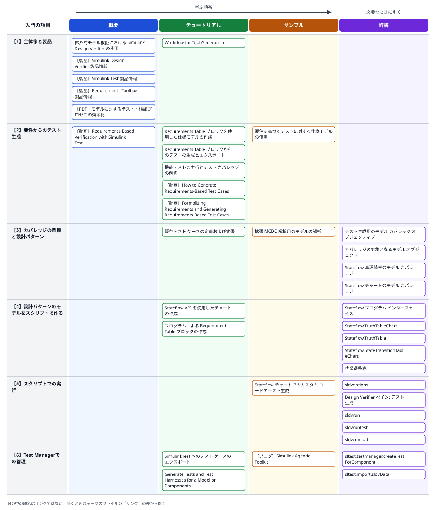

# 02 設計情報からのテスト自動生成

- 確認日: 2026-10-11
- 調査時点の最新リリース: R2026b
- 日本語版のページの表示: R2026bのものがある（ページにより英語版より古いことがあり、各ページに英語版へのリンクがある）

## 概要

### はじめに

制御のソフトウェアを検証するときは、「設計どおりに動くか」を確かめるテストケースを用意する。**テストケース**とは、モデルに与える入力の時系列と、そのときに期待する結果の組である。要件の1つ1つ、モデルの中の分岐の1つ1つについて、それを確かめる入力を人が考えて作ると、数が多く、抜けも出やすい。設計の段階で手元にある情報（要件や設計モデル）から、テストを自動で作るのがこのテーマである。

テストが十分かを測る物差しが**カバレッジ**で、モデルの中の判定や条件のうち、テストで実際に通った割合を表す。**判定**（decision）はif文のような分岐で、真と偽の両方の向きを通ったかを見る。**条件**（condition）は判定を作る個々の条件（`a > 0 && b < 5`の`a > 0`等）で、それぞれが真にも偽にもなったかを見る。**MC/DC**は、各条件が単独で判定の結果を変えることをテストで示せたかを見る、より厳しい基準で、航空や自動車などの安全性の規格で、安全度の水準が高いソフトウェアに対して求められる（推奨される）ことがある。

自動生成の出発点は2つある。1つは**要件**で、文章の要件をRequirements Tableブロックで「この条件のとき、この出力」という表の形に書き直し（形式化）、そこからテストを作る。もう1つは**設計モデル**そのもので、Simulink Design Verifierが、判定・条件・MC/DC等の目標を満たす入力を形式的な解析で探す。どちらで作ったテストも、Simulink TestのTest Managerに取り込んで、実行・管理する。

入門の内容は、次の6つの項目に分けられる。番号は、下の関連図の行と同じである。

- 【1】**全体像と製品**: テスト生成の流れと、関わる製品（Simulink Design Verifier・Simulink Test・Requirements Toolbox・Simulink Coverage）の役割。
- 【2】**要件からのテスト生成**: Requirements Tableで要件を形式化し、テストを生成して、設計モデルに対して実行する。
- 【3】**カバレッジの目標と設計パターン**: どのカバレッジを目標にするかを決める。真理値表・状態遷移表・Stateflowチャートは、それぞれが対象になるカバレッジを確かめて目標を選ぶ。
- 【4】**設計パターンのモデルをスクリプトで作る**: 真理値表・状態遷移表・Stateflowチャート・Requirements Tableを、Stateflow APIや`slreq.modeling`でスクリプトから作ったり読んだりする。
- 【5】**スクリプトでの実行**: `sldvoptions`→`sldvrun`→`sldvruntest`の流れで、UIを使わずにテストを生成し、カバレッジを確かめる。
- 【6】**Test Managerでの管理**: 生成したテストやテストハーネス（テスト対象を囲んで入力と判定をつなぐモデル）をTest Managerに取り込み、要件と結び付けて管理する。

### 入門の内容とリンクの関連図

図の行は上の【1】〜【6】、列はREADMEの「[用途の分類](../README.md#用途の分類)」の4つである。左から右へ、概要→チュートリアル→サンプルの順に読み、辞書は必要なときに引く。題名の前の〔ブログ〕〔動画〕等は、リンクの種類（何も付いていないものはドキュメント）を示す。図の中の題名はリンクではないので、開くときは下の「リンク」の表から開く。

### 方法の整理

設計情報（要件・仕様、モデルの構造）から、テストケースやテスト入力を自動で作る方法は、大きく次の3つに分かれる。

| 方法 | 何から作るか | 主な製品・関数 |
|---|---|---|
| 要件ベースのテスト生成 | Requirements Tableブロックで形式化した要件（仕様モデル） | Requirements Toolbox＋Simulink Design Verifier |
| カバレッジを満たすテスト生成 | 設計モデルそのもの（判定・条件・MC/DC等のカバレッジ目標） | Simulink Design Verifier（`sldvrun`、`sldvoptions`） |
| テストの枠組みの自動作成 | モデルの構成（サブシステム・Model・Stateflowチャート等のコンポーネント） | Simulink Test（Create Test for Componentウィザード、`sltest.testmanager.createTestForComponent`） |

生成したテストは、Simulink TestのTest Managerへエクスポートして実行・管理する（`sltest.import.sldvData`。Requirements Tableから作ったテストは対応する要件に自動でリンクされる）。カバレッジの測定にはSimulink Coverageを使う。いずれも有償の製品が前提で、テーマ全体ではSimulink Test・Simulink Design Verifier・Requirements Toolbox・Simulink Coverageが関わる。

テスト生成の前に、Requirements Tableの要件が完全で矛盾がないかを解析しておくことが推奨されている（不完全だとテスト目標を満たすテストを作れないことがある）。

### 設計パターンごとのテスト生成

調査時点では、真理値表・状態遷移表・Stateflowチャートに絞った専用のテスト生成の機能は見つからなかった。これらは、パターンを含むモデルに対してSimulink Design Verifierのカバレッジを満たすテスト生成を行う（Requirements Tableだけは要件ベースのテスト生成がある）。対象になるカバレッジの種類（判定・条件・MC/DC・関係演算子の境界等）はブロックによって違いうるので、目標のカバレッジを選ぶ前に「カバレッジの対象となるモデル オブジェクト」の表で確かめる。

| 設計パターン | テスト生成の方法 | モデルをスクリプトで作る・読む |
|---|---|---|
| 真理値表（Truth Tableブロック、チャートの中の真理値表関数） | カバレッジを満たすテスト生成 | `Stateflow.TruthTableChart`・`Stateflow.TruthTable`の`ConditionTable`・`ActionTable` |
| 状態遷移表（State Transition Tableブロック） | カバレッジを満たすテスト生成 | `Stateflow.StateTransitionTableChart`（行・列を追加する関数はR2026b以降） |
| Stateflowチャート | カバレッジを満たすテスト生成 | Stateflow API（`sfnew`・`Stateflow.State`・`Stateflow.Transition`等） |
| Requirements Table | 要件ベースのテスト生成 | `slreq.modeling.create`・`addRequirementRow`等（R2022a以降） |

スクリプトでの操作は、どのパターンでも同じ流れになる。

1. `sldvoptions`でオプションを作り、`Mode`を`TestGeneration`に、`ModelCoverageObjectives`を目標のカバレッジ（`MCDC`等）にする
2. `sldvrun`でテストを生成する（生成したテストはデータファイルに保存される）
3. `sldvruntest`でテストを実行してカバレッジを確かめるか、`sltest.import.sldvData`でSimulink TestのTest Managerへ取り込む

## 読む順番の目安

1. 「Workflow for Test Generation」で、Simulink Design Verifierによるテスト生成の全体の流れをつかむ
2. 要件から作るなら「Requirements Table ブロックを使用した仕様モデルの作成」→「Requirements Table ブロックからのテストの生成とエクスポート」→例題「要件に基づくテストに対する仕様モデルの使用」
3. カバレッジの穴を埋めるなら「テスト生成用のモデル カバレッジ オブジェクティブ」と「既存テスト ケースの定義および拡張」
4. Test Managerでの管理は「SimulinkTest へのテスト ケースのエクスポート」と`sltest.import.sldvData`
5. 真理値表・状態遷移表等で生成するなら、「カバレッジの対象となるモデル オブジェクト」で目標のカバレッジを決める
6. スクリプトで操作するなら、例題「Stateflow チャートでのカスタム コードのテスト生成」で`sldvoptions`→`sldvrun`→`sldvruntest`の流れをつかみ、「Design Verifier ペイン: テスト生成」でオプションの名前を引く

## リンク

「用途」の列は、学ぶ順番に沿った使い方（概要／チュートリアル／サンプル／辞書）を示す。分類の基準はREADMEの「[用途の分類](../README.md#用途の分類)」を参照。

### ドキュメント（Simulink Design Verifierによるテスト生成）

| リンク | 用途 | 説明 | 製品・リリース |
|---|---|---|---|
| [体系的モデル検証における Simulink Design Verifier の使用](https://jp.mathworks.com/help/sldv/gs/systematic-model-verification-using-simulink-design-verifier.html) | 概要 | 入門。モデルの体系的な検証に製品をどう使うかの全体像 | Simulink Design Verifier |
| [Workflow for Test Generation](https://jp.mathworks.com/help/sldv/ug/workflow-test-case-generation.html) | チュートリアル | テスト生成の手順の全体像（英語） | Simulink Design Verifier |
| [テスト生成用のモデル カバレッジ オブジェクティブ](https://jp.mathworks.com/help/sldv/ug/model-coverage-objectives-for-test-generation.html) | 辞書 | 判定・条件・MC/DC等、どのカバレッジを目標にテストを作るかの設定 | Simulink Design Verifier |
| [既存テスト ケースの定義および拡張](https://jp.mathworks.com/help/sldv/ug/defining-and-extending-existing-tests-cases.html) | チュートリアル | 既存のテストケースを起点に、タイムステップを追加して拡張し、テストスイートを効率よく作る | Simulink Design Verifier |
| [SimulinkTest へのテスト ケースのエクスポート](https://jp.mathworks.com/help/sldv/ug/create-test-cases-from-simulink-design-verifier-results.html) | チュートリアル | 生成したテストをSimulink TestのTest Managerへ取り込む | Simulink Design Verifier、Simulink Test |

### ドキュメント（要件からのテスト生成）

| リンク | 用途 | 説明 | 製品・リリース |
|---|---|---|---|
| [Requirements Table ブロックを使用した仕様モデルの作成](https://jp.mathworks.com/help/sldv/ug/what-is-specification-model.html) | チュートリアル | 文章の要件をRequirements Tableで形式化し、テスト生成に使う「仕様モデル」を作る | Requirements Toolbox、Simulink Design Verifier |
| [Requirements Table ブロックからのテストの生成とエクスポート](https://jp.mathworks.com/help/sldv/ug/export-generated-tests-from-requirements-table.html) | チュートリアル | 仕様モデルからテストを生成し、Test Managerへエクスポートする手順。スクリプト（`sldvoptions`・`sldvrun`）での実行例もある | Requirements Toolbox、Simulink Design Verifier、Simulink Test |
| [要件に基づくテストに対する仕様モデルの使用](https://jp.mathworks.com/help/sldv/ug/use-specification-model-for-requirements-based-testing.html) | サンプル | 例題。仕様モデルで生成したテストを設計モデルに対して実行し、カバレッジを確かめる | Simulink、Simulink Coverage、Simulink Design Verifier、Requirements Toolbox |
| [機能テストの実行とテスト カバレッジの解析](https://jp.mathworks.com/help/slrequirements/ug/functional-testing-and-coverage-analysis.html) | チュートリアル | 要件ベースのテストを実行し、カバレッジの不足を確かめて対処する流れ | Requirements Toolbox、Simulink Test、Simulink Coverage、Simulink Design Verifier |

### ドキュメント（Simulink Testでのテストの枠組みの作成）

| リンク | 用途 | 説明 | 製品・リリース |
|---|---|---|---|
| [Generate Tests and Test Harnesses for a Model or Components](https://jp.mathworks.com/help/sltest/ug/generate-tests-and-test-harnesses-for-a-model-or-components.html) | チュートリアル | モデルやコンポーネントごとに、テストハーネスとテストケースをウィザードで作る（英語） | Simulink Test |
| [sltest.testmanager.createTestForComponent](https://jp.mathworks.com/help/sltest/ref/sltest.testmanager.createtestforcomponent.html) | 辞書 | 上のウィザードと同じことをスクリプトで行う。複数のコンポーネントにまとめて作れる（英語） | Simulink Test、R2020b以降 |
| [sltest.import.sldvData](https://jp.mathworks.com/help/sltest/ref/sltest.import.sldvdata.html) | 辞書 | Simulink Design Verifierの解析結果から、テストハーネスとテストファイルを作る | Simulink Test、Simulink Design Verifier、R2015b以降 |

### ドキュメント（設計パターンとカバレッジ）

| リンク | 用途 | 説明 | 製品・リリース |
|---|---|---|---|
| [カバレッジの対象となるモデル オブジェクト](https://jp.mathworks.com/help/slcoverage/ug/model-objects-that-receive-coverage.html) | 辞書 | ブロックごとに、どの種類のカバレッジ（判定・条件・MC/DC・関係演算子の境界等）の対象になるかの表（表は画像） | Simulink Coverage |
| [Stateflow 真理値表のモデル カバレッジ](https://jp.mathworks.com/help/slcoverage/ug/coverage-for-truth-tables.html) | 辞書 | 真理値表のカバレッジ。クラシックの真理値表とMATLABの真理値表で、対象になるものが違う | Simulink Coverage、Stateflow |
| [Stateflow チャートのモデル カバレッジ](https://jp.mathworks.com/help/slcoverage/ug/coverage-for-stateflow-charts.html) | 辞書 | チャートのステート・遷移のカバレッジ。状態遷移表の節もあり、同じ内容のチャートと同じ結果になることや、`after`等の時相論理の扱いがアクション言語で違うことを説明している | Simulink Coverage、Stateflow |
| [拡張 MCDC 解析用のモデルの解析](https://jp.mathworks.com/help/sldv/ug/analyze-a-model-for-enhanced-mcdc-analysis.html) | サンプル | 例題。条件の組み合わせをより厳しく確かめる「拡張MCDC」を目標にテストを生成する（操作はUIが中心） | Simulink Design Verifier |

### ドキュメント（スクリプトでのテスト生成）

| リンク | 用途 | 説明 | 製品・リリース |
|---|---|---|---|
| [Stateflow チャートでのカスタム コードのテスト生成](https://jp.mathworks.com/help/sldv/ug/test-generation-for-custom-code-in-stateflow-chart.html) | サンプル | 例題。Stateflowチャートのモデルに対し、`sldvoptions`→`sldvrun`でテストを生成し、`sldvruntest`でカバレッジを確かめるまでをスクリプトで行う | Simulink Design Verifier、Stateflow |
| [sldvoptions](https://jp.mathworks.com/help/sldv/ref/sldvoptions.html) | 辞書 | 解析のオプションのオブジェクトを作る。`Mode`・`ModelCoverageObjectives`・`TestSuiteOptimization`等の一覧。`set_param`で設定するときの名前（`DV`を前に付ける）もここ | Simulink Design Verifier、R2007a以降 |
| [Design Verifier ペイン: テスト生成](https://jp.mathworks.com/help/sldv/ug/design-verifier-pane-test-generation.html) | 辞書 | テスト生成のパラメーターの一覧。各パラメーターの「コマンド ライン情報」に`set_param`で使う名前（`DVModelCoverageObjectives`等）がある | Simulink Design Verifier |
| [sldvrun](https://jp.mathworks.com/help/sldv/ref/sldvrun.html) | 辞書 | 解析を実行する。生成したデータファイル・ハーネスモデル・レポートのファイル名を返す | Simulink Design Verifier、R2007a以降 |
| [sldvruntest](https://jp.mathworks.com/help/sldv/ref/sldvruntest.html) | 辞書 | 生成したテストケースごとにモデルをシミュレーションする。`sldvruntestopts`でカバレッジの収集も指定できる | Simulink Design Verifier、R2007b以降 |
| [sldvcompat](https://jp.mathworks.com/help/sldv/ref/sldvcompat.html) | 辞書 | モデルが解析に対応しているかを、解析の前に確かめる | Simulink Design Verifier、R2007a以降 |

### ドキュメント（設計パターンのモデルをスクリプトで作る）

| リンク | 用途 | 説明 | 製品・リリース |
|---|---|---|---|
| [Stateflow プログラム インターフェイス](https://jp.mathworks.com/help/stateflow/programmatic-interface.html) | 辞書 | カテゴリのページ。Stateflow APIの関数・オブジェクト・解説の一覧 | Stateflow |
| [Stateflow API を使用したチャートの作成](https://jp.mathworks.com/help/stateflow/api/quick-start-for-the-stateflow-api.html) | チュートリアル | 例題。ステート・遷移・データをコマンドで追加してチャートを作り、シミュレーションするまで | Stateflow |
| [Stateflow.TruthTableChart](https://jp.mathworks.com/help/stateflow/api/stateflow.truthtablechart.html) | 辞書 | Truth Tableブロックのオブジェクト。条件の表（`ConditionTable`）とアクションの表（`ActionTable`）をセル配列で読み書きできる | Stateflow |
| [Stateflow.TruthTable](https://jp.mathworks.com/help/stateflow/api/stateflow.truthtable.html) | 辞書 | チャートの中の真理値表関数のオブジェクト。`ConditionTable`・`ActionTable`は上と同じ | Stateflow |
| [Stateflow.StateTransitionTableChart](https://jp.mathworks.com/help/stateflow/api/stateflow.statetransitiontablechart.html) | 辞書 | State Transition Tableブロックのオブジェクト。内容を構造体で書き出す`exportAsStruct`（R2022b以降）。行・列を追加する関数（`addStateRow`・`addTransitionColumn`等）はR2026b以降で、調査時点では英語版のページにだけ載っている | Stateflow、R2012b以降 |
| [状態遷移表](https://jp.mathworks.com/help/stateflow/state-transition-tables.html) | 辞書 | カテゴリのページ。状態遷移表とチャートを相互に変換する`convertToChart`・`convertToSTT`（R2023b以降）もここ | Stateflow |
| [プログラムによる Requirements Table ブロックの作成](https://jp.mathworks.com/help/slrequirements/ug/configure-requirements-table-blocks-programmatically.html) | チュートリアル | `slreq.modeling.create`でブロックを作り、シンボル・要件の行・前提の行をスクリプトで追加する | Requirements Toolbox、R2022a以降 |

### 製品・ソリューションのページ

| リンク | 用途 | 説明 | 製品・リリース |
|---|---|---|---|
| [Simulink Design Verifier 製品情報](https://jp.mathworks.com/products/simulink-design-verifier.html) | 概要 | カバレッジ目標やカスタム目標のテストケースを生成し、要件ベースのテストを補う | Simulink Design Verifier |
| [Simulink Test 製品情報](https://jp.mathworks.com/products/simulink-test.html) | 概要 | シミュレーションによるテストの作成・管理・実行、要件とのトレース | Simulink Test |
| [Requirements Toolbox 製品情報](https://jp.mathworks.com/products/requirements-toolbox.html) | 概要 | 要件の作成・リンク・妥当性確認。Requirements Tableブロックで形式的な要件を書ける | Requirements Toolbox |

### ブログ

| リンク | 用途 | 説明 | 製品・リリース |
|---|---|---|---|
| [Simulink Agentic Toolkit](https://blogs.mathworks.com/simulink/2026/04/17/simulink-agentic-toolkit/) | サンプル | 英語。AIエージェントにテスト計画を立てさせ、コンポーネント単位と閉ループのテストをTest Managerに実装させた例（Guy on Simulink、2026年） | Simulink Agentic Toolkit、Simulink Test |

### 講演資料（PDF）

| リンク | 用途 | 説明 | 製品・リリース |
|---|---|---|---|
| [モデルに対するテスト・検証プロセスの効率化（PDF）](https://www.mathworks.com/content/dam/mathworks/mathworks-dot-com/solutions/automotive/files/jp-expo-2014/model-verification-and-validation-solution.pdf) | 概要 | 日本語。MATLAB EXPO 2014の講演資料。Simulink Design Verifierによるテストケースの自動生成と、スクリプトによる検証作業の自動化（古い資料） | Simulink Design Verifier ほか |

### 動画

| リンク | 用途 | 説明 | 製品・リリース |
|---|---|---|---|
| [How to Generate Requirements-Based Test Cases](https://www.mathworks.com/videos/requirements-based-testing-89778.html) | チュートリアル | 英語、約4分（2023年）。Requirements Tableの仕様モデルからSimulink Design Verifierでテストを生成する | Requirements Toolbox、Simulink Design Verifier |
| [Formalizing Requirements and Generating Requirements Based Test Cases](https://www.mathworks.com/videos/formalizing-requirements-and-generating-requirements-based-test-cases-1683216502105.html) | チュートリアル | 英語、約21分（2023年）。文章の要件をRequirements Tableで形式化し、抜け・矛盾を確かめてからテストを自動生成する | Requirements Toolbox、Simulink Design Verifier |
| [Requirements-Based Verification with Simulink Test](https://www.mathworks.com/videos/requirements-based-verification-with-simulink-test-1554822878413.html) | 概要 | 英語、約22分（2019年）。文章の要件を、時間の条件を含む実行可能な判定（temporal assessment）に置き換えてテストする | Simulink Test |

## 補足

- 文章の要件から直接テストを生成する専用の機能（AIによるもの等）は、調査時点の公式ドキュメントでは見つからなかった。要件をRequirements Tableで形式化してから生成するのが公式の流れ。AIエージェントを使う方法は、上のブログ（Simulink Agentic Toolkit）が近い。
- 検索で見つかった次の英語のページは、調査時点で`www.`・`jp.`ともに404だった（ページの移動・統合の可能性がある）ため載せていない: Simulink Testの「Increase Coverage by Generating Test Inputs」、「Automatically Create a Set of Test Cases」。
- 日本語の動画: 「MATLAB Japan」チャンネルで、テストの自動生成を主題にした動画は見つからなかった。
- 新しい年の講演資料（MATLAB EXPO 2025・2026等）は、検索では見つからなかった。
- 真理値表・状態遷移表に絞ってテスト生成を説明したページや例題は、調査時点の検索では見つからなかった。上の「設計パターンごとのテスト生成」は、カバレッジのページとテスト生成のページを組み合わせた整理である。
- 「カバレッジの対象となるモデル オブジェクト」の表は画像で、パターンごとのカバレッジの種類を文字で確かめられなかったため、このファイルには書いていない。各自でページの表を見て確かめる。
- Stateflowの「真理値表」のカテゴリのページ（日本語版）には、英語版のページがこのリリースで削除された旨の表示があったため載せていない。`Stateflow.TruthTableChart`・`Stateflow.TruthTable`のページから関連するページをたどれる。
