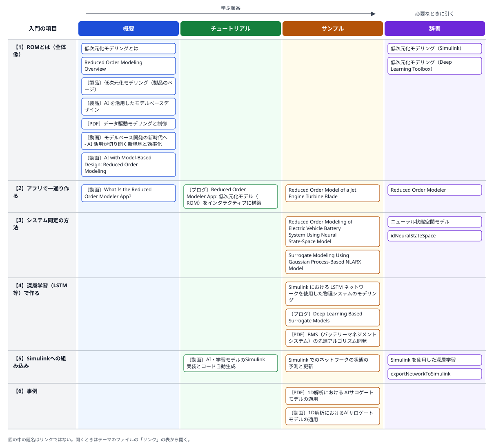

# 03 プラントモデルをニューラルネットワークに置き換えるサロゲート化

- 確認日: 2026-10-11
- 調査時点の最新リリース: R2026b
- 日本語版のページの表示: 確認していない（日本語版は英語版より更新が遅れることがあり、各ページに英語版へのリンクがある）

## 概要

### はじめに

制御の対象（プラント）を細かく表したモデルは正確だが、重い。物理法則を細部まで式にしたモデルや、有限要素法（FEM）の解析は、1回のシミュレーションに長い時間がかかる。制御器のパラメーターを何百通りも試す、実機の制御器とつないで実時間で動かす（HILテスト）、といった場面では、この遅さが開発の妨げになる。

そこで、元のモデルを何度か動かして入力と出力のデータを集め、そのデータから「同じ入力に対して、近い出力を、ずっと速く返す」軽いモデルを学習させ、元のモデルの代わりに使う。この代わりのモデルが**サロゲートモデル**（代理のモデル）で、MathWorksは**低次元化モデリング**（Reduced Order Modeling、**ROM**）と呼んでいる。

大事なのは、サロゲートモデルは内部の物理を再現するのではなく、**入力と出力の関係をまねる**ということである。そのため、学習に使ったデータの範囲の外では、精度の保証がない。どのような入力でデータを集めるか（**実験計画**）と、元のモデルと比べて誤差が許容できるかの**検証**が、学習そのものと同じくらい重要になる。

時間とともに状態が変わる動的なプラントには、過去の入力の影響を覚えておけるモデルを使う。代表的なものは、時系列を扱うニューラルネットワークの**LSTM**、状態の時間変化（連続時間では微分方程式、離散時間では次の時刻の状態）をニューラルネットワークで表す**ニューラル状態空間モデル**、過去の入出力から次の出力を予測する**非線形ARX**である。

入門の内容は、次の6つの項目に分けられる。番号は、下の関連図の行と同じである。

- 【1】**ROMとは（全体像）**: 何のために使い、どのような手法があるか。データ駆動の方法と、線形化に基づく方法の違い。
- 【2】**アプリで一通り作る**: Reduced Order Modelerアプリで、実験計画→データの生成→学習→Simulinkへの書き出しを行う。
- 【3】**システム同定の方法**: ニューラル状態空間モデルや非線形ARXで、動的なモデルを作る（System Identification Toolbox）。
- 【4】**深層学習（LSTM等）で作る**: LSTM等のネットワークを学習させて、物理モデルの一部と置き換える。
- 【5】**Simulinkへの組み込み**: 学習したネットワークをブロックとして動かし、コードを生成する。
- 【6】**事例**: 実際の製品開発でサロゲートモデルを使った例。

### 入門の内容とリンクの関連図

図の行は上の【1】〜【6】、列はREADMEの「[用途の分類](../README.md#用途の分類)」の4つである。左から右へ、概要→チュートリアル→サンプルの順に読み、辞書は必要なときに引く。題名の前の〔ブログ〕〔動画〕等は、リンクの種類（何も付いていないものはドキュメント）を示す。図の中の題名はリンクではないので、開くときは下の「リンク」の表から開く。

### 方法の整理

上で説明したROMは、シミュレーションの高速化、HILテスト、制御設計、仮想センサー等に使う。精度は元のモデルより落ちるので、許容できる誤差かを確かめて使う。

基本の流れは次の4段階。

1. 実験計画を立て、高忠実度モデルをシミュレーションして入出力データを作る
2. データでROMを学習する
3. 元のモデルと比べて精度を確かめる
4. ROMをSimulinkのブロックとして組み込み、元のサブシステムと置き換える

| 方法 | 主な関数・アプリ・ブロック | 主な製品 |
|---|---|---|
| アプリで一通り行う | Reduced Order Modelerアプリ（`reducedOrderModeler`）。LSTM・非線形ARX・ニューラル状態空間モデル等を選べる | Reduced Order Modeler for MATLAB（アドオン、R2025b以降） |
| ニューラル状態空間モデル | `idNeuralStateSpace`（R2022b以降）、`nlssest`、Neural State-Space Modelブロック | System Identification Toolbox、Deep Learning Toolbox（ネットワークに`dlnetwork`を使う） |
| LSTM等の深層学習ネットワーク | Stateful Predictブロック、`exportNetworkToSimulink`（R2024b以降） | Deep Learning Toolbox |
| 非線形ARX（ガウス過程等） | Nonlinear ARX Modelブロック | System Identification Toolbox、Statistics and Machine Learning Toolbox |

### 内部の状態の扱い方

動的なプラントを置き換えるサロゲートモデルは、プラントの内部の状態（速度・温度・蓄えたエネルギー等）に当たる情報を、時刻をまたいで持ち続ける必要がある。MathWorksの公式のドキュメントでは、その持ち方は方式によって次のように違う。

| 方式 | 状態をどう持つか | 微分値との関係 | Simulinkでの状態の扱い |
|---|---|---|---|
| LSTM（Deep Learning Toolbox） | ネットワークの内部の**セル状態と隠れ状態**として持つ。物理的な意味のある状態ではない | 扱わない。決まった時間の刻みごとに状態を更新する | Stateful Predictブロック（R2021a以降）は予測のたびに状態を更新し、初期状態に戻すにはResettable Subsystemに入れて`Reset`の信号で戻す。LSTM Layerブロック（R2024b以降）は既定で状態を保ち、セル状態と隠れ状態の初期値を設定できる |
| ニューラル状態空間（System Identification Toolbox） | **状態ベクトル x を明示的に持つ**。状態の関数と出力の関数をそれぞれニューラルネットワークで表す | 連続時間のモデルでは、状態の関数が**状態の微分 dx/dt**を出す。離散時間のモデルでは**次の時刻の状態**を出す | Neural State-Space Modelブロック（R2022b以降）。初期状態を設定でき、状態と、その微分（離散時間では差分）を出力できる |
| Neural ODE（Deep Learning Toolbox） | 状態を明示的に持ち、初期状態から時間を進めて解く | 常微分方程式の右辺（**微分を与える関数**）をネットワークで学習し、`dlode45`で解く。制御入力を加える例題もある（R2026a以降） | 公式の例題はMATLABでの学習と予測まで。ニューラル状態空間は、MathWorksのブログでNeural ODEと関連づけて紹介されている |
| 非線形ARX（System Identification Toolbox） | 状態を明示的には持たない。**過去の入力と出力の値**（`y(t-1)`・`u(t-2)`等）を回帰の変数にして、状態の代わりにする | 扱わない | Nonlinear ARX Modelブロック |

ニューラル状態空間モデルの学習には、状態の計測値が要る。状態を計測できないときは、出力を状態と見なして（出力＝状態として）学習するよう、公式のドキュメントで説明されている。また、オートエンコーダーで計測値を潜在の状態（`LatentDim`）に写して、状態の次元を変える方法もある。

どの方式を選ぶべきかについて、公式のドキュメントの「Reduced Order Modeling Overview」は「用途による」とするだけで、具体的な基準は示していない。方式を比べた公式の資料で見つかったのは、MathWorksのブログ「Using AI for Reduced-Order Modeling」（2022年）だけである。エンジンのモデルをLSTMとニューラル状態空間で置き換えて比べ、精度はLSTMがわずかに上、それ以外の観点はニューラル状態空間が上としている。ただし、この例に限った定性的な比較で、比べた観点の名前もブログの本文には書かれていない。

## 読む順番の目安

1. 「低次元化モデリングとは」と、Simulinkのカテゴリのページ「低次元化モデリング」で全体像と手段をつかむ
2. 「Reduced Order Modeling Overview」で、データ駆動の方法（LSTM・ニューラル状態空間等）と線形化に基づく方法の違いを知る
3. 使う手段の例題を読む（アプリなら「Reduced Order Model of a Jet Engine Turbine Blade」、LSTMなら「Simulink における LSTM ネットワークを使用した物理システムのモデリング」、ニューラル状態空間ならEVバッテリーの例題）
4. 内部の状態の持ち方で方式を選ぶなら、上の「内部の状態の扱い方」の表から、「What Are Neural State-Space Models?」・「ニューラル ODE を使用した動的システムのモデル化」・Stateful Predictブロックのページへ進む

## リンク

「用途」の列は、学ぶ順番に沿った使い方（概要／チュートリアル／サンプル／辞書）を示す。分類の基準はREADMEの「[用途の分類](../README.md#用途の分類)」を参照。

### ドキュメント（全体像）

| リンク | 用途 | 説明 | 製品・リリース |
|---|---|---|---|
| [低次元化モデリングとは](https://jp.mathworks.com/discovery/reduced-order-modeling.html) | 概要 | 用語の解説ページ。ROMの目的と手法の概要 | — |
| [低次元化モデリング（Simulink）](https://jp.mathworks.com/help/simulink/reduced-order-modeling.html) | 辞書 | Simulinkのカテゴリのページ。ROMの作り方・アプリ・例題の一覧。Reduced Order Modelerアプリのアドオンの入手方法もここ | Simulink ほか |
| [低次元化モデリング（Deep Learning Toolbox）](https://jp.mathworks.com/help/deeplearning/reduced-order-modeling.html) | 辞書 | Deep Learning Toolboxのカテゴリのページ。深層学習によるROMの例題の一覧 | Deep Learning Toolbox |
| [Reduced Order Modeling Overview](https://jp.mathworks.com/help/ident/ug/reduced-order-modeling.html) | 概要 | ROMの手法の分類（データ駆動の静的・動的モデル、線形化に基づく方法）と選び方（英語） | System Identification Toolbox ほか |

### ドキュメント（作り方・例題）

| リンク | 用途 | 説明 | 製品・リリース |
|---|---|---|---|
| [Reduced Order Modeler](https://jp.mathworks.com/help/simulink/slref/reducedordermodeler-app.html) | 辞書 | アプリのリファレンス。実験計画→データ生成→学習→Simulinkへのエクスポートを一通り行える（英語） | Reduced Order Modeler for MATLAB、R2025b以降 |
| [Reduced Order Model of a Jet Engine Turbine Blade](https://jp.mathworks.com/help/ident/ug/reduced-order-model-of-a-jet-engine-turbine-blade.html) | サンプル | 例題。タービンブレードの高忠実度モデルからAIベースのROMを作る（英語） | System Identification Toolbox、Deep Learning Toolbox、Partial Differential Equation Toolbox、Reduced Order Modeler for MATLAB |
| [Simulink における LSTM ネットワークを使用した物理システムのモデリング](https://jp.mathworks.com/help/deeplearning/ug/physical-system-modeling-using-lstm-network.html) | サンプル | 例題。物理モデルのデータでLSTMを学習し、Stateful Predictブロックで物理コンポーネントと置き換える | Simulink、Simscape、Deep Learning Toolbox |
| [Reduced Order Modeling of Electric Vehicle Battery System Using Neural State-Space Model](https://jp.mathworks.com/help/ident/ug/reduced-order-modeling-of-electric-vehicle-battery-system-using-neural-state-space-model.html) | サンプル | 例題。EVバッテリーの電圧・温度をニューラル状態空間モデルで予測し、Simulinkのブロックとして使う（英語） | System Identification Toolbox、Deep Learning Toolbox、Simscape Battery、Simscape Fluids |
| [Surrogate Modeling Using Gaussian Process-Based NLARX Model](https://jp.mathworks.com/help/ident/ug/surrogate-modeling-using-gaussian-process-nlarx-model.html) | サンプル | 例題。ニューラルネットワークでなくガウス過程の非線形ARXでサロゲートを作る別の方法（英語） | System Identification Toolbox、Statistics and Machine Learning Toolbox、Simscape |
| [ニューラル状態空間モデル](https://jp.mathworks.com/help/ident/neural-state-space-models.html) | 辞書 | カテゴリのページ。ニューラル状態空間モデルの関数・ブロック・例題の一覧 | System Identification Toolbox |
| [What Are Neural State-Space Models?](https://jp.mathworks.com/help/ident/ug/what-are-neural-state-space-models.html) | 概要 | ニューラル状態空間モデルの構造。連続時間では状態の関数が状態の微分を、離散時間では次の時刻の状態を出すこと、学習に状態の計測値が要り、計測できないときは出力を状態と見なすこと（英語） | System Identification Toolbox |
| [What Are Nonlinear ARX Models?](https://jp.mathworks.com/help/ident/ug/what-are-nonlinear-arx-models.html) | 概要 | 非線形ARXモデルの構造。過去の入出力の値（回帰の変数）から現在の出力を予測する（英語） | System Identification Toolbox |
| [ニューラル ODE を使用した動的システムのモデル化](https://jp.mathworks.com/help/deeplearning/ug/dynamical-system-modeling-using-neural-ode.html) | サンプル | 例題。常微分方程式の右辺をネットワークで学習し、`dlode45`で解いて、初期状態から状態の軌跡を予測する | Deep Learning Toolbox |
| [Train Neural ODE Network with Control Input](https://jp.mathworks.com/help/deeplearning/ug/train-neural-ode-network-with-control-input.html) | サンプル | 例題。トルクを加える振り子を、制御入力を受け取るNeural ODEで学習する（英語） | Deep Learning Toolbox、R2026a以降 |
| [idNeuralStateSpace](https://jp.mathworks.com/help/ident/ref/idneuralstatespace.html) | 辞書 | ニューラル状態空間モデルのオブジェクト。状態と出力の関数はDeep Learning Toolboxの`dlnetwork`で表し、学習は`nlssest`で行う（英語） | System Identification Toolbox、Deep Learning Toolbox、R2022b以降 |

### ドキュメント（Simulinkへの組み込み）

| リンク | 用途 | 説明 | 製品・リリース |
|---|---|---|---|
| [Simulink を使用した深層学習](https://jp.mathworks.com/help/deeplearning/deep-learning-with-simulink.html) | 辞書 | カテゴリのページ。学習済みネットワークをSimulinkで使うブロックと例題の一覧 | Deep Learning Toolbox |
| [Simulink でのネットワークの状態の予測と更新](https://jp.mathworks.com/help/deeplearning/ug/predict-update-network-simulink.html) | サンプル | 例題。LSTM等の再帰型ネットワークを、時刻をまたいで状態を保つStateful Predictブロックで動かす | Deep Learning Toolbox、Simulink |
| [Stateful Predict](https://jp.mathworks.com/help/deeplearning/ref/statefulpredict.html) | 辞書 | 再帰型ネットワークで予測するブロック。予測のたびにネットワークの状態を更新する。初期状態に戻すにはResettable Subsystemに入れる | Deep Learning Toolbox、R2021a以降 |
| [LSTM Layer](https://jp.mathworks.com/help/deeplearning/ref/lstmlayer.html) | 辞書 | LSTMの層のブロック。既定でセル状態と隠れ状態を時刻をまたいで保ち、それぞれの初期値を設定できる（英語） | Deep Learning Toolbox、R2024b以降 |
| [Neural State-Space Model](https://jp.mathworks.com/help/ident/ref/neuralstatespacemodel.html) | 辞書 | ニューラル状態空間モデルのブロック。初期状態を内部か入力端子で与え、状態とその微分（離散時間では差分）を出力できる（英語） | System Identification Toolbox、R2022b以降 |
| [exportNetworkToSimulink](https://jp.mathworks.com/help/deeplearning/ref/dlnetwork.exportnetworktosimulink.html) | 辞書 | 学習済みネットワークを、層ごとのブロックで構成したSimulinkモデルに書き出す。入出力が1つずつのネットワークに限る（英語） | Deep Learning Toolbox、R2024b以降 |

### 製品・ソリューションのページ

| リンク | 用途 | 説明 | 製品・リリース |
|---|---|---|---|
| [低次元化モデリング（製品のページ）](https://jp.mathworks.com/products/reduced-order-modeling.html) | 概要 | ROMに関する製品・機能の紹介 | — |
| [AI を活用したモデルベースデザイン](https://jp.mathworks.com/solutions/ai-model-based-design.html) | 概要 | ROM・AIサロゲートモデル・仮想センサー等の活用の紹介と、企業の事例 | — |

### ブログ

| リンク | 用途 | 説明 | 製品・リリース |
|---|---|---|---|
| [Reduced Order Modeler App: 低次元化モデル（ROM）をインタラクティブに構築](https://blogs.mathworks.com/japan-community/2024/11/08/reduced-order-modeler-app-how-to-interactively-create-ai-based-reduced-order-models-roms-jp/) | チュートリアル | 日本語。アプリでタービンブレードのROMを作り、Simulinkへエクスポートする例（MATLAB ユーザーコミュニティー、2024年。英語の記事の翻訳）。当時はベータ版のサポートパッケージで、現在はReduced Order Modeler for MATLABに置き換わっている | Reduced Order Modeler for MATLAB |
| [Using AI for Reduced-Order Modeling](https://blogs.mathworks.com/deep-learning/2022/12/05/using-ai-for-reduced-order-modeling/) | 概要 | 英語。エンジンのモデルをLSTMとニューラル状態空間モデルで置き換えて比べ、精度はLSTMがわずかに上、ほかの観点はニューラル状態空間が上とした（この例に限った定性的な比較。2022年） | Deep Learning Toolbox、System Identification Toolbox |
| [Deep Learning Based Surrogate Models](https://blogs.mathworks.com/deep-learning/2021/05/21/deep-learning-based-surrogate-models/) | サンプル | 英語。永久磁石同期モーターの電気・熱の挙動をLSTMのサロゲートで置き換え、Simulinkへ書き出す例（2021年） | Deep Learning Toolbox |

### 講演資料（PDF）

| リンク | 用途 | 説明 | 製品・リリース |
|---|---|---|---|
| [1D解析における AIサロゲートモデルの適用（PDF）](https://www.mathworks.com/content/dam/mathworks/mathworks-dot-com/images/events/matlabexpo/jp/2023/application-of-ai-surrogate-models-in-1d-analysis.pdf) | サンプル | 日本語。MATLAB EXPO 2023 Japanのユーザー講演（SUBARU）。計算の重いトランスミッションの油圧制御のモデルを、Neural ODEのAIモデルで置き換え、計算負荷の低減を図った事例。下の動画は同じ講演の録画 | MATLAB ほか |
| [データ駆動モデリングと制御（PDF）](https://www.mathworks.com/content/dam/mathworks/mathworks-dot-com/images/events/matlabexpo/jp/2024/control-ai-algorithm-integration-with-model-based-design.pdf) | 概要 | 日本語。MATLAB EXPO 2024 JapanのMathWorksの講演（MBD 04）。AIによるサロゲートモデリングと、周波数応答の推定に基づく制御設計・制御ゲインの最適化の流れ | Simulink Design Optimization、Optimization Toolbox ほか |
| [BMS（バッテリーマネジメントシステム）の先進アルゴリズム開発（PDF）](https://www.mathworks.com/content/dam/mathworks/mathworks-dot-com/company/events/webinar-cta/2020_bms-advanced-algorithm-development.pdf) | サンプル | 日本語。MathWorks Japanのウェビナーの資料（2020年）。バッテリーの実験データからニューラルネットワークで劣化の予測モデルを作る例と、非線形カルマンフィルターによるSOC推定。プラントの置き換えそのものではないが、データからニューラルネットワークのモデルを作る流れの参考になる（古い資料） | — |

### 動画

| リンク | 用途 | 説明 | 製品・リリース |
|---|---|---|---|
| [モデルベース開発の新時代へ - AI 活用が切り開く新境地と効率化](https://www.mathworks.com/videos/ai-with-model-based-design-1722926819909.html) | 概要 | 日本語のウェビナー、約45分（2024年）。ROMによるシミュレーションの高速化、サロゲートモデル、仮想センサー等、AIモデルをSimulinkで使う方法のまとめ | Deep Learning Toolbox ほか |
| [AI with Model-Based Design: Reduced Order Modeling](https://www.mathworks.com/videos/ai-with-model-based-design-reduced-order-modeling-1670274257624.html) | 概要 | 英語、約45分（2024年）。ジェットエンジンのブレードの高忠実度シミュレーションからAIベースのROMを作り、制御設計・HILテスト・組み込みに使う | Deep Learning Toolbox、System Identification Toolbox ほか |
| [What Is the Reduced Order Modeler App?](https://www.mathworks.com/videos/what-is-the-reduced-order-modeler-app-1712575809152.html) | 概要 | 英語、約4分（2026年）。アプリでSimulinkのサブシステムのROMを作る方法の紹介 | Reduced Order Modeler for MATLAB |
| [1D解析におけるAIサロゲートモデルの適用](https://www.mathworks.com/videos/application-of-ai-surrogate-models-in-1d-analysis-1687793664976.html) | サンプル | 日本語、約20分（2023年）。MATLAB EXPO 2023 JapanのSUBARUの講演の録画。トランスミッションの油圧制御のモデルをNeural ODEのサロゲートで置き換えた事例（上の講演資料と同じ内容） | MATLAB ほか |
| [AI・学習モデルのSimulink実装とコード自動生成](https://www.youtube.com/watch?v=yknhTjZhuoQ) | チュートリアル | 日本語。学習済みのネットワークをSimulinkに組み込み、コードを生成する方法（YouTube「MATLAB Japan」チャンネル） | Deep Learning Toolbox ほか |

## 補足

- Reduced Order Modelerアプリは、以前はFile Exchangeのベータ版のサポートパッケージ（Reduced Order Modeling Support Package）として配布されていた。アプリのリファレンスのページの表示は「R2025bで導入」で、アドオン（Reduced Order Modeler for MATLAB）はアドオン エクスプローラーから入手する。一方、File Exchangeの案内では、ベータ版がReduced Order Modeler for MATLABに置き換わったのはR2025b Update 3以降とされている。R2025bの初期の版で使う場合は、どちらで入手するかを確かめる。古い記事の手順は、名前や入手方法が変わっていることがある。
- 講演資料（PDF）: 最初の調査の検索では見つからず、ユーザーから教わった3件を載せた。ほかの資料は、MathWorksの「[イベントの講演資料を検索](https://jp.mathworks.com/company/events/conferences/search-proceedings.html)」のページで「低次元化」「サロゲート」等の語で探すと見つかる可能性がある。
- 講演資料のURL: 教わったURLは`ch.mathworks.com`と`www.matlabexpo.com`のものだったが、READMEの規則に従い、同じパスで`www.mathworks.com`から取得できることを確かめて、そちらで載せた。PDFの本文はツールで読めなかったため、説明は検索結果に出た資料の題名・目次と、講演の動画のページの説明から書いた。
