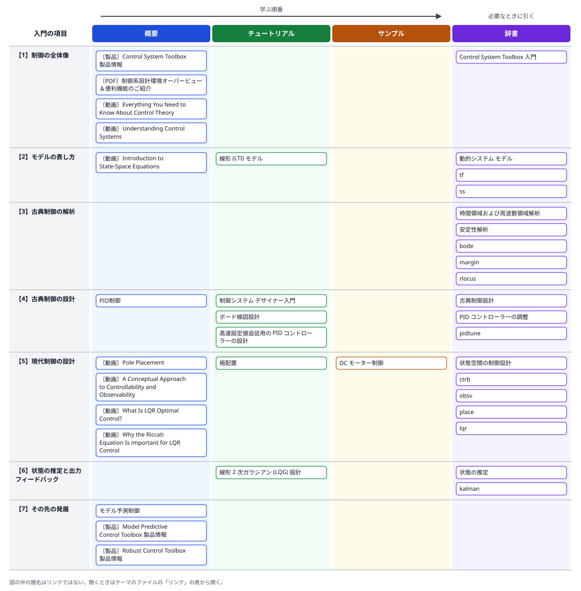

# 04 古典制御と現代制御でできること

- 確認日: 2026-10-11
- 調査時点の最新リリース: R2026b
- 日本語版のページの表示: R2026aのものが多い（ページにより英語版より古く、各ページに英語版へのリンクがある）
- 詳細解説: [04a 現代制御の数学（固有値・可制御性・極配置・LQR・オブザーバー）](../guides/04a-modern-control-math.md)

## 概要

### はじめに

モーターの回転数を一定に保つ、部屋の温度を設定値に近づける、車の速度を保つ。こうした「目標に合わせて動かす」仕組みの多くは、測った結果を目標と比べ、そのずれに応じて操作を変える**フィードバック制御**でできている。フィードバックを使うと、外からの乱れ（**外乱**）や、制御する対象（**プラント**）の性質のばらつきがあっても、目標に近づけられる。その一方で、強く効かせすぎると振動したり、発散して不安定になったりする。どのくらい効かせれば速く・安定に動くかを、数式のモデルを使って決めるのが制御設計である。

制御設計の考え方は、大きく2つの流れに分けて教えられることが多い。

**古典制御**は、プラントを**伝達関数**（初期値をゼロとしたときの、出力と入力のラプラス変換の比。連続時間ではラプラス変換の変数 s の分数式になる）で表し、主に1入力1出力（**SISO**）の系を扱う。いろいろな周波数の正弦波を入れたときの出力の大きさと位相のずれ（**周波数応答**）をボード線図で見て、不安定になるまでの余裕（**ゲイン余裕・位相余裕**）を確かめながら、PID制御器や位相進み・遅れの補償器を調整する。図の上で設計できて直感的で、実機の調整とも結び付けやすい。

**現代制御**は、プラントを**状態空間モデル**（行列 A・B・C・D を使い、内部の状態 x の時間変化を1階の連立微分方程式で、出力を状態と入力の式で表したもの）で表す。多入力多出力（**MIMO**）の系をそのまま扱え、全部の状態を使ったフィードバック（**状態フィードバック**）で、閉ループの**極**（応答の速さと減衰を決める値）を指定の位置に置いたり（**極配置**）、状態と操作量のそれぞれの2乗に重みを付けて足し、時間で積分した評価関数を最小にしたり（**LQR**、最適制御）できる。状態を全部は測れないときは、測れる出力から状態を推定する**オブザーバー**や**カルマンフィルター**を組み合わせる（LQRとカルマンフィルターの組み合わせが**LQG**）。ただし、状態フィードバックで閉ループの極を自由な位置に置くには、入力を操作して、どの状態からでも望みの状態へ移せること（**可制御性**）が要る。同じように、オブザーバーの極を自由な位置に置くには、出力の観測から状態が分かること（**可観測性**）が要る。

2つは対立するものではない。同じ線形のモデルを別の見方で扱うもので、MATLABのControl System Toolboxでは、伝達関数のモデルと状態空間のモデルを相互に変換でき、どちらの設計の道具も同じモデルに使える。ただし、状態空間から伝達関数に変換すると、入力で動かせない・出力に現れない内部の動き（可制御でない・可観測でないモード）は見えなくなる。現代制御の考え方は、モデルの不確かさを考えるロバスト制御や、制約を考えながら未来の応答を予測して操作を決めるモデル予測制御（MPC）へと発展している。

入門の内容は、次の7つの項目に分けられる。番号は、下の関連図の行と同じである。

- 【1】**制御の全体像**: フィードバック制御の考え方、開ループとの違い、制御の手法の種類。
- 【2】**モデルの表し方**: 伝達関数（`tf`）と状態空間（`ss`）のモデルの作り方と、相互の変換。
- 【3】**古典制御の解析**: ステップ応答などの時間応答、ボード線図などの周波数応答、ゲイン余裕・位相余裕、極と零点、根軌跡。
- 【4】**古典制御の設計**: PID制御器の調整（PID Tuner、`pidtune`）と、ボード線図・根軌跡を見ながらの補償器の設計（Control System Designer）。
- 【5】**現代制御の設計**: 可制御性・可観測性の確認、極配置（`place`）、LQR（`lqr`）。
- 【6】**状態の推定と出力フィードバック**: オブザーバー、カルマンフィルター（`kalman`）、LQG。
- 【7】**その先の発展**: ロバスト制御（Robust Control Toolbox）とモデル予測制御（Model Predictive Control Toolbox）。

### 入門の内容とリンクの関連図

図の行は上の【1】〜【7】、列はREADMEの「[用途の分類](../README.md#用途の分類)」の4つである。左から右へ、概要→チュートリアル→サンプルの順に読み、辞書は必要なときに引く。題名の前の〔ブログ〕〔動画〕等は、リンクの種類（何も付いていないものはドキュメント）を示す。図の中の題名はリンクではないので、開くときは下の「リンク」の表から開く。

### 古典制御と現代制御の比較

| 観点 | 古典制御 | 現代制御 |
|---|---|---|
| モデル | 伝達関数（`tf`・`zpk`）、周波数応答のデータ（`frd`） | 状態空間（`ss`） |
| 主な対象 | 1入力1出力（SISO） | 多入力多出力（MIMO）もそのまま扱える |
| 設計の手がかり | 周波数応答（ボード線図）、ゲイン余裕・位相余裕、根軌跡 | 閉ループの極の位置、評価関数の重み（LQRの Q と R） |
| 主な制御器 | PID、位相進み・遅れの補償器 | 状態フィードバック（極配置・LQR）、オブザーバー・カルマンフィルターとの組み合わせ（LQG） |
| 前提 | 入出力の関係（伝達関数）が分かればよい。周波数領域の設計は、実測した周波数応答のデータ（`frd`）からもできる | 状態空間のモデルが要る。極を自由に置くには可制御性、オブザーバーの極を自由に置くには可観測性が要る |
| 主な関数・アプリ | `bode`・`margin`・`rlocus`・`pidtune`、PID Tuner、Control System Designer | `ctrb`・`obsv`・`place`・`lqr`・`kalman`・`lqg` |

どちらもControl System Toolboxの機能で、対象は線形のモデルである。極配置のページは、根軌跡がSISOの系で補償器のゲインを動かして閉ループの極を移すのに対し、状態空間による極配置はMIMOの系にも使え、動的な補償器も設計できる、と説明している。また、極の位置の選び方として、複数の極を同じ位置に置くことと、可制御性・可観測性の弱い極を動かすことを避けるよう注意している。後者は一般に高いゲインを要し、外乱に非常に敏感な閉ループになるためである。モデルの表し方については、状態空間の表現が数値計算に最適で、精度のためには、モデルを組み合わせる前に状態空間に変換し、伝達関数や零点・極・ゲインの形はモデルを書き表すときとその確認のときにだけ使うよう、説明されている。

## 読む順番の目安

1. 動画「Everything You Need to Know About Control Theory」と「Understanding Control Systems」のシリーズで、フィードバック制御の考え方と手法の全体像をつかむ
2. 「線形 (LTI) モデル」で、伝達関数と状態空間のモデルの作り方と変換を知る
3. 古典制御は、「高速設定値追従用の PID コントローラーの設計」でPIDの調整を、「制御システム デザイナー入門」と「ボード線図設計」で補償器の設計を試す
4. 現代制御は、動画のシリーズ「State Space」（第1〜5部）で直感をつかみ、「極配置」と「線形 2 次ガウシアン (LQG) 設計」を読む
5. 例題「DC モーター制御」で、古典制御（積分のフィードバック、根軌跡でゲインを選ぶ）と現代制御（LQR）の結果を比べる
6. 制約やモデルの不確かさを扱う必要が出てきたら、モデル予測制御とロバスト制御の製品のページへ進む

## リンク

「用途」の列は、学ぶ順番に沿った使い方（概要／チュートリアル／サンプル／辞書）を示す。分類の基準はREADMEの「[用途の分類](../README.md#用途の分類)」を参照。

### ドキュメント（全体像とモデル）

| リンク | 用途 | 説明 | 製品・リリース |
|---|---|---|---|
| [Control System Toolbox 入門](https://jp.mathworks.com/help/control/getting-started-with-control-system-toolbox.html) | 辞書 | カテゴリのページ。モデル・解析・設計の入門の解説と例題の一覧 | Control System Toolbox |
| [線形 (LTI) モデル](https://jp.mathworks.com/help/control/getstart/linear-lti-models.html) | チュートリアル | 伝達関数・零点極ゲイン・状態空間・周波数応答データの4種類のモデルの作り方と、相互の変換。精度のために、モデルを組み合わせる前に状態空間へ変換するよう勧めている | Control System Toolbox |
| [動的システム モデル](https://jp.mathworks.com/help/control/dynamic-system-models.html) | 辞書 | カテゴリのページ。モデルの表現・相互接続（直列・並列・フィードバック）・変換・低次元化 | Control System Toolbox |
| [tf](https://jp.mathworks.com/help/control/ref/tf.html) | 辞書 | 伝達関数のモデルを作る。ほかのモデルを伝達関数に変換する | Control System Toolbox |
| [ss](https://jp.mathworks.com/help/control/ref/ss.html) | 辞書 | 状態空間のモデルを作る。ほかのモデルを状態空間に変換する | Control System Toolbox |

### ドキュメント（古典制御の解析）

| リンク | 用途 | 説明 | 製品・リリース |
|---|---|---|---|
| [時間領域および周波数領域解析](https://jp.mathworks.com/help/control/response-plots-and-data.html) | 辞書 | カテゴリのページ。ステップ応答・ボード線図・ナイキスト線図等の関数と解説の一覧 | Control System Toolbox |
| [安定性解析](https://jp.mathworks.com/help/control/stability-margins.html) | 辞書 | カテゴリのページ。極・零点、ゲイン余裕・位相余裕、根軌跡の関数の一覧 | Control System Toolbox |
| [bode](https://jp.mathworks.com/help/control/ref/dynamicsystem.bode.html) | 辞書 | 周波数応答（ゲインと位相）を計算し、ボード線図を描く | Control System Toolbox |
| [margin](https://jp.mathworks.com/help/control/ref/dynamicsystem.margin.html) | 辞書 | ゲイン余裕・位相余裕と、交差周波数を求める | Control System Toolbox |
| [rlocus](https://jp.mathworks.com/help/control/ref/dynamicsystem.rlocus.html) | 辞書 | ゲインを変えたときの閉ループの極の軌跡（根軌跡）を描く | Control System Toolbox |

### ドキュメント（古典制御の設計）

| リンク | 用途 | 説明 | 製品・リリース |
|---|---|---|---|
| [古典制御設計](https://jp.mathworks.com/help/control/single-input-single-output-control-design.html) | 辞書 | カテゴリのページ。SISOのフィードバック系の設計（根軌跡・ボード線図・ニコルス線図による設計、多重ループ）の解説と例題の一覧 | Control System Toolbox |
| [制御システム デザイナー入門](https://jp.mathworks.com/help/control/ug/getting-started-with-the-control-system-designer.html) | チュートリアル | 1次のプラントに対し、ステップ応答の要求を設定して、根軌跡とボード線図のエディターで補償器を手で調整し、自動調整も試す | Control System Toolbox |
| [ボード線図設計](https://jp.mathworks.com/help/control/ug/bode-diagram-design.html) | チュートリアル | DCモーターに対し、ボード線図のエディターで交差周波数を上げ、積分と位相進みを加えて、ゲイン余裕・位相余裕などの要求を満たす | Control System Toolbox |
| [PID コントローラーの調整](https://jp.mathworks.com/help/control/pid-controller-design.html) | 辞書 | カテゴリのページ。PID Tuner・`pidtune`による調整、測定データからの調整、2自由度PID、Simulinkでの調整の解説と例題の一覧 | Control System Toolbox |
| [高速設定値追従用の PID コントローラーの設計](https://jp.mathworks.com/help/control/getstart/pid-controller-design-for-fast-reference-tracking.html) | チュートリアル | 3次のプラントに対し、PID Tunerで立ち上がり時間と整定時間の要求を満たすまで調整する。PIではうまくいかず、微分を加えて満たす流れ | Control System Toolbox |
| [pidtune](https://jp.mathworks.com/help/control/ref/dynamicsystem.pidtune.html) | 辞書 | プラントのモデルからPID制御器のゲインを自動で調整する | Control System Toolbox、R2010b以降 |

### ドキュメント（現代制御の設計と状態の推定）

| リンク | 用途 | 説明 | 製品・リリース |
|---|---|---|---|
| [状態空間の制御設計](https://jp.mathworks.com/help/control/state-space-control-design-1.html) | 辞書 | カテゴリのページ。LQR・LQGと極配置の関数、解説、例題の一覧 | Control System Toolbox |
| [極配置](https://jp.mathworks.com/help/control/getstart/pole-placement.html) | チュートリアル | 状態フィードバックのゲインと、状態を推定するオブザーバーのゲインを`place`で求め、`reg`で出力フィードバックの補償器にまとめる。極の選び方の注意もある | Control System Toolbox |
| [ctrb](https://jp.mathworks.com/help/control/ref/statespacemodel.ctrb.html) | 辞書 | 可制御行列を求める。階数で可制御性を確かめる | Control System Toolbox |
| [obsv](https://jp.mathworks.com/help/control/ref/statespacemodel.obsv.html) | 辞書 | 可観測行列を求める。階数で可観測性を確かめる | Control System Toolbox |
| [place](https://jp.mathworks.com/help/control/ref/place.html) | 辞書 | 指定した位置に閉ループの極を置く状態フィードバックのゲインを求める | Control System Toolbox |
| [lqr](https://jp.mathworks.com/help/control/ref/lti.lqr.html) | 辞書 | 状態と入力の2乗に重み（Q・R）を付けて時間で積分した評価関数を最小にする、状態フィードバックのゲインを求める | Control System Toolbox |
| [DC モーター制御](https://jp.mathworks.com/help/control/ug/dc-motor-control.html) | サンプル | 例題。同じDCモーターに、フィードフォワード、積分のフィードバック（根軌跡でゲインを選ぶ）、LQRの3つを設計し、目標への追従と負荷の外乱への強さを比べる | Control System Toolbox |
| [状態の推定](https://jp.mathworks.com/help/control/state-estimation.html) | 辞書 | カテゴリのページ。カルマンフィルターの設計（`kalman`）と、非線形の系のオンラインの状態推定（拡張・アンセンテッドカルマンフィルター等）の関数の一覧 | Control System Toolbox |
| [kalman](https://jp.mathworks.com/help/control/ref/ss.kalman.html) | 辞書 | 雑音の共分散から、状態を推定するカルマンフィルターを設計する | Control System Toolbox |
| [線形 2 次ガウシアン (LQG) 設計](https://jp.mathworks.com/help/control/getstart/linear-quadratic-gaussian-lqg-design.html) | チュートリアル | `lqr`の状態フィードバックと`kalman`の状態推定を組み合わせてLQGの制御器を作る考え方と手順（`lqgreg`・`lqg`） | Control System Toolbox |

### ドキュメント（用語の解説）

| リンク | 用途 | 説明 | 製品・リリース |
|---|---|---|---|
| [PID制御](https://jp.mathworks.com/discovery/pid-control.html) | 概要 | 用語の解説ページ。比例・積分・微分のそれぞれの働きと副作用、ゲインの調整法（限界感度法等）、設計から実装までの流れ | — |
| [モデル予測制御](https://jp.mathworks.com/discovery/model-predictive-control.html) | 概要 | 用語の解説ページ。内部のモデルで未来の応答を予測し、各時刻で最適化を解いて操作を決める。アクチュエーターの上下限などの制約を扱える | — |

### 製品・ソリューションのページ

| リンク | 用途 | 説明 | 製品・リリース |
|---|---|---|---|
| [Control System Toolbox 製品情報](https://jp.mathworks.com/products/control.html) | 概要 | 線形の制御系の解析・設計・調整。PIDほかSISO・MIMOの制御器、状態空間による設計、ゲインスケジューリング | Control System Toolbox |
| [Model Predictive Control Toolbox 製品情報](https://jp.mathworks.com/products/model-predictive-control.html) | 概要 | 線形・非線形の系のモデル予測制御の設計とシミュレーション、コード生成 | Model Predictive Control Toolbox |
| [Robust Control Toolbox 製品情報](https://jp.mathworks.com/products/robust.html) | 概要 | モデルの不確かさがあっても安定性と性能を保つ制御器を、H∞法やμ設計法で設計・解析する | Robust Control Toolbox |

### 講演資料（PDF）

| リンク | 用途 | 説明 | 製品・リリース |
|---|---|---|---|
| [制御系設計環境オーバービュー＆便利機能のご紹介（PDF）](https://www.mathworks.com/content/dam/mathworks/mathworks-dot-com/images/events/matlabexpo/jp/2016/b4-control-system-design-overview.pdf) | 概要 | 日本語。MATLAB EXPO 2016 JapanのMathWorksの講演資料。MATLAB・Simulinkでの制御系設計の環境の紹介（古い資料） | Control System Toolbox ほか |

### 動画

| リンク | 用途 | 説明 | 製品・リリース |
|---|---|---|---|
| [Everything You Need to Know About Control Theory](https://www.mathworks.com/videos/everything-you-need-to-know-about-control-theory-1664864151410.html) | 概要 | 英語、約16分（2022年）。開ループとフィードバック、PID・ロバスト・適応・最適・予測・学習による制御、状態推定まで、制御の全体像の紹介 | — |
| [Understanding Control Systems](https://www.mathworks.com/videos/series/understanding-control-systems-123420.html) | 概要 | 英語、6本のシリーズ。開ループとフィードバックの違い、フィードバック系の構成要素、外乱の抑制と変動へのロバスト性をSimulinkで試す | Simulink |
| [Introduction to State-Space Equations](https://www.mathworks.com/videos/introduction-to-state-space-equations-1547129824178.html) | 概要 | 英語、約14分（2019年）。シリーズ「State Space」の第1部。状態変数と状態方程式の考え方を、ばね・質量・ダンパーの例で直感的に説明する | — |
| [Pole Placement](https://www.mathworks.com/videos/state-space-part-2-pole-placement-1547198830727.html) | 概要 | 英語、約15分（2019年）。第2部。状態フィードバックで極を動かして系を安定にする考え方と、MATLABでの実演 | Control System Toolbox |
| [A Conceptual Approach to Controllability and Observability](https://www.mathworks.com/videos/state-space-part-3-a-conceptual-approach-to-controllability-and-observability-1548327460100.html) | 概要 | 英語、約13分（2019年）。第3部。可制御性と可観測性を、行列の計算でなく身近な例で説明する | — |
| [What Is LQR Optimal Control?](https://www.mathworks.com/videos/state-space-part-4-what-is-lqr-control-1551955957637.html) | 概要 | 英語、約17分（2019年）。第4部。極配置と同じ状態フィードバックの形で、性能（Q）と操作量（R）の兼ね合いからゲインを決めるLQRの考え方と、MATLABでの調整 | Control System Toolbox |
| [Why the Riccati Equation Is important for LQR Control](https://www.mathworks.com/videos/why-the-riccati-equation-is-important-for-lqr-control-1689235310468.html) | 概要 | 英語、約14分。第5部。LQRのゲインを求めるときに解くリカッチ方程式の役割 | — |

## 補足

- このテーマは、線形の制御（Control System Toolbox）を中心に整理した。非線形のプラントを扱う場合の線形化（Simulink Control Design）や、ロバスト制御・モデル予測制御の設計の詳細は、製品のページの紹介にとどめた。
- 関数のリファレンスの`ctrb`・`obsv`は、`ss.ctrb.html`・`ctrb.html`の形のURLは404で、`statespacemodel.ctrb.html`の形が正しかった。
- 講演資料（PDF）の本文は読んでおらず、説明は検索結果に出た資料の題名とURLから書いた。
- 「State Space」の第5部の動画は、シリーズのページに載っていた題名・長さ・URLで載せた（公開年は確かめていない）。
- 日本語の動画: 「MATLAB Japan」チャンネルの、このテーマを主題にした動画は、今回は調べていない。
- 大学等が公開している制御のチュートリアル（MATLABを使うもの）は、READMEの「情報源の範囲」に従い、MathWorksのドメインでないため載せていない。
