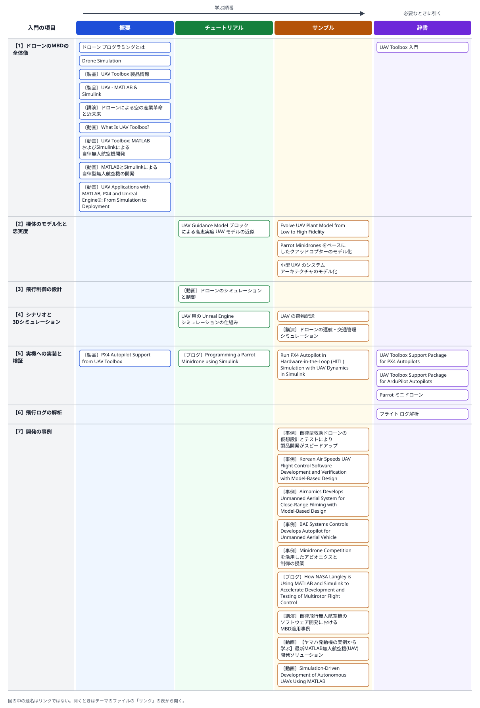

# 05 モデルベース開発によるドローンの開発基盤と事例

- 確認日: 2026-10-30
- 調査時点の最新リリース: R2026b
- 日本語版のページの表示: R2026aのものが多い（R2026bを表示していたページもある。UAV Toolboxの例題には、日本語サイト上でも本文が英語のものが多い）

## 概要

### はじめに

ドローン（UAV、無人航空機）の開発は、実機で試すと墜落による機体の損失や周りへの危険を伴い、天候や場所の制約で試験の回数も限られる。そのため、機体とその周りをモデルにして、まずパソコンの上で飛ばして確かめ、確かめたモデルから実機のソフトウェアを作る**モデルベース開発（MBD）**が広く使われている。MathWorksの資料では、ドローンのシミュレーションは主に次の要素の組み合わせとして説明されている。

- **プラントモデル**: 機体の動き（運動方程式）を表すモデル。モーターやバッテリーなどの動力系を含めることもある
- **飛行制御モデル**: 姿勢・位置を目標に合わせる制御（PID等）と、飛行の段階を切り替える論理
- **センサーモデル**: IMU（加速度・角速度のセンサー）・GPS・気圧計・カメラ・LiDAR等の出力を模擬する
- **自律のアルゴリズム**: 周りの認識、経路の計画、障害物の回避
- **シミュレーション環境**: 簡単な直方体の世界から、Unreal Engineによる写実的な3Dの世界まで

モデルの細かさ（**忠実度**）は、開発の段階に合わせて上げていく。初めは速く動く簡単なモデルで経路計画や制御の方針を試し、後から6自由度の運動方程式やセンサー・アクチュエーターの遅れを含む細かいモデルで確かめる。

検証は、モデルだけで閉ループを回す**MIL**（Model-in-the-Loop）、生成したコードをパソコンの上で動かす**SIL**（Software-in-the-Loop。PX4・ArduPilotでは、オートパイロットのソフトウェアをパソコンで動かす**SITL**の形をとる）、実際のフライトコントローラーのボードを、パソコンの上のプラントモデルとつないで動かす**HIL**（Hardware-in-the-Loop。PX4では**HITL**と書く）の順に実機へ近づけ、最後に飛行試験に進む。飛行試験で記録したログをモデルと比べ、モデルを直して次の設計に生かす。

ドローン向けの小型のフライトコントローラーには、オープンソースのオートパイロット（**PX4**、**ArduPilot**）を載せたボード（**Pixhawk**等）が多く使われている（著者の見立て）。MathWorksは、これらのボードに向けて、Simulinkのモデルからコードを生成して書き込むサポートパッケージを用意している。地上の管制ソフト（QGroundControl・Mission Planner）との通信には**MAVLink**というプロトコルが使われる。

入門の内容は、次の7つの項目に分けられる。番号は、下の関連図の行と同じである。

- 【1】**ドローンのMBDの全体像**: 製品の構成、開発の流れ（モデル化 → シミュレーション → 実機への実装 → 飛行試験 → ログの解析）。
- 【2】**機体のモデル化と忠実度**: UAV Guidance Modelブロック（低忠実度）から6自由度のモデル（高忠実度）への移り方、クアッドコプターのモデル。
- 【3】**飛行制御の設計**: ホバリングの考え方、姿勢・位置のPID制御、内側と外側のループ。
- 【4】**シナリオと3Dシミュレーション**: UAVシナリオ、センサーモデル、Unreal Engineとの協調シミュレーション、荷物配送の参照例。
- 【5】**実機への実装と検証**: PX4・ArduPilot・Parrotミニドローンのサポートパッケージ、コード生成、SITL・HITL。
- 【6】**飛行ログの解析**: フライトログアナライザー、ログの再生によるモデルの検証。
- 【7】**開発の事例**: 企業・研究機関・大学がMBDでドローンを開発した事例。

### 入門の内容とリンクの関連図

図の行は上の【1】〜【7】、列はREADMEの「[用途の分類](../README.md#用途の分類)」の4つである。左から右へ、概要→チュートリアル→サンプルの順に読み、辞書は必要なときに引く。題名の前の〔ブログ〕〔動画〕等は、リンクの種類（何も付いていないものはドキュメント）を示す。図の中の題名はリンクではないので、開くときは下の「リンク」の表から開く。

### 開発の流れと主な製品

次の図と表は、上の「はじめに」の流れと、各段階で使う主な製品を、このリンク集の項目の番号と合わせて示したものである（著者の整理）。表の「主な製品・機能」の列は、各段階の例題・製品のページに出てくるものから著者が選んだもので、公式の分類ではない。「補足」の列は、各例題・ページの記述である。

| 段階 | 主な製品・機能 | 補足 |
|---|---|---|
| アーキテクチャと要件 | System Composer、Requirements Toolbox | 例題「小型 UAV のシステム アーキテクチャのモデル化」は、要件とコンポーネントをつなぎ、質量を積み上げて機体全体の重さを求める |
| 機体のモデル化 | UAV Toolbox（UAV Guidance Modelブロック、Fixed-Wing UAV Point Massブロック）、Aerospace Blockset（6自由度の運動方程式、Multirotorブロック）、Simscape（動力系） | 忠実度の低いモデルから高いモデルへ、段階的に置き換える例題がある |
| 飛行制御の設計 | Simulink、Stateflow、Control System Toolbox、Simulink Control Design | クアッドコプターの例題は、位置と姿勢をPIDで制御し、相補フィルターとカルマンフィルターで状態を推定する |
| シナリオと3Dシミュレーション | UAV Toolbox（`uavScenario`、センサーモデル）、Simulink 3D Animation（Unreal Engineとの協調シミュレーションに必要） | Simulinkと3Dのエンジンは、固定の時間刻みで交互に進むロックステップで同期する |
| 実機への実装 | Embedded Coder、UAV Toolbox Support Package for PX4 Autopilots／for ArduPilot Autopilots、Simulink Support Package for Parrot Minidrones | PX4はSITL（PX4 Host Target）とHITLに、ArduPilotはSITLに対応する（各ページの記述） |
| 飛行ログの解析 | UAV Toolbox（フライトログアナライザー、`ulogreader`・`mavlinktlog`・`ardupilotreader`） | TLOG・ULOG・ArduPilotのログ・独自の形式を読める |

### 事例の比較

各社の事例のページに書かれている内容を、著者が表にまとめた。国名は、取得したページの内容で確かめられたもの（AVILUSのドイツ）だけを書いた。成果の数値は、いずれもMathWorksのページに書かれた各社の申告で、第三者による検証ではない。

| 事例 | 機体 | MBDの範囲と主な製品 | ページに書かれた成果 |
|---|---|---|---|
| AVILUS（ドイツ） | 救助用の垂直離着陸型の機体（6つの同軸ローター） | System Composerでアーキテクチャ、Simscapeで電動の動力系、Simulinkで飛行制御のMIL、Embedded CoderでCコード、合成したセンサーデータでHIL、繋留飛行から自由飛行へ | 実機の試験で必要な追加の検証が5〜10%で済んだ。2機目の開発期間は1機目の約5分の1と予想 |
| Korean Air | UAVの飛行制御ソフトウェア | Aerospace Blocksetで機体、System Identification Toolboxでパラメーター推定、Robust Control Toolboxで制御則、Simulink Check・Simulink Coverageで規約とMC/DC、Embedded Coder、Polyspace Code Prover、Simulink Real-TimeでHIL | 開発の工数60%減、自動操縦の検証に要る飛行試験が約3分の1。機体は韓国政府の耐空証明を得た |
| Airnamics | 近距離撮影用のUAS「R5」（8つのモーター） | Aerospace Blocksetで機体・センサー、拡張カルマンフィルター、センサー・モーターの故障や突風を含むシミュレーション、Simulink Coderで搭載PC向けのコード、Simulink Real-Time | 初飛行の前に制御ソフトウェアの不具合の95%以上を発見。デバッグが数週間から数時間に |
| BAE Systems Controls | 固定翼のUAV「Eagle 150」 | 既存の自動操縦のモデルを再利用、Simulink・Stateflowで6自由度の非線形モデルを含めてモデル化、Simulink Coderでコードと設計文書を生成、HILと飛行試験を繰り返す | 約8か月で飛行試験まで。設計・試験の費用を50%削減 |
| NASA Langley〔ブログ〕 | マルチコプター（将来のVTOL機に向けた手順の確立） | Simulinkでプラントと制御、デスクトップのシミュレーション、ベンチ試験とHIL、Embedded CoderとPX4のサポートパッケージでCube Orange・Cube Blueへ | 2023年8月に自由飛行に成功。新しい制御器を数分で書き込んで試せるようになった |

日本の企業・研究機関の事例は、MATLAB EXPO Japanの講演資料（SUBARU、JAXA、ヤマハ発動機の講演の録画）として公開されている（下の「講演資料（PDF）」「動画」）。

## 読む順番の目安

1. 用語の解説「ドローン プログラミングとは」と「Drone Simulation」で、ドローンの開発の要素と流れをつかむ
2. 動画「UAV Toolbox: MATLABおよびSimulinkによる自律無人航空機開発」（日本語）または「What Is UAV Toolbox?」で、製品でできることを知る
3. 動画のシリーズ「ドローンのシミュレーションと制御」で、ホバリングから飛行制御のコードとモデルの作り方までの考え方を学ぶ
4. 例題「Parrot Minidrones をベースにしたクアッドコプターのモデル化」で、Simulinkのクアッドコプターのモデルを動かしてみる
5. 例題「UAV Guidance Model ブロックによる高忠実度 UAV モデルの近似」と「Evolve UAV Plant Model from Low to High Fidelity」で、忠実度の上げ方を知る
6. 参照例「UAV の荷物配送」で、シナリオ・センサー・3Dシミュレーション・地上局との通信を含む全体を見る
7. 実機に進むときは、PX4またはArduPilotのサポートパッケージの入門と、HITLの例題を読む
8. 事例（AVILUS、Korean Air等）と講演資料で、実際の開発での使い方と効果を知る

## リンク

「用途」の列は、学ぶ順番に沿った使い方（概要／チュートリアル／サンプル／辞書）を示す。分類の基準はREADMEの「[用途の分類](../README.md#用途の分類)」を参照。

### ドキュメント（全体像と機体のモデル化）

| リンク | 用途 | 説明 | 製品・リリース |
|---|---|---|---|
| [UAV Toolbox 入門](https://jp.mathworks.com/help/uav/getstarted.html) | 辞書 | カテゴリのページ。フライトログ・UAVシナリオ・忠実度・座標系のチュートリアルと、注目の例題の一覧 | UAV Toolbox |
| [UAV Guidance Model ブロックによる高忠実度 UAV モデルの近似](https://jp.mathworks.com/help/uav/ug/approximate-high-fidelity-uav-model-with-guidance-model.html) | チュートリアル | 固定翼の高忠実度のモデルを、低忠実度のUAV Guidance Modelブロックで近似する。ステップ応答を比べてゲインを合わせ、低忠実度のモデルでウェイポイント追従を試してから高忠実度のモデルで確かめる | UAV Toolbox、Aerospace Blockset ほか |
| [Evolve UAV Plant Model from Low to High Fidelity](https://jp.mathworks.com/help/uav/ug/transition-from-low-to-high-fidelity-uav-models.html) | サンプル | 英語。固定翼のプラントを、Guidance Model（低）→ Fixed-Wing UAV Point Mass（中）→ 6自由度とセンサー・アクチュエーター・内側ループの制御（高）の3段階で置き換える | UAV Toolbox、Aerospace Blockset、Control System Toolbox |
| [Parrot Minidrones をベースにしたクアッドコプターのモデル化](https://jp.mathworks.com/help/aeroblks/quadcopter-project.html) | サンプル | Simulinkプロジェクト（`asbQuadcopter`）のクアッドコプターのモデル。機体・制御・センサー・3D表示を含み、Parrotミニドローンの実機への展開にもつながる | Aerospace Blockset、Simulink 3D Animation ほか |
| [小型 UAV のシステム アーキテクチャのモデル化](https://jp.mathworks.com/help/slrequirements/ug/smalluav.html) | サンプル | System Composerで小型UAVのアーキテクチャを作り、要件をコンポーネントにリンクし、質量を積み上げて機体全体の重さを求める | System Composer、Requirements Toolbox |

### ドキュメント（シナリオと3Dシミュレーション）

| リンク | 用途 | 説明 | 製品・リリース |
|---|---|---|---|
| [UAV 用の Unreal Engine シミュレーションの仕組み](https://jp.mathworks.com/help/uav/ug/how-3d-simulation-for-uav-works.html) | チュートリアル | SimulinkとUnreal Engineがロックステップで同期する仕組み、ブロックの実行順序、シミュレーションの速さ | UAV Toolbox、Simulink 3D Animation |
| [UAV の荷物配送](https://jp.mathworks.com/help/uav/ug/uav-package-delivery.html) | サンプル | 参照例。市街地で小型マルチコプターが離陸・飛行・着陸する。QGroundControlとMAVLinkでつなぎ、LiDARで障害物を避け、写実的な3D環境・6自由度のモデルへ段階的に切り替える | UAV Toolbox、Aerospace Blockset、Navigation Toolbox、Simulink 3D Animation ほか |

### ドキュメント（実機への実装と飛行ログ）

| リンク | 用途 | 説明 | 製品・リリース |
|---|---|---|---|
| [UAV Toolbox Support Package for PX4 Autopilots](https://jp.mathworks.com/help/uav/px4-spkg.html) | 辞書 | カテゴリのページ。PX4のボードの周辺装置にアクセスし、Embedded Coderで飛行制御のアルゴリズムを生成・書き込む。設定、展開、PILによる検証 | UAV Toolbox、Embedded Coder |
| [Run PX4 Autopilot in Hardware-in-the-Loop (HITL) Simulation with UAV Dynamics in Simulink](https://jp.mathworks.com/help/uav/px4/ref/hitl-simulink-plant-example.html) | サンプル | 英語。Pixhawk 6xで生成した制御器を動かし、パソコンのSimulinkでクアッドコプターの運動とセンサーを模擬して、MAVLinkでつなぐHITL | UAV Toolbox、Support Package for PX4、Aerospace Blockset、Embedded Coder ほか |
| [UAV Toolbox Support Package for ArduPilot Autopilots](https://jp.mathworks.com/help/uav/ardupilot-spkg.html) | 辞書 | カテゴリのページ。ArduCopter・ArduPlaneに向けて、Simulinkで設計した制御を生成してArduPilotに組み込む。ArduPilotのSITLでの試験に対応 | UAV Toolbox、Embedded Coder |
| [Parrot ミニドローン](https://jp.mathworks.com/help/simulink/supportpkg-parrot.html) | 辞書 | カテゴリのページ。Parrotミニドローンの飛行制御を設計・シミュレーション・展開するサポートパッケージ | Simulink Support Package for Parrot Minidrones |
| [フライト ログ解析](https://jp.mathworks.com/help/uav/flight-log-analysis.html) | 辞書 | カテゴリのページ。TLOG・ULOG・ArduPilotのログ等の読み込みと解析、フライトログアナライザー、ログの再生によるマルチローターのモデルの検証の例題 | UAV Toolbox（`ardupilotreader`はR2024a以降） |

### ドキュメント（用語の解説）

| リンク | 用途 | 説明 | 製品・リリース |
|---|---|---|---|
| [ドローン プログラミングとは](https://jp.mathworks.com/discovery/drone-programming.html) | 概要 | 用語の解説ページ。飛行制御・自律・データ解析の3つの目的と、プラント・航法・計画・制御に分けた設計 → シミュレーション → 実装の流れ、関連する製品とハードウェア | — |
| [Drone Simulation](https://jp.mathworks.com/discovery/drone-simulation.html) | 概要 | 英語。用語の解説ページ。低忠実度と高忠実度のシミュレーションの使い分けと、プラント・飛行制御・センサー・自律・環境の各要素 | — |

### 製品・ソリューションのページ

| リンク | 用途 | 説明 | 製品・リリース |
|---|---|---|---|
| [UAV Toolbox 製品情報](https://jp.mathworks.com/products/uav.html) | 概要 | 飛行制御器の設計、UAVシナリオとセンサーのシミュレーション、PX4・PixhawkでのHIL、コード生成、フライトログの解析、MAVLinkでの通信 | UAV Toolbox |
| [UAV - MATLAB & Simulink](https://jp.mathworks.com/solutions/robotics/uav.html) | 概要 | ソリューションのページ。アーキテクチャ、飛行制御、認識と位置推定、モーションプランニング、シミュレーションによる試験、実装の6つの観点で製品・例題・事例を紹介 | UAV Toolbox ほか |
| [PX4 Autopilot Support from UAV Toolbox](https://jp.mathworks.com/hardware-support/px4-autopilots.html) | 概要 | 英語。ハードウェアサポートのページ。対応ボード、センサー・周辺装置のブロック、uORB、ログ、Monitor and Tune、SITL（PX4 Host Target）とHITL | UAV Toolbox、Embedded Coder |

### ユーザー事例・技術記事

| リンク | 用途 | 説明 | 製品・リリース |
|---|---|---|---|
| [自律型救助ドローンの仮想設計とテストにより製品開発がスピードアップ](https://jp.mathworks.com/company/mathworks-stories/virtual-design-and-testing-of-an-autonomous-rescue-drone-speeds-up-product-development.html) | サンプル | 日本語（機械翻訳）。AVILUSの救助用の垂直離着陸型の機体。アーキテクチャ・動力系・飛行制御のモデル、MIL、コード生成、HIL、繋留飛行から自由飛行へ | System Composer、Simscape、Embedded Coder ほか |
| [Korean Air Speeds UAV Flight Control Software Development and Verification with Model-Based Design](https://jp.mathworks.com/company/user_stories/korean-air-speeds-uav-flight-control-software-development-and-verification-with-model-based-design.html) | サンプル | 英語。UAVの飛行制御ソフトウェアを、モデル化・規約の確認・MC/DCカバレッジ・コード生成・静的解析・HILで開発し、認証機関に報告書を出した | Embedded Coder、Simulink Coverage、Polyspace Code Prover ほか |
| [Airnamics Develops Unmanned Aerial System for Close-Range Filming with Model-Based Design](https://jp.mathworks.com/company/user_stories/airnamics-develops-unmanned-aerial-system-for-close-range-filming-with-model-based-design.html) | サンプル | 英語。3人のチームが手書きのCコードからMBDに移り、故障や突風を含むシミュレーションで不具合を初飛行の前に見つけた | Aerospace Blockset、Simulink Coder、Simulink Real-Time ほか |
| [BAE Systems Controls Develops Autopilot for Unmanned Aerial Vehicle](https://jp.mathworks.com/company/user_stories/bae-systems-controls-develops-autopilot-for-unmanned-aerial-vehicle.html) | サンプル | 英語。固定翼のUAVの自動操縦を、既存のモデルの再利用とコード生成で約8か月で飛行試験まで進めた（古い事例） | Simulink、Stateflow、Simulink Coder |
| [Minidrone Competition を活用したアビオニクスと制御の授業](https://jp.mathworks.com/company/technical-articles/teaching-avionics-and-control-with-a-minidrone-competition.html) | サンプル | 日本語（2023年）。大学の授業で、Parrot Mamboの画像処理・経路計画・制御をSimulinkで作って飛ばした。シミュレーションで安定でも、実機ではゲインが高すぎて不安定になった教訓 | Simulink Support Package for Parrot Minidrones ほか |

### ブログ

| リンク | 用途 | 説明 | 製品・リリース |
|---|---|---|---|
| [How NASA Langley is Using MATLAB and Simulink to Accelerate Development and Testing of Multirotor Flight Control](https://blogs.mathworks.com/autonomous-systems/2024/04/26/how-nasa-langley-is-using-matlab-and-simulink-to-accelerate-development-and-testing-of-multirotor-flight-control/) | サンプル | 英語（2024年）。マルチコプターの制御を、デスクトップのシミュレーション → HIL → PX4のボードへのコード生成 → 自由飛行の順に進めた事例 | UAV Toolbox、Support Package for PX4、Embedded Coder |
| [Programming a Parrot Minidrone using Simulink](https://blogs.mathworks.com/simulink/2017/11/17/programming-a-parrot-minidrone-using-simulink/) | チュートリアル | 英語（2017年、Guy on Simulink）。サポートパッケージの導入から、クアッドコプターのモデルのコードを生成して実機で動かすまでの体験記（古い情報） | Simulink Support Package for Parrot Minidrones |

### 講演資料（PDF）

| リンク | 用途 | 説明 | 製品・リリース |
|---|---|---|---|
| [自律飛行無人航空機のソフトウェア開発におけるMBD適用事例（PDF）](https://www.mathworks.com/content/dam/mathworks/mathworks-dot-com/images/events/matlabexpo/jp/2022/a-case-study-of-model-based-design-application-in-the-development-of-software-for-autonomous-flight-of-unmanned-aerial-vehicles.pdf) | サンプル | 日本語。MATLAB EXPO 2022 JapanのSUBARUの講演資料。自律飛行のソフトウェアへのMBDの適用（検索結果では、MILSで衝突回避のアルゴリズムを検証した内容） | — |
| [ドローンの運航・交通管理シミュレーション（PDF）](https://www.mathworks.com/content/dam/mathworks/mathworks-dot-com/images/events/matlabexpo/jp/2020/drone-operation-and-traffic-management-simulation.pdf) | サンプル | 日本語。MATLAB EXPO 2020 JapanのJAXAの講演資料。ドローンの運航管理（UTM）のシミュレーターをMATLABで開発した内容 | — |
| [ドローンによる空の産業革命と近未来（PDF）](https://www.mathworks.com/content/dam/mathworks/mathworks-dot-com/solutions/automotive/files/jp-expo-2015/industrial-revolution-of-the-skies-and-near-future-due-to-drones.pdf) | 概要 | 日本語。MATLAB EXPO 2015 Japanの講演資料（講演者は千葉大学）。国産ドローンの姿勢推定・飛行制御のアルゴリズムやエミュレーターの開発（古い資料） | — |

### 動画

| リンク | 用途 | 説明 | 製品・リリース |
|---|---|---|---|
| [What Is UAV Toolbox?](https://www.mathworks.com/videos/what-is-uav-toolbox-1600154005892.html) | 概要 | 英語、約2分（2024年）。飛行制御器の設計、自律、ミッション計画、フライトログアナライザー、シナリオとセンサーの模擬、コード生成の紹介 | UAV Toolbox |
| [UAV Toolbox: MATLABおよびSimulinkによる自律無人航空機開発](https://www.mathworks.com/videos/uav-toolbox-uav-development-with-matlab-and-simulink-1634023519104.html) | 概要 | 日本語、約33分（2021年）。誘導モデルと軌道追従、Unreal Engineの3Dシナリオとセンサー、MAVLinkとPX4への実装、フライトログの解析 | UAV Toolbox |
| [MATLABとSimulinkによる自律型無人航空機の開発](https://www.mathworks.com/videos/autonomous-uav-development-with-matlab-and-simulink-1593530885498.html) | 概要 | 日本語、約31分（2020年）。機体のモデル化、自己位置推定、LiDAR・Visual SLAM、ROSとGazeboの連携、PX4へのコード生成 | UAV Toolbox ほか |
| [【ヤマハ発動機の実例から学ぶ】最新MATLAB無人航空機(UAV)開発ソリューション](https://www.mathworks.com/videos/model-based-design-for-uav-development-1639156892955.html) | サンプル | 日本語、約1時間13分（2021年）。ヤマハ発動機による、ドローン向けのシリーズハイブリッドシステムのMBDの事例と、MathWorksによるUAV Toolboxの紹介 | UAV Toolbox ほか |
| [ドローンのシミュレーションと制御](https://www.mathworks.com/videos/series/drone-simulation-and-control.html) | チュートリアル | 英語（第1回だけ日本語の題名）、5本のシリーズ（各約12〜18分、2018年ごろ）。制御の問題の立て方、ホバリング、飛行制御のコードの作り方、シミュレーション用のモデルの作り方、PIDの調整 | — |
| [Simulation-Driven Development of Autonomous UAVs Using MATLAB](https://www.mathworks.com/videos/simulation-driven-development-of-autonomous-uavs-using-matlab-1762323756087.html) | サンプル | 英語、約18分（2025年）。インドの大学による、マルチローターと固定翼VTOLのモデル化、Unreal Engineでの閉ループ試験、PX4系のボードへの実装とHIL、ログによるモデルの改良 | UAV Toolbox、Embedded Coder ほか |
| [UAV Applications with MATLAB, PX4 and Unreal Engine®: From Simulation to Deployment](https://www.youtube.com/watch?v=qZDZMC83UO8) | 概要 | 英語。YouTubeの公式チャンネル「MATLAB」の投稿。題名から、PX4とUnreal Engineを使ったシミュレーションから実機への展開を扱うと判断した（説明文・長さは確かめていない） | UAV Toolbox |

## 補足

- このテーマは、MathWorksの製品を使ったドローンの開発基盤（UAV Toolboxとサポートパッケージ）と、MathWorksのサイトに載っている事例に絞った。ドローン本体のハードウェアの選び方や、PX4・ArduPilotそのものの使い方は扱っていない。
- 事例の成果の数値は、いずれも事例のページに書かれた各社の申告である。BAE Systems Controls・Airnamics・Korean Airの事例は公開年がページから読み取れず、内容から古いものと考えられる（製品名が今と違うことがある）。AVILUSの事例も、ページに公開年の記載がなかった。
- 講演資料（PDF）の本文は読んでおらず（取得はできたが、本文の文字を取り出せなかった）、説明は検索結果に出た資料の題名と抜粋から書いた。ヤマハ発動機の講演は動画のページの説明文から書き、技術の中身は確かめていない。
- Parrotミニドローンは、用語の解説「ドローン プログラミングとは」で生産終了と書かれている。サポートパッケージのページは今も公開されているが、新しく実機をそろえる場合は、PX4のボードを使う流れのほうが、このリンク集で見つかった例題・事例が多い（著者の見立て）。
- ArduPilotのサポートパッケージの導入リリースは、ページに書かれていなかった（検索結果ではR2025bのリリースノートに出ていたが、リリースノートのページは確かめていない）。
- 検索で見つかったYouTubeの動画のうち、「From Data To Deployment: Advanced UAV Modeling, Control, and Autonomy…」はPX4のコミュニティのチャンネルの投稿、「Matlab, Simulink and UAV Toolbox」は第三者のチャンネルの投稿だったため、READMEの「情報源の範囲」に従い載せていない。
- File Exchangeのサポートパッケージのページ（対応するPX4のファームウェアの版の記述がある）と、サードパーティーの製品のページ（屋内の飛行試験の設備等）は、今回は載せていない。
- 「ドローンのシミュレーションと制御」のシリーズの公開年はページに書かれておらず、「2018年ごろ」はURLの末尾の数値からの推定である。
- 日本語の動画: 「MATLAB Japan」チャンネルの、このテーマを主題にした動画は、今回は見つけられなかった（`mathworks.com/videos`の日本語の動画は載せた）。
