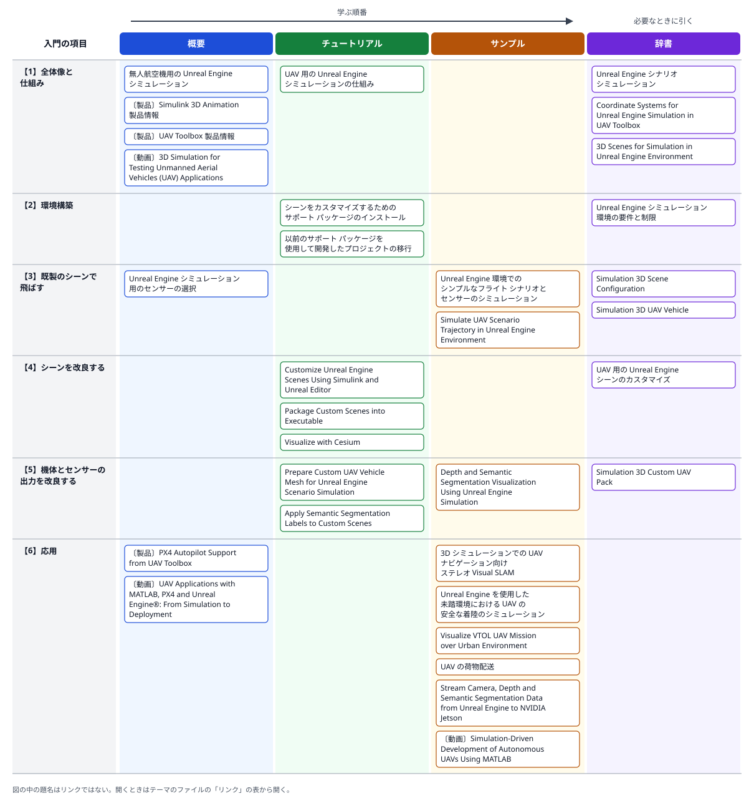
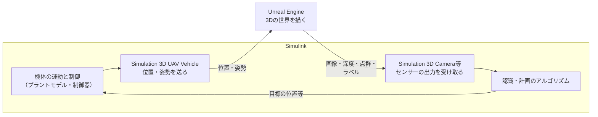

# 06 SimulinkとUnreal Engineによるドローンのシミュレーション

- 確認日: 2026-10-30
- 調査時点の最新リリース: R2026b
- 日本語版のページの表示: R2026aのものとR2026bのものが混在する。要件のページ等、R2026aの日本語版と、R2026bの英語版とで内容が違うページがある（「補足」を参照）。例題・ブロックのリファレンスの多くは、日本語サイト上でも本文が英語

## 概要

### はじめに

ドローンのカメラやLiDARを使う機能（障害物の回避、着陸地点の判定、自己位置の推定等）は、機体の動きだけでなく、周りの建物や地面が「センサーにどう見えるか」まで含めて試す必要がある。実機の飛行で試すと危険で手間がかかり、正解の値（**グラウンドトゥルース**: 機体の本当の位置や、画像の各画素が何であるかの正しいラベル）も取りにくい。そこで、ゲームエンジンの**Unreal Engine**（Epic Games社）で描いた写実的な3Dの世界の中にドローンを飛ばし、そこから得たカメラ画像や点群を、Simulinkで作った制御・認識のアルゴリズムに戻す、という閉ループのシミュレーションが使われる。

MathWorksの製品では、**UAV Toolbox**のSimulation 3Dのブロックと、**Simulink 3D Animation**（Unreal Engineと連携する製品）を組み合わせてこれを行う。SimulinkとUnreal Engineは、固定の時間刻みで交互に1歩ずつ進む**ロックステップ**の方式で同期する（**協調シミュレーション**、co-simulation）。Simulinkで機体の位置・姿勢を計算してUnreal Engineに送り、Unreal Engineはその位置での景色を描いて、センサーの出力をSimulinkに返す。

このテーマでは、次の2つを詳しく扱う。

- **環境構築**: 何をそろえれば動くか。既製のシーンで飛ばすだけなら、MathWorksの製品と性能の足りるパソコンでよい。シーンを作り変える場合は、MATLABのリリースに合った版のUnreal Engine（Unreal Editor）、Visual Studio、サポートパッケージ等が要る。
- **改良できること**: 天候・時刻、シーン（独自のシーン、RoadRunner、地図の3Dデータ）、機体の見た目と動く部品、センサーの種類と設定、セマンティックセグメンテーションのラベル、外部の機器への映像の送信など、何をどこで変えられるか。

ドローンの開発全体（機体のモデル化、実機への実装、事例）は、[テーマ05](05-drone-model-based-design.md)にまとめている。このテーマは、その中の「シナリオと3Dシミュレーション」を掘り下げたものである。

入門の内容は、次の6つの項目に分けられる。番号は、下の関連図の行と同じである。

- 【1】**全体像と仕組み**: できること、ロックステップの協調シミュレーション、ブロックの構成と実行の順序、座標系、既製のシーン。
- 【2】**環境構築**: OS・GPU等の要件、MATLABのリリースとUnreal Engine・Visual Studioの版の対応、シーンを作り変えるためのサポートパッケージの導入、古いプロジェクトの移行。
- 【3】**既製のシーンで飛ばす**: 最小の構成のモデル、センサーの選び方、UAVシナリオで作った軌道の再生。
- 【4】**シーンを改良する**: 天候・太陽・視点の設定、Unreal Editorでの独自のシーン、実行ファイルへのパッケージ化、Cesiumによる地図の3Dデータ。
- 【5】**機体とセンサーの出力を改良する**: 独自の機体のメッシュ、ローターの回転やモーターの傾きの表示、セマンティックセグメンテーションのラベル、深度の出力。
- 【6】**応用**: Visual SLAM、LiDARによる着陸地点の判定、VTOL機の飛行、Jetsonへの映像の送信、PX4のHITLとの組み合わせ。

### 入門の内容とリンクの関連図

図の行は上の【1】〜【6】、列はREADMEの「[用途の分類](../README.md#用途の分類)」の4つである。左から右へ、概要→チュートリアル→サンプルの順に読み、辞書は必要なときに引く。題名の前の〔製品〕〔動画〕等は、リンクの種類（何も付いていないものはドキュメント）を示す。図の中の題名はリンクではないので、開くときは下の「リンク」の表から開く。

### 協調シミュレーションの仕組み

「UAV 用の Unreal Engine シミュレーションの仕組み」のページによると、1歩ごとに、Simulinkが設定とデータをUnreal Engineに送り、Unreal Engineがシミュレーションを進めて結果を返し、両方が終わったことを確かめ合ってから次の歩に進む。次の図は、この流れを著者が図にしたものである。

ブロックの要点（各ページの記述）:

- **Simulation 3D Scene Configuration**: シーンを選ぶ。モデルに1つだけ置く（複数は不可）。描画の時間刻み（既定は1/60秒）も決める。
- **Simulation 3D UAV Vehicle**: 機体をシーンに置く。入力は位置（メートル）と姿勢（ヨー・ピッチ・ロール、ラジアン）。種類はクアッドコプター・固定翼・独自（Custom）。センサーのブロックは、この機体の名前を「Parent name」で選んで取り付ける。
- **センサーのブロック**: Simulation 3D Camera（ピンホールのカメラ。深度とセマンティックセグメンテーションの正解も出せる）、Simulation 3D Fisheye Camera（魚眼）、Simulation 3D Lidar（走査型のLiDAR。点群を出す）、Simulation 3D Ultrasonic Sensor（超音波）。
- **実行の順序**: 機体のブロック（優先度 −1）→ シーンのブロック（0）→ センサーのブロック（1）の順に実行させる。閉ループにする場合は、Simulation 3Dのブロックをすべて同じサブシステムの中に置く。
- **座標系**: Unreal Engineの世界は、X前・Y左・Z上の右手系（ISO 8855）。一方、Unreal Editorの画面の座標は左手系なので、Editorから値を写すときはY・ピッチ・ヨーの符号を反転する。センサーの出力の座標系は、Coordinate systemのパラメーターで選べる。UAV Toolboxの他の部分でよく使うNED（北・東・下）とは軸の向きが違うので、つなぐときに変換が要る（著者の補足）。

### 環境構築

#### 要件（R2026bの英語版のページ）

| 項目 | 要件・推奨 |
|---|---|
| MathWorksの製品 | UAV Toolbox、Simulink、Simulink 3D Animation（3Dの環境でのシミュレーションに必要。Simulation 3D UAV VehicleのページではR2024a以降は必須と書かれている）。カメラの画像を表示する例題ではComputer Vision Toolboxも使う |
| OS | Windows（64ビット）、Linux（Debian 13が必須）。Macは対応しない |
| GPU | 推奨はNVIDIA GeForce RTX 2080、ビデオメモリ8 GB |
| CPU・メモリ | 推奨は2.5 GHz以上、32 GB |
| グラフィックスのドライバー | WindowsはNVIDIAの最新、LinuxはNVIDIA 535.86以上 |
| オンライン版 | Simulink OnlineではUnreal Engineとの協調シミュレーションに対応しない。MATLAB Onlineでは`sim3d`のオブジェクトと関数に対応しない |

要件のページは、Unreal Editor・Visual Studio等を、**シーンを作り変える（カスタムのシーンを使う）場合**の要件として挙げている。既製のシーン（下の「改良できること」の表の「シーンの選択」）で飛ばすだけなら、上の表のものがそろえばよい、と読める（著者の読み方。ページに「既製のシーンだけならUnreal Editorは不要」と明記されているわけではない）。

#### シーンを作り変える場合に追加で要るもの

MATLABのリリースと、Unreal Engine・Visual Studio（Windows）・Clang（Linux）の版は、決まった組み合わせで使う。

| MATLABのリリース | Unreal Engine | Visual Studio | Clang |
|---|---|---|---|
| R2020b〜R2021a | 4.23 | 2019 | — |
| R2021b | 4.25 | 2019 | — |
| R2022a〜R2022b | 4.26 | 2019 | — |
| R2023a〜R2023b | 4.27 | 2019 | — |
| R2024a | 5.1 | 2022 | 13.0.1 |
| R2024b〜R2025b | 5.3 | 2022（v17.4以降、17.6を推奨） | 16.0.6 |
| R2026a〜R2026b | 5.4 | 2022（v17.4以降、17.6を推奨） | 16.0.6 |

開発環境は、WindowsではVisual Studio、LinuxではVisual Studio Codeを使う。

#### 導入の手順（「シーンをカスタマイズするためのサポート パッケージのインストール」のページ、R2026aの日本語版）

1. MATLABのリリースに合う版のUnreal Engineを入れ、上の要件を満たしているか確かめる。
2. MATLABの［ホーム］→［アドオン］→［アドオンを探す］で「UAV Toolbox Interface for Unreal Engine Projects」を探して入れる。インストール先のフォルダーへの書き込みの権限が要る。
3. Windowsでは、`copyExampleSim3dProject`（`sim3d.utils.copyExampleSim3dProject`）で、サンプルのプロジェクト（`AutoVrtlEnv.uproject`）を作業用のフォルダーへ、3つのプラグイン（`MathWorkSimulation`・`MathworksUAVContent`・`RoadRunnerMaterials`）をUnreal Engineのプラグインのフォルダーへ写す。Unreal Engineを既定以外の場所に入れた場合は、`PluginDestination`で写し先を指定する。
4. Linuxでは、Unreal Editorを決まったフォルダーの構造で入れ、`PluginDestination`を指定して写し、`.uproject`を開く既定のアプリをUnreal Editorにする。
5. 地図の3Dデータを使う場合は、Cesium for Unrealのプラグイン（GitHubで配布されている第三者のプラグイン。日本語版のページでは2.16.0。R2026bでは2.21.0に対応したとリリースノートの検索結果にある）を入れ、Unreal Editorで「MathWorks Geospatial」のプラグインが有効か確かめる。

前のリリースのサポートパッケージで作ったプロジェクトは、Unreal Engine 5.4でコピーを開いて変換し、フォルダー名の空白を除き、`sim3d.Editor`で開き直して、出力ログで移行しきれなかったアクターを確かめる（「以前のサポート パッケージを使用して開発したプロジェクトの移行」）。

#### 制限（要件のページの記述）

- Simulation 3Dのブロックは、コード生成、モデル参照、ラピッドアクセラレータのモードに対応しない。
- 1つのMATLABのセッションで、複数のUnreal Engineを同時に動かせない。
- シミュレーションの速さは、終了時間・時間刻み・モデルの複雑さと、パソコンの描画の性能で決まる（仕組みのページ）。

### 改良できること

各ページに書かれている、変えられる項目を著者が表にまとめた。「どこで」の列は、変える場所（ブロックのパラメーター、Unreal Editor等）である。

| 対象 | 何を変えられるか | どこで・どうやって | 主なページ |
|---|---|---|---|
| シーンの選択 | 既製のシーン（US city block・Suburban scene・Blank scene・Empty scene）、Unreal Editorで開いたプロジェクト、パッケージ化した実行ファイル、RoadRunnerで作ったシーン（.fbx・.usd・.rrscene・.rrscenario） | Simulation 3D Scene ConfigurationのScene source | Simulation 3D Scene Configuration |
| 天候・太陽 | 太陽の高度・方位、雲の不透明度・速さ・量・高さ、霧・雨・雪の濃さ、カメラのレンズに付く雨粒、地理の位置と日時から太陽の位置を決める設定 | 同じブロックで「Override scene weather」をオンにしてから設定する | Simulation 3D Scene Configuration |
| 視点と表示 | 視点（シーンの原点・機体・任意の位置と向き）、3Dの窓を出さない動かし方（ヘッドレス） | 同じブロックのScene view、Display 3D simulation window。実行中はテンキーの1〜9・0で視点を切り替える | Simulation 3D Scene Configuration、簡単な飛行の例題 |
| 独自のシーン | 既製のシーンの変更、新しいレベル（地図）の作成、アセットの追加、霧や照明 | Unreal Editor。新しいシーンではレベルのブループリントの親を`Sim3dLevelScriptActor`にし、独自のプロジェクトではゲームモードを`Sim3dGameMode`にする。Simulinkで実行してからEditorでPlayを押す | Customize Unreal Engine Scenes Using Simulink and Unreal Editor |
| 実行ファイル化 | 作ったシーンを実行ファイルにまとめ、毎回Editorを開かずに使う | Unreal Editorでパッケージ化の設定（地図とMathWorksのアセットのフォルダーを含める、照明をビルドする）→ Scene sourceを`Unreal Executable`に | Package Custom Scenes into Executable |
| 地図の3Dデータ | Cesium ionから、指定した緯度・経度の地形と建物（Cesium OSM Buildings、Google Photorealistic 3D Tiles等）を流し込み、その上で飛ばす | Scene ConfigurationのGeospatialのタブで地理の設定を有効にし、Cesium ionのアクセストークンを登録する。機体は地理座標（緯度・経度・高度）で入力できる | Visualize with Cesium、Simulation 3D UAV Vehicle |
| 機体の見た目 | 種類（クアッドコプター・固定翼）と色（表示だけで、センサーの出力には影響しない） | Simulation 3D UAV VehicleのType・Color | Simulation 3D UAV Vehicle |
| 独自の機体 | 自作の3Dモデル（.fbx）の機体。モーターとローターは8組まで、カメラの支点とアームも持てる | 部品に決まった名前を付けてBlender等で書き出し、Unreal Editorに取り込んで、TypeをCustomにして参照を貼る | Prepare Custom UAV Vehicle Mesh for Unreal Engine Scenario Simulation |
| 動く部品 | ローターごとの回転数、モーターごとの傾き（ティルトローター機の表示等） | Simulation 3D Custom UAV Pack（R2026aで導入）で、独自の機体に入力を作る | Simulation 3D Custom UAV Pack |
| センサー | 種類（ピンホール・魚眼のカメラ、LiDAR、超音波）、カメラの画像の大きさ・焦点距離・歪み、LiDARの検出距離・分解能・視野、取り付け位置、出力の座標系 | 各センサーのブロック。カメラを2台並べればステレオカメラになる（Visual SLAMの例題） | Unreal Engine シミュレーション用のセンサーの選択 |
| 正解のデータ | 深度（0〜1000 m）、セマンティックセグメンテーションのラベル、機体の位置・姿勢 | Simulation 3D Cameraの出力を有効にする | Depth and Semantic Segmentation Visualization |
| ラベル | 独自のシーンに足した物体のラベル（建物・植生・道路等のID） | Unreal Editorで物体のCustomDepth Stencilの値にIDを入れる。IDを付けない物体は0（なし）になる | Apply Semantic Segmentation Labels to Custom Scenes |
| 外部への出力 | カメラ画像・深度・ラベルを、ネットワーク越しにNVIDIA Jetsonへ送る（搭載コンピューターの代わりの試験） | Video Sendのブロック（GStreamerが要る）。受け側はJetsonの上のNetwork Video Receive | Stream Camera, Depth and Semantic Segmentation Data from Unreal Engine to NVIDIA Jetson |
| 実機の制御器との接続 | PX4のHITL（実機のフライトコントローラー＋Simulinkのプラント）の飛行をUnreal Engineで描く。Unreal Engineの深度画像で、障害物の回避を試す | PX4のサポートパッケージの例題 | PX4 Autopilot Support from UAV Toolbox |

機体の動き（プラントモデル）の忠実度を上げる方法は、Unreal Engineとは別の話題で、[テーマ05](05-drone-model-based-design.md)の【2】で扱っている。Unreal Engineは景色とセンサーを描く役で、機体の運動はSimulinkの側で計算する（PX4のHITLの例題のページも、Unreal Engineは描画の役で、制御の論理の実行には関わらないと説明している）。

## 読む順番の目安

1. 動画「3D Simulation for Testing Unmanned Aerial Vehicles (UAV) Applications」と「無人航空機用の Unreal Engine シミュレーション」で、何ができるかをつかむ
2. 「Unreal Engine シミュレーション環境の要件と制限」で、手元のパソコンとMATLABのリリースで動くかを確かめる
3. 例題「Unreal Engine 環境でのシンプルなフライト シナリオとセンサーのシミュレーション」を動かし、「UAV 用の Unreal Engine シミュレーションの仕組み」と「Coordinate Systems…」で、ブロックの役割と座標系を知る
4. 「Unreal Engine シミュレーション用のセンサーの選択」と、Simulation 3D Scene Configurationのリファレンスで、センサーと天候・視点の設定を変えてみる
5. 「Simulate UAV Scenario Trajectory in Unreal Engine Environment」で、UAVシナリオで作った軌道を3Dの中で再生する
6. シーンを作り変える場合は、「UAV 用の Unreal Engine シーンのカスタマイズ」の手順（サポートパッケージの導入 → Unreal Editorでの編集 → 実行ファイル化）に進み、必要に応じて独自の機体とラベルのページを読む
7. 応用として、Visual SLAM、着陸地点の判定、荷物配送の例題を読む

## リンク

「用途」の列は、学ぶ順番に沿った使い方（概要／チュートリアル／サンプル／辞書）を示す。分類の基準はREADMEの「[用途の分類](../README.md#用途の分類)」を参照。

### ドキュメント（全体像と仕組み）

| リンク | 用途 | 説明 | 製品・リリース |
|---|---|---|---|
| [Unreal Engine シナリオ シミュレーション](https://jp.mathworks.com/help/uav/uav-unreal-simulation.html) | 辞書 | カテゴリのページ。Simulation 3Dのブロック、`sim3d`のオブジェクト、既製のシーン、基本・センサー・カスタマイズ・セマンティックセグメンテーションのトピック、例題の一覧 | UAV Toolbox |
| [無人航空機用の Unreal Engine シミュレーション](https://jp.mathworks.com/help/uav/ug/3d-simulation-for-unmanned-aerial-vehicles.html) | 概要 | できること（シーンの設定、機体の配置、センサーの取り付け、正解のデータ）、ブロックの一覧、カスタマイズに要るサポートパッケージ | UAV Toolbox、Simulink 3D Animation |
| [UAV 用の Unreal Engine シミュレーションの仕組み](https://jp.mathworks.com/help/uav/ug/how-3d-simulation-for-uav-works.html) | チュートリアル | ロックステップの同期、1歩ごとのやり取り、ブロックの実行の順序、シミュレーションの速さを決めるもの | UAV Toolbox、Simulink 3D Animation |
| [Coordinate Systems for Unreal Engine Simulation in UAV Toolbox](https://jp.mathworks.com/help/uav/ug/coordinate-systems-for-unreal-engine-simulation-in-uav-toolbox.html) | 辞書 | 英語。世界・機体・センサーの座標系と、Unreal Editorの左手系との違い、センサーの出力の座標系の選択肢 | UAV Toolbox |
| [3D Scenes for Simulation in Unreal Engine Environment](https://jp.mathworks.com/help/uav/ug/3d-scenes-for-simulation-in-unreal-engine-environment.html) | 辞書 | 英語。製品ごとの既製のシーンの一覧と画像。UAV Toolboxで使えるのはUS city blockとSuburban scene | UAV Toolbox ほか |

### ドキュメント（環境構築）

| リンク | 用途 | 説明 | 製品・リリース |
|---|---|---|---|
| [Unreal Engine シミュレーション環境の要件と制限](https://jp.mathworks.com/help/uav/ug/unreal-engine-simulation-environment-requirements-and-limitations.html) | 辞書 | OS・GPU等の推奨、MATLABのリリースとUnreal Engine・Visual Studio・Clangの版の対応表、ブロックの制限（日本語版はR2026a。最新は英語版） | UAV Toolbox、Simulink 3D Animation |
| [シーンをカスタマイズするためのサポート パッケージのインストール](https://jp.mathworks.com/help/uav/ug/install-support-package-for-customizing-scenes.html) | チュートリアル | UAV Toolbox Interface for Unreal Engine Projectsの導入、`copyExampleSim3dProject`によるプロジェクトとプラグインの配置、Linuxでの設定、Cesium for Unrealの導入 | UAV Toolbox Interface for Unreal Engine Projects |
| [以前のサポート パッケージを使用して開発したプロジェクトの移行](https://jp.mathworks.com/help/uav/ug/migrate-projects-developed-using-prior-support-packages.html) | チュートリアル | 古い版のサポートパッケージで作ったプロジェクトを、Unreal Engine 5.4で変換して開き直す手順 | UAV Toolbox Interface for Unreal Engine Projects |

### ドキュメント（ブロックとセンサー）

| リンク | 用途 | 説明 | 製品・リリース |
|---|---|---|---|
| [Simulation 3D Scene Configuration](https://jp.mathworks.com/help/uav/ref/simulation3dsceneconfiguration.html) | 辞書 | 英語。シーンの出どころ（既製・RoadRunner・実行ファイル・Unreal Editor）、視点、描画の時間刻み、天候・太陽・雲・霧・雨・雪、地理の設定 | UAV Toolbox、R2020b以降 |
| [Simulation 3D UAV Vehicle](https://jp.mathworks.com/help/uav/ref/simulation3duavvehicle.html) | 辞書 | 英語。位置・姿勢の入力、機体の種類と色、独自のメッシュのパス、地理座標での入力 | UAV Toolbox、R2020b以降（Simulink 3D AnimationはR2024a以降必須） |
| [Simulation 3D Custom UAV Pack](https://jp.mathworks.com/help/uav/ref/simulation3dcustomuavpack.html) | 辞書 | 英語。独自の機体に、位置・姿勢と、モーターごとの傾き・ローターごとの回転数の入力を作る | UAV Toolbox、R2026a以降 |
| [Unreal Engine シミュレーション用のセンサーの選択](https://jp.mathworks.com/help/uav/ug/choose-a-sensor-for-3d-simulation.html) | 概要 | カメラ・魚眼のカメラ・LiDARの違い、主なパラメーター、出力とその表示の方法（日本語版はR2026a） | UAV Toolbox |

### ドキュメント（シーンと機体の改良）

| リンク | 用途 | 説明 | 製品・リリース |
|---|---|---|---|
| [UAV 用の Unreal Engine シーンのカスタマイズ](https://jp.mathworks.com/help/uav/ug/customize-3d-scenes-for-uav.html) | 辞書 | シーンを作り変える4つの手順（導入、移行、Editorでの編集、実行ファイル化）の目次 | UAV Toolbox Interface for Unreal Engine Projects |
| [Customize Unreal Engine Scenes Using Simulink and Unreal Editor](https://jp.mathworks.com/help/uav/ug/customize-scenes-using-simulink-and-unreal-editor.html) | チュートリアル | 英語。Scene sourceとProjectの設定、プラグインの有効化、シーンの編集、独自のプロジェクトの設定、Simulinkで実行してからEditorでPlayを押す順序 | UAV Toolbox Interface for Unreal Engine Projects |
| [Package Custom Scenes into Executable](https://jp.mathworks.com/help/uav/ug/package-custom-scenes-into-executable.html) | チュートリアル | 英語。パッケージ化の設定（地図とアセットのフォルダー、照明のビルド）と、実行ファイルをSimulinkから使う設定 | UAV Toolbox Interface for Unreal Engine Projects |
| [Visualize with Cesium](https://jp.mathworks.com/help/uav/ug/visualize-with-cesium.html) | チュートリアル | 英語。Cesium ionのアカウントとアクセストークン、地理の設定（緯度・経度・地図の種類・建物のアセット）で、実在の街の3Dデータの上に機体を表示する | UAV Toolbox、Simulink 3D Animation |
| [Prepare Custom UAV Vehicle Mesh for Unreal Engine Scenario Simulation](https://jp.mathworks.com/help/uav/ug/prepare-custom-vehicle-mesh-for-the-unreal-editor.html) | チュートリアル | 英語。自作の機体の部品の名前と骨の階層、Blenderからの書き出しの設定、Unreal Editorへの取り込み、ブロックでの指定 | UAV Toolbox Interface for Unreal Engine Projects |
| [Apply Semantic Segmentation Labels to Custom Scenes](https://jp.mathworks.com/help/uav/ug/apply-semantic-segmentation-labels-to-custom-scenes.html) | チュートリアル | 英語。独自のシーンの物体にステンシルのIDを付けて、セマンティックセグメンテーションに出す。IDと種類の対応表 | UAV Toolbox Interface for Unreal Engine Projects |

### ドキュメント（例題）

| リンク | 用途 | 説明 | 製品・リリース |
|---|---|---|---|
| [Unreal Engine 環境でのシンプルなフライト シナリオとセンサーのシミュレーション](https://jp.mathworks.com/help/uav/ug/simulate-a-simple-flight-scenario-and-sensor-in-3d-environment.html) | サンプル | 最小の構成。US City Blockで円を描いて飛ぶクアッドローターに魚眼カメラを付け、画像を表示する。パラメーターやセンサーの種類を変えてみる | UAV Toolbox、Computer Vision Toolbox、Simulink 3D Animation |
| [Simulate UAV Scenario Trajectory in Unreal Engine Environment](https://jp.mathworks.com/help/uav/ug/simulate-uav-scenario-trajectory-in-ue.html) | サンプル | 英語。`uavScenario`の上で経由点を選んでミッションと軌道を作り、Read UAV Trajectoryのブロックで3Dの中で再生する | UAV Toolbox |
| [Depth and Semantic Segmentation Visualization Using Unreal Engine Simulation](https://jp.mathworks.com/help/uav/ug/depth-and-semantic-visual-with-ue4.html) | サンプル | 英語。カメラの深度とセマンティックセグメンテーションの出力を表示する。深度の範囲と、ラベルの配色 | UAV Toolbox、Computer Vision Toolbox、Simulink 3D Animation |
| [3D シミュレーションでの UAV ナビゲーション向けステレオ Visual SLAM](https://jp.mathworks.com/help/vision/ug/stereo-visual-slam-for-uav-navigation-in-3d-simulation.html) | サンプル | カメラ2台でステレオカメラを作り、市街地を飛ぶUAVの自己位置をVisual SLAMで推定して、正解の軌道と比べる | Computer Vision Toolbox、UAV Toolbox、Navigation Toolbox、Simulink 3D Animation |
| [Unreal Engine を使用した未踏環境における UAV の安全な着陸のシミュレーション](https://jp.mathworks.com/help/uav/ug/simulate-uav-safe-landing-in-unexplored-environment.html) | サンプル | Suburbanのシーンで、異常の後にLiDARで地図を作り、安全な着陸地点を見つけて降りる。モードの切り替えはStateflow | UAV Toolbox、Stateflow、Point Cloud Toolbox、Simulink 3D Animation |
| [Visualize VTOL UAV Mission over Urban Environment](https://jp.mathworks.com/help/uav/ug/visualize-vtol-flight-mission-over-urban-environment.html) | サンプル | 英語。VTOL機の3Dモデルを取り込み、都市の上のミッションをUnreal Engineで描く | UAV Toolbox、Aerospace Blockset、Simulink 3D Animation、Interface for Unreal Engine Projects ほか |
| [UAV の荷物配送](https://jp.mathworks.com/help/uav/ug/uav-package-delivery.html) | サンプル | 参照例。直方体の世界から写実的な3Dの環境へ切り替え、LiDARの点群とカメラの映像を使って市街地を飛ぶ | UAV Toolbox、Simulink 3D Animation ほか |
| [Stream Camera, Depth and Semantic Segmentation Data from Unreal Engine to NVIDIA Jetson](https://jp.mathworks.com/help/uav/ug/stream-camera-depth-and-semantic-segmentation-data-from-unreal-engine-to-nvidia-jetson.html) | サンプル | 英語。カメラ画像・深度・ラベルを3つのVideo Sendのブロックで圧縮してJetsonに送り、Jetsonの側で受けて表示する | UAV Toolbox、Simulink 3D Animation、MATLAB Coder Support Package for NVIDIA Jetson |

### 製品・ソリューションのページ

| リンク | 用途 | 説明 | 製品・リリース |
|---|---|---|---|
| [Simulink 3D Animation 製品情報](https://jp.mathworks.com/products/3d-animation.html) | 概要 | SimulinkとUnreal Engineをつなぐ製品。既製のシーン、RoadRunnerのシーンの取り込み、独自のシーン、天候、センサー、MATLABからシーンを作るAPI | Simulink 3D Animation |
| [UAV Toolbox 製品情報](https://jp.mathworks.com/products/uav.html) | 概要 | UAVシナリオとセンサーのシミュレーション、Unreal Engineによる3D、PX4でのHIL、コード生成 | UAV Toolbox |
| [PX4 Autopilot Support from UAV Toolbox](https://jp.mathworks.com/hardware-support/px4-autopilots.html) | 概要 | 英語。ハードウェアサポートのページ。Unreal Engineの深度画像を使った障害物の回避の試験と、HITLの紹介を含む | UAV Toolbox、Embedded Coder |

### 動画

| リンク | 用途 | 説明 | 製品・リリース |
|---|---|---|---|
| [3D Simulation for Testing Unmanned Aerial Vehicles (UAV) Applications](https://www.mathworks.com/videos/3d-simulation-for-testing-uav-applications-1606233257007.html) | 概要 | 英語、約3分（2020年）。SimulinkとUnreal Engineの協調シミュレーション、LiDAR・カメラのデータ、深度とセマンティックセグメンテーション、独自のシーンの紹介 | UAV Toolbox |
| [Simulation-Driven Development of Autonomous UAVs Using MATLAB](https://www.mathworks.com/videos/simulation-driven-development-of-autonomous-uavs-using-matlab-1762323756087.html) | サンプル | 英語、約18分（2025年）。インドの大学による、Unreal Engineでの都市・障害物・天候を含む閉ループの試験から、PX4系のボードへの実装までの事例 | UAV Toolbox、Embedded Coder ほか |
| [UAV Applications with MATLAB, PX4 and Unreal Engine®: From Simulation to Deployment](https://www.youtube.com/watch?v=qZDZMC83UO8) | 概要 | 英語。YouTubeの公式チャンネル「MATLAB」の投稿。題名から、PX4とUnreal Engineを使ったシミュレーションから実機への展開を扱うと判断した（説明文・長さは確かめていない） | UAV Toolbox |

## 補足

- **日本語版と英語版の違い**: 「要件と制限」のページは、日本語版（R2026a）と英語版（R2026b）で推奨が違う。日本語版はGPUを「NVIDIA GeForce 960 GTX以上」、LinuxをDebian 11とし、Vulkanのドライバーの推奨版も書いている。英語版はGPUを「NVIDIA GeForce RTX 2080」、LinuxをDebian 13としている。「環境構築」の節の要件の表は英語版（R2026b）に、導入の手順は日本語版（R2026a）に基づく。使うリリースのページで確かめること。
- **リリースノート**: UAV Toolboxのリリースノートのページは、取得しても本文を読めなかった。Cesium for Unrealの2.21.0への対応（R2026b）と、Unreal Engine 5.4への更新（R2026a）は、リリースノートの検索結果の抜粋によるもので、ページ自体では確かめていない。
- **外部のソフトウェアとサービス**: Unreal Engine・Visual Studio・Blender・GStreamer・Cesium for Unrealは、MathWorks以外の会社・団体のソフトウェアで、それぞれの利用条件に従う（このリンク集では利用条件を確かめていない）。Cesium ionはアカウントの登録が要る外部のサービスで、アクセストークンは秘密の情報として扱う（Simulinkの側では、Authentication Managerに登録してIDで参照する）。
- **既製のシーンとUnreal Editor**: 既製のシーンだけで飛ばす場合に、Unreal Editorを別に入れなくてよいかは、ページに明記されていない（「環境構築」の節の著者の読み方を参照）。
- **シーンの一覧**: 「3D Scenes for Simulation…」のページには多くのシーンが載っているが、多くは自動車・航空機等の他の製品のもので、UAV Toolboxの名前が付いているのはUS city blockとSuburban sceneである。Scene Configurationのブロック（UAV Toolbox）で選べるのは、US city block・Suburban scene・Blank scene・Empty sceneの4つ。
- **PX4とJetsonの障害物の回避の例題**: 検索で見つかった「Obstacle Avoidance in NVIDIA Jetson with PX4 Autopilot in HITL…」のページは、取得するとHITLの例題の一覧のページになり、例題の本文を確かめられなかったため、載せていない。Unreal Engineの深度画像による障害物の回避は、PX4のハードウェアサポートのページの紹介として載せた。
- File Exchangeの「UAV Toolbox Interface for Unreal Engine Projects」のページ（対応のリリースとUnreal Engine・Visual Studioの最小の版の記述がある）は、ドキュメントの導入の手順と重なるため載せていない。
- AirSim等、Unreal Engineを使う他のドローンのシミュレーターは、READMEの「情報源の範囲」の外のため扱っていない。
